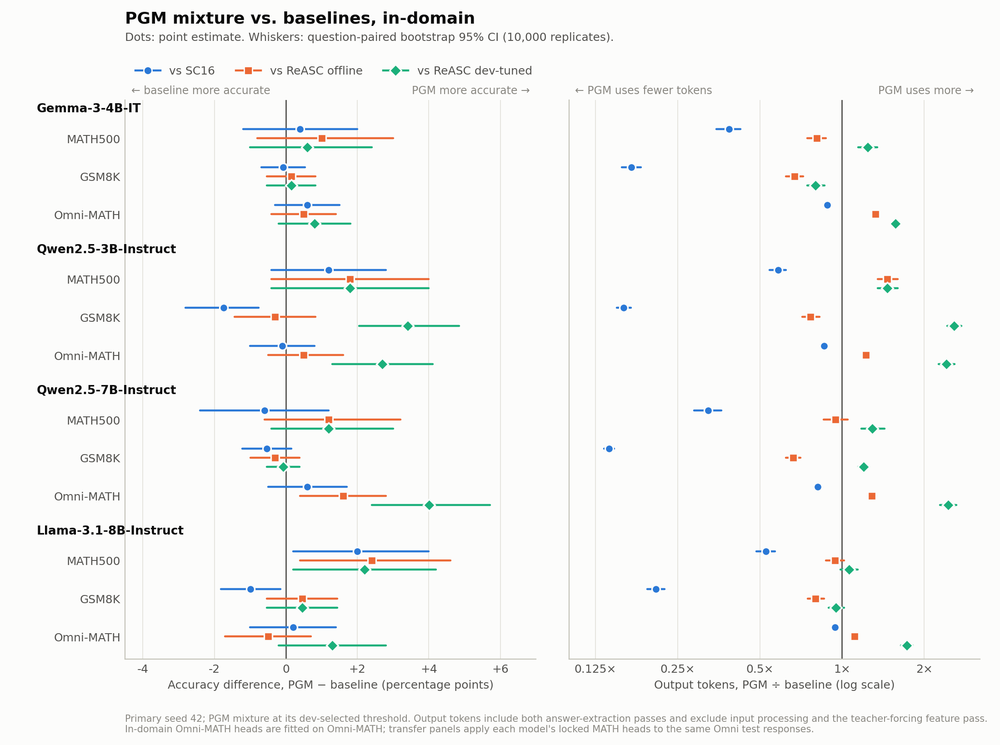

# PGM Adaptive Self-Consistency

Research code for **probabilistic graphical models (PGM) for adaptive self-consistency**: aggregate a language model's reasoning samples and decide when to stop generating.

The current study compares a semantic partition mixture with matched structural ablations and ASC, ESC, and ReASC baselines across **Gemma-3-4B-IT, Qwen2.5-3B-Instruct, Qwen2.5-7B-Instruct, and Llama-3.1-8B-Instruct**, on MATH, GSM8K, and Omni-MATH. Each dataset is fitted and evaluated in-domain; MATH-to-Omni-MATH transfer is reported separately. Language models stay frozen; only small aggregation heads are trained.

[Results](results/followup/README.md) · [Experiment protocol](docs/PGM_FOLLOWUP_PLAN.md) · [Reproduction guide](docs/REPRODUCIBILITY.md) · [Documentation index](docs/README.md)

## Method

1. Generate a shared bank of up to **16 responses per question** with vLLM.
2. Extract exact-token confidence features and reasoning embeddings in a separate teacher-forcing pass.
3. Form several partitions of the observed responses, including cosine-similarity groups, all-one, and singletons.
4. Learn positive response support, a cluster-size discount, a partition mixture gate, and an **OTHER** probability for unseen answers.
5. Calibrate confidence on a separate cohort and stop when the selected policy is satisfied, with **minimum 2 / maximum 16** responses.

The follow-up uses **no continuation/value head**. Controls include uniform mixture, matched random partitions, alpha=1, independently trained single partition, count/confidence MLPs, and DeepSets. All learned arms share 800 training, 200 dev, and 128 calibration questions, with training seeds 42/43/44.

## Results

Primary seed 42. Each cell is **accuracy (%) / mean output tokens per question**, including both answer-extraction outputs. PGM mixture and ASC dev-tuned use thresholds selected on dev (accuracy ≥ dev SC16 − 1 pp, fewest tokens).

### In-domain

Heads, calibrators and thresholds are fitted on the same dataset (calibration/train/dev = 128/800/200 questions).

| Model | Evaluation | SC16 | ASC dev-tuned | ReASC offline | PGM mixture |
|---|---|---:|---:|---:|---:|
| Gemma-3-4B-IT | MATH500 | 77.4 / 11,852 | 78.0 / 4,161 | 76.8 / 5,648 | 77.8 / 4,571 |
| Gemma-3-4B-IT | GSM8K | 91.8 / 7,144 | 91.7 / 1,325 | 91.6 / 1,807 | 91.7 / 1,209 |
| Gemma-3-4B-IT | Omni-MATH | 31.6 / 21,542 | 31.9 / 11,047 | 31.7 / 14,346 | 32.2 / 19,020 |
| Qwen2.5-3B-Instruct | MATH500 | 73.0 / 9,628 | 73.4 / 5,586 | 72.4 / 3,847 | 74.2 / 5,627 |
| Qwen2.5-3B-Instruct | GSM8K | 90.4 / 4,889 | 85.3 / 302 | 89.0 / 1,012 | 88.7 / 775 |
| Qwen2.5-3B-Instruct | Omni-MATH | 28.0 / 13,221 | 27.4 / 7,529 | 27.4 / 9,296 | 27.9 / 11,385 |
| Qwen2.5-7B-Instruct | MATH500 | 79.8 / 9,111 | 79.6 / 2,789 | 78.0 / 3,112 | 79.2 / 2,949 |
| Qwen2.5-7B-Instruct | GSM8K | 94.1 / 4,635 | 93.8 / 707 | 93.9 / 983 | 93.6 / 650 |
| Qwen2.5-7B-Instruct | Omni-MATH | 33.5 / 13,156 | 33.3 / 6,618 | 32.5 / 8,335 | 34.1 / 10,715 |
| Llama-3.1-8B-Instruct | MATH500 | 58.8 / 7,709 | 59.6 / 3,997 | 58.4 / 4,311 | 60.8 / 4,062 |
| Llama-3.1-8B-Instruct | GSM8K | 90.4 / 2,885 | 89.5 / 609 | 88.9 / 751 | 89.4 / 600 |
| Llama-3.1-8B-Instruct | Omni-MATH | 17.2 / 16,941 | 17.0 / 12,171 | 17.9 / 14,409 | 17.4 / 15,988 |

### Cross-dataset transfer (MATH → Omni-MATH)

Each model's locked MATH cell (heads, calibrators, thresholds, baseline offline calibration) is applied unchanged to Omni-MATH, with no Omni labels. It replays the same Omni test responses as the in-domain Omni cell.

| Model | SC16 | ASC dev-tuned | ReASC offline | PGM mixture |
|---|---:|---:|---:|---:|
| Gemma-3-4B-IT | 31.6 / 21,542 | 31.9 / 9,456 | 31.3 / 15,277 | 30.9 / 7,576 |
| Qwen2.5-3B-Instruct | 28.0 / 13,221 | 28.0 / 10,272 | 27.6 / 9,743 | 28.3 / 11,785 |
| Qwen2.5-7B-Instruct | 33.5 / 13,156 | 33.3 / 6,618 | 32.7 / 9,114 | 33.0 / 7,390 |
| Llama-3.1-8B-Instruct | 17.2 / 16,941 | 17.0 / 12,171 | 17.1 / 14,986 | 17.1 / 14,200 |

### Findings

- On MATH and GSM8K, PGM mixture stays near SC16 accuracy (−1.7 to +2.0 pp) with 42–86% fewer output tokens, but **dev-tuned ASC reaches a similar point**. Llama-3.1-8B MATH500 is the clearest case of mixture above SC16 at a lower cost.
- Omni-MATH heads fitted in-domain are conservative: accuracy is within −0.1 to +0.6 pp of SC16 with only 6–19% fewer tokens. For three of four models, MATH-fitted heads transferred to Omni-MATH stop earlier than the in-domain heads, saving more tokens at up to 0.7 pp accuracy cost; Qwen2.5-3B is the exception.
- **Semantic partition structure is not supported.** One of 64 reported per-cell Holm-adjusted structure contrasts favors mixture (Llama GSM8K vs. the confidence MLP, at 12% more tokens), and mixture never differs from size-matched random grouping. The learned cluster-size discount (α ≈ 0.45) improves dev NLL over independent voting, but random grouping with the same cluster sizes matches it.
- Output-token counts exclude input processing and the teacher-forcing feature pass; they are not measured serving speedups.

See [all methods, ablations, fixed95 operating points, and paired statistics](results/followup/README.md), the [figures](results/followup/figures/), or [machine-readable metrics](results/followup/metrics.json). GSM8K uses all 1,319 official test questions. Omni-MATH evaluates 999 distinct questions; its in-domain fitting cohorts come from the rest of the full Omni-MATH release with every test question removed. MATH confirm500 and the earlier Gemma subsets stay in `metrics.json` but are not part of these tables.



## Setup and tests

For model/policy development and CPU tests (Python 3.10+):

```bash
git clone https://github.com/ever2after/PGM.git
cd PGM
python -m venv .venv
source .venv/bin/activate
python -m pip install -e '.[test]'
python scripts/setup_references.py
OMP_NUM_THREADS=2 python -m pytest -q
```

`setup_references.py` downloads ReASC and xVerify at pinned commits. Tests use small synthetic banks and reference source files; they do not download model weights or run benchmark generation.

For the recorded vLLM study environment, use a **separate Python 3.10 environment**:

```bash
python3.10 -m venv .venv-reasc
source .venv-reasc/bin/activate
python -m pip install -r requirements-reasc.txt
python -m pip install --no-deps -e .
```

The study used vLLM 0.11.0, PyTorch 2.8.0, and Transformers 4.56.2. GPU generation requires a compatible NVIDIA/CUDA setup and the pinned model assets. Legacy `requirements.txt` and `requirements-vllm.txt` describe older V2/V5 environments; do not combine their pins with `requirements-reasc.txt`.

## Commands

Run commands from the repository root:

```bash
# Inspect local experiment completion; works without installing dependencies.
python scripts/followup.py status

# Inspect public aggregate results without downloading model weights.
python -m json.tool results/followup/metrics.json > /dev/null

# One cell end to end on a 4-GPU node: fitting banks, fit/lock, evaluation banks, replay.
python scripts/run_cell.py --config configs/pgm_followup/llama8b_math.json

# With banks already collected: fit/lock or replay a single cell.
python scripts/followup.py fit --cell llama8b_math
python scripts/followup.py evaluate --cell llama8b_math --split math500

# Refresh aggregate results and figures.
python scripts/followup.py export
python scripts/plot_results.py
```

`scripts/slurm/cell.sbatch` wraps `run_cell.py` for a whole-node Slurm job. Fitting/replay require the corresponding banks, cohorts, preprocessing, and checkpoints under `artifacts/`. Those large artifacts are **not included in Git**. A fresh clone supports code inspection, tests, and aggregate analysis; exact training/replay additionally requires the artifact bundle. The [reproduction guide](docs/REPRODUCIBILITY.md) describes these boundaries, generation commands, and integrity checks.

## Repository layout

```text
pgm_asc/
  core/           Configuration, I/O, answer handling, integrity
  data/           Cohorts, causal prefix features, scaling
  models/         PGM selector, matched ablation heads, legacy state/value
  training/       Training objectives and legacy training recipes
  policies/       Calibration, stopping, reference baselines
  collection/     vLLM generation, confidence/embedding extraction, judging
  evaluation/     Replay, cost metrics, paired statistics
  experiments/    Fit/lock/evaluate orchestration and historical runners
configs/          Recorded experiment settings and per-model/dataset cells
scripts/          Follow-up commands, cell runner and worker wrappers, exports, figures
  slurm/          Example whole-node Slurm job for run_cell.py
  omni_bundle/    Archived runners from the Omni-MATH artifact bundle
tests/           Unit tests and synthetic integration tests
results/followup/ Aggregate results and provenance tracked in Git
docs/             Protocols, implementation notes, experiment history
third_party/      Source audit metadata; downloaded checkouts are ignored
artifacts/        Local datasets, banks, model weights, logs (ignored)
```

The `python -m pgm_asc` CLI operates the **legacy integrated V2/V5 pipeline**. The current ReASC/follow-up study uses `scripts/run_cell.py`, `scripts/followup.py`, and the per-cell configs. Historical code and locked configs remain in their original paths so that their recorded hashes can still be verified.

## References and provenance

- [Official ReASC code](https://github.com/junseokkim00/ReASC); source differences and reproduction adaptations are documented in the [reference audit](docs/REASC_REFERENCE_AUDIT.md).
- [xVerify](https://github.com/IAAR-Shanghai/xVerify); a pinned public **xVerify-3B-Ia** judge is shared by every method because the original ReASC model alias was unavailable.
- [OpenAI PRM800K MATH splits](https://github.com/openai/prm800k#math-splits), [original MATH](https://huggingface.co/datasets/EleutherAI/hendrycks_math), [GSM8K](https://huggingface.co/datasets/openai/gsm8k), and [Omni-MATH](https://huggingface.co/datasets/KbsdJames/Omni-MATH).

Model revisions, sampling settings, cohort hashes, and selection locks are retained in `configs/` and [results provenance](results/followup/provenance/). Upstream code, model weights, and datasets retain their respective licenses and access requirements.
