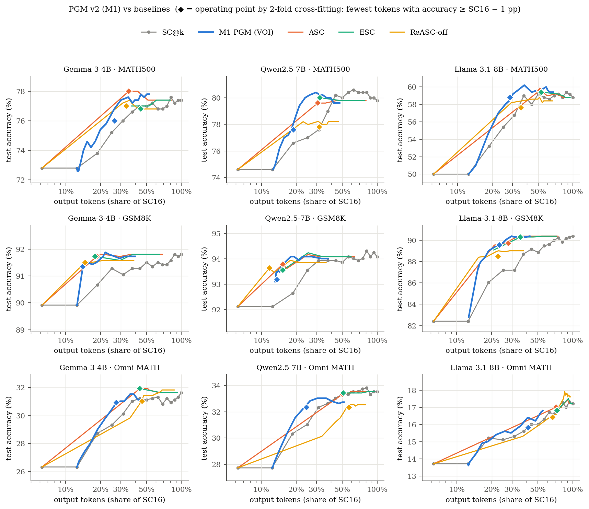

# PGM Adaptive Self-Consistency

Self-consistency samples a language model many times and takes a majority vote; adaptive variants stop once the vote looks settled. This repository studies **when to stop sampling** with a small **probabilistic graphical model (PGM)** of the sampled answers. The model has:
- a latent question difficulty q;
- a correct answer that may not have been sampled yet;
- a Chinese restaurant process for how wrong answers pile up.

From the model's own predictive distribution it computes the **value of one more sample (VOI)** and stops when VOI falls below a threshold λ. The answer is the plurality vote. The final model has **4 parameters** and no neural network.

The study replays 16 frozen responses per question for **Gemma-3-4B-IT, Qwen2.5-7B-Instruct and Llama-3.1-8B-Instruct** on **MATH500, GSM8K and Omni-MATH**. It compares the model against **SC, ASC, ESC and ReASC** under one protocol, and uses 11 ablations to test which parts of the graph are needed.

[Method](docs/METHOD.md) · [Protocol & adding methods](docs/PROTOCOL.md) · [All results](results/v2/README.md) · [Interactive report](results/v2/report.html) · [PDF report](results/v2/report.pdf) · [Data](docs/DATA.md) · [v1 (archived)](docs/v1/README.md) · [Artifacts on 🤗](https://huggingface.co/datasets/Ever2after/PGM-artifacts)



## Results

Each method's threshold is swept to give a test accuracy–token curve; up and to the left is better.

**Frontier score.** This is the mean best accuracy over 60 token budgets between SC@2 and SC16. Averaged over the 9 cells:

| PGM v2 (M1) | SC@k | ReASC-on | ReASC-off | ASC | ESC |
|---|---|---|---|---|---|
| **63.5** | 62.9 | 62.5 | 62.4 | 62.4 | 62.3 |

**Matched-accuracy table.** One threshold per method, chosen by 2-fold cross-fitting on test (fewest tokens with accuracy ≥ SC16 − 1 pp). Cells are accuracy (%) / mean output tokens per question:

| Model | Dataset | SC16 | ASC | ESC | ReASC-off | ReASC-on | **PGM v2 (M1)** | Frontier M1 / best baseline |
|---|---|---:|---:|---:|---:|---:|---:|---:|
| Gemma-3-4B | MATH500 | 77.4 / 11,852 | 78.0 / 4,161 | 76.8 / 5,271 | 77.0 / 3,958 | 77.4 / 3,836 | **76.0 / 3,130** | 77.2 / 76.6 |
| Gemma-3-4B | GSM8K | 91.8 / 7,144 | 91.7 / 1,325 | 91.7 / 1,285 | 91.5 / 1,049 | 91.6 / 1,196 | **91.4 / 1,003** | 91.8 / 91.7 |
| Gemma-3-4B | Omni-MATH | 31.6 / 21,542 | 31.9 / 9,456 | 31.9 / 9,408 | 31.0 / 9,867 | 30.5 / 9,100 | **30.9 / 5,922** | 31.0 / 30.5 |
| Qwen2.5-7B | MATH500 | 79.8 / 9,111 | 79.6 / 2,789 | 80.0 / 2,922 | 77.8 / 2,867 | 79.0 / 2,937 | **77.6 / 1,724** | 80.0 / 79.2 |
| Qwen2.5-7B | GSM8K | 94.1 / 4,635 | 93.8 / 707 | 93.6 / 711 | 93.6 / 541 | 93.8 / 613 | **93.2 / 631** | 94.0 / 94.2 |
| Qwen2.5-7B | Omni-MATH | 33.5 / 13,156 | 33.3 / 6,618 | 33.4 / 6,714 | 32.3 / 7,545 | 32.7 / 7,055 | **32.3 / 3,238** | 32.6 / 32.5 |
| Llama-3.1-8B | MATH500 | 58.8 / 7,709 | 59.6 / 3,997 | 59.4 / 4,110 | 57.6 / 2,743 | 58.2 / 3,406 | **58.8 / 2,202** | 58.9 / 57.6 |
| Llama-3.1-8B | GSM8K | 90.4 / 2,885 | 89.7 / 803 | 90.3 / 1,023 | 88.5 / 654 | 89.4 / 747 | **89.5 / 674** | 89.9 / 89.5 |
| Llama-3.1-8B | Omni-MATH | 17.2 / 16,941 | 17.0 / 12,171 | 16.8 / 12,363 | 16.4 / 11,340 | 16.6 / 13,113 | **15.8 / 6,982** | 16.2 / 16.1 |

**Findings**

- **Curves.** Over whole curves, M1 has the highest mean frontier score. It is at or above every baseline in 8 of 9 cells.
- **Single operating point.** At one matched-accuracy point, M1 uses 14–41 % of SC16's tokens and 11–51 % fewer tokens than ASC tuned by the same rule. Its accuracy is 0.1–2.0 pp lower than ASC, and the gap is significant for Gemma and Qwen on MATH500. So "better at equal accuracy" is not yet established.
- **The graph structure is needed.**
  - Removing the wrong-answer CRP (treating wrong answers as independent) lowers the frontier by **3.9 pp** on average, and by 8.9 pp on Llama MATH500.
  - Replacing VOI by a confidence threshold lowers it by 1.1 pp.
  - Neither part exists in count-based rules.
- **What is not needed.**
  - A confidence (self-certainty) node lowers the frontier by 0.7 pp; the node is learned as a difficulty signal and makes the posterior over-confident.
  - A reasoning-path redundancy node changes it by ±0.0 pp, and its permuted-similarity control is identical.
  - Hidden-state similarity and the posterior-argmax answer add nothing either.
- **Caveat.** The dev split (200 questions) is much easier than test, so thresholds chosen on dev stop too early on test. Cross-fitted points are therefore primary; dev-selected points are reported too.

## Quick start

```bash
git clone https://github.com/Ever2after/PGM && cd PGM
python -m venv .venv && source .venv/bin/activate
pip install -e '.[test]'                 # CPU only
pgm download --only v2                   # 37 MB: v2 replay inputs and traces -> artifacts/v2/
pgm v2 rescore                           # re-run the evaluation protocol from the saved traces -> results/v2/cells/
pgm v2 report                            # results/v2/README.md, summary.csv, figures/, report.html
```

| Goal | Command | Needs |
|---|---|---|
| Look at the results | open `results/v2/` (`report.html` in a browser) | nothing |
| Evaluate a **new baseline** on the same protocol and figures | `pgm v2 method --plugin my_method.py` or `--csv decisions.csv --name my_method`, then `pgm v2 report` | `pgm download --only v2` |
| Draw any set of methods | `pgm v2 plot --methods M1 asc my_method --out fig` | results |
| Refit and replay everything (~11 min on 72 cores) | `pgm download --only cohorts banks && pgm v2 prepare && pgm v2 run --workers 64` | CPU |
| PDF of the report | `pip install quickjs weasyprint brotli && python scripts/report_pdf.py` | results |
| Collect a bank for a new model or benchmark | add it to `configs/`, then `pgm collect run --model ... --dataset ...` | 4 GPUs, `pip install -e '.[collect]'` |

The full protocol is in [docs/PROTOCOL.md](docs/PROTOCOL.md). It covers baselines and thresholds, the cost definition, operating-point selection, statistics, the frontier score, the plugin/CSV interface for new methods, and the figure commands. [`examples/plurality_margin.py`](examples/plurality_margin.py) is a complete new-baseline example. On Slurm, `scripts/slurm/v2.sbatch` runs `prepare` and `run`.

## What is where

| | GitHub (this repository) | Hugging Face [`Ever2after/PGM-artifacts`](https://huggingface.co/datasets/Ever2after/PGM-artifacts) |
|---|---|---|
| Code, CLI, tests, Slurm scripts | `pgm_asc/`, `scripts/`, `tests/`, `examples/` | – |
| Configuration | `configs/v2.json` (arms, thresholds, protocol), `configs/models.json`, `configs/study.json` | – |
| Questions and gold answers | – | `cohorts/` (3 files) |
| 16 sampled responses per question, features, labels, embeddings | – | `banks/` (24 files, ~7 GB; top-20 log-probs optional, 18 GB) |
| v2 replay inputs and posterior/VOI traces | – | `v2/` (18 files, 37 MB) |
| v2 results: per-cell JSON, tables, figures, HTML/PDF report | `results/v2/` | – |
| v1 fitted heads and decisions | – | `policies/`, `decisions/` |
| v1 results | `results/v1/` | – |
| Documentation | `README.md`, `docs/` | dataset card |

```text
pgm_asc/
  v2/                 the v2 study
    model.py          generative model: likelihood, exact posterior, maximum-likelihood fit
    voi.py            Monte-Carlo value of more samples
    baselines.py      SC@k, ASC, ESC, ReASC offline/online threshold families
    run.py            fit + replay + the evaluation protocol (score_families), rescore
    methods.py        plugin / CSV interface for new methods
    data.py           compact inputs from the banks (text and hidden-state similarities)
    report.py, html.py, report_template.html   tables, figures, interactive report
  data/, baselines.py, stats.py, collect/      banks, v1 baseline replication, statistics, GPU collection pipeline
  model.py, train.py, policies.py, fit.py, evaluate.py, report/   v1 (archived study)
  hub.py, cli.py      download/verify, command line (`pgm`)
configs/  docs/  examples/  results/{v2,v1}/  scripts/  tests/
```

## References

- Self-Consistency ([Wang et al., ICLR 2023](https://arxiv.org/abs/2203.11171)).
- Adaptive-Consistency ([Aggarwal et al., EMNLP 2023](https://aclanthology.org/2023.emnlp-main.761/)).
- Early-Stopping Self-Consistency ([Li et al., ICLR 2024](https://arxiv.org/abs/2401.10480)).
- ReASC ([Findings of ACL 2026](https://aclanthology.org/2026.findings-acl.1085/); [code](https://github.com/junseokkim00/ReASC) @ `8ee1c76`).
- Judge: xVerify-3B-Ia ([paper](https://arxiv.org/abs/2504.10481), [code](https://github.com/IAAR-Shanghai/xVerify) @ `3f50a37`). The original ReASC judge alias was unavailable, so baseline scores are a controlled reproduction, not identical to published numbers.
- Data: [MATH](https://huggingface.co/datasets/EleutherAI/hendrycks_math) with the [PRM800K MATH500 split](https://github.com/openai/prm800k#math-splits), [GSM8K](https://huggingface.co/datasets/openai/gsm8k), [Omni-MATH](https://huggingface.co/datasets/KbsdJames/Omni-MATH). Upstream data, models and code keep their own licenses.

The v1 study (partition-mixture heads) is summarised in [docs/v1/README.md](docs/v1/README.md). The pre-release history is at git tag `v0-archive`.
