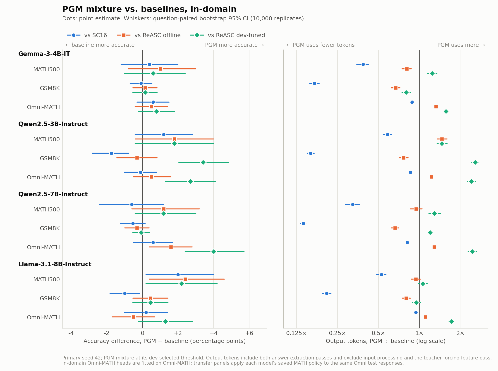

# v1: partition-mixture aggregation heads (archived study)

v1 trained a small neural aggregation head that turns the responses seen so far into a distribution over
answers plus "not sampled yet", and discounts redundant reasoning through a mixture over semantic partitions
of the responses (online cosine clustering of hidden-state embeddings at several thresholds). It was compared
with 11 matched ablations and SC / ASC / ESC / ReASC on Gemma-3-4B-IT, Qwen2.5-3B/7B-Instruct and
Llama-3.1-8B-Instruct on MATH500, GSM8K, Omni-MATH and MATH → Omni-MATH (16 cells).

**Outcome: the semantic partition structure was not supported**, which motivated the simpler generative model of
v2 ([../METHOD.md](../METHOD.md)). Everything below still runs: `pgm fit`, `pgm evaluate`, `pgm report` operate
on v1 and write to `results/v1/`.

[Method](METHOD.md) · [Reproducing and verification](REPRODUCING.md) · [All results](../../results/v1/README.md) · [Interactive report](../../results/v1/report.html)

## Results (seed 42)

Accuracy / mean output tokens per question (seed 42). PGM mixture and ASC dev-tuned use thresholds
chosen on dev (fewest tokens with dev accuracy ≥ dev SC16 − 1 pp).

| Model | Evaluation | SC16 | ASC dev-tuned | ReASC offline | PGM mixture |
|---|---|---:|---:|---:|---:|
| Gemma-3-4B-IT | MATH500 | 77.4 / 11,852 | 78.0 / 4,161 | 76.8 / 5,648 | 77.8 / 4,571 |
| Gemma-3-4B-IT | GSM8K | 91.8 / 7,144 | 91.7 / 1,325 | 91.6 / 1,807 | 91.7 / 1,209 |
| Gemma-3-4B-IT | Omni-MATH | 31.6 / 21,542 | 31.9 / 11,047 | 31.7 / 14,346 | 32.2 / 19,020 |
| Gemma-3-4B-IT | MATH → Omni | 31.6 / 21,542 | 31.9 / 9,456 | 31.3 / 15,277 | 30.9 / 7,576 |
| Qwen2.5-3B-Instruct | MATH500 | 73.0 / 9,628 | 73.4 / 5,586 | 72.4 / 3,847 | 74.2 / 5,627 |
| Qwen2.5-3B-Instruct | GSM8K | 90.4 / 4,889 | 85.3 / 302 | 89.0 / 1,012 | 88.7 / 775 |
| Qwen2.5-3B-Instruct | Omni-MATH | 28.0 / 13,221 | 27.4 / 7,529 | 27.4 / 9,296 | 27.9 / 11,385 |
| Qwen2.5-3B-Instruct | MATH → Omni | 28.0 / 13,221 | 28.0 / 10,272 | 27.6 / 9,743 | 28.3 / 11,785 |
| Qwen2.5-7B-Instruct | MATH500 | 79.8 / 9,111 | 79.6 / 2,789 | 78.0 / 3,112 | 79.2 / 2,949 |
| Qwen2.5-7B-Instruct | GSM8K | 94.1 / 4,635 | 93.8 / 707 | 93.9 / 983 | 93.6 / 650 |
| Qwen2.5-7B-Instruct | Omni-MATH | 33.5 / 13,156 | 33.3 / 6,618 | 32.5 / 8,335 | 34.1 / 10,715 |
| Qwen2.5-7B-Instruct | MATH → Omni | 33.5 / 13,156 | 33.3 / 6,618 | 32.7 / 9,114 | 33.0 / 7,390 |
| Llama-3.1-8B-Instruct | MATH500 | 58.8 / 7,709 | 59.6 / 3,997 | 58.4 / 4,311 | 60.8 / 4,062 |
| Llama-3.1-8B-Instruct | GSM8K | 90.4 / 2,885 | 89.5 / 609 | 88.9 / 751 | 89.4 / 600 |
| Llama-3.1-8B-Instruct | Omni-MATH | 17.2 / 16,941 | 17.0 / 12,171 | 17.9 / 14,409 | 17.4 / 15,988 |
| Llama-3.1-8B-Instruct | MATH → Omni | 17.2 / 16,941 | 17.0 / 12,171 | 17.1 / 14,986 | 17.1 / 14,200 |

- On MATH and GSM8K the mixture stays within −1.7 to +2.0 pp of SC16 with 42–86 % fewer output tokens.
  Dev-tuned ASC reaches a similar point.
- On Omni-MATH the in-domain heads are conservative: −0.1 to +0.6 pp of SC16, with only 6–19 % fewer
  tokens. The MATH policies transferred to Omni-MATH stop earlier for three of four models.
- **The semantic partition structure is not supported.** One of 48 in-domain primary structure
  contrasts favors the mixture after per-cell Holm adjustment (Llama GSM8K vs. the confidence MLP, at
  12 % more tokens). Size-matched random grouping is never different from the mixture: the learned
  cluster-size discount (α ≈ 0.45) helps, but which responses are grouped together does not.
- Output tokens include both answer-extraction passes and exclude input processing and the
  teacher-forcing feature pass, so they are not serving-time speedups.



## Commands

```bash
pgm download                  # cohorts, banks, policies, decisions
pgm evaluate all              # replay all 16 cells (about 5 min) -> results/v1/evaluations/
pgm report                    # results/v1/README.md, summary.csv, figures/, report.html
pgm fit qwen7b_math --overwrite   # refit the 36 heads of one cell (~10 min on CPU)
```

Code: `pgm_asc/model.py` (heads and arms), `train.py`, `policies.py`, `fit.py`, `evaluate.py`, `stats.py`,
`data/partitions.py`, `data/features.py`, `report/`.
