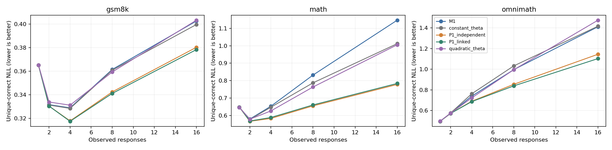
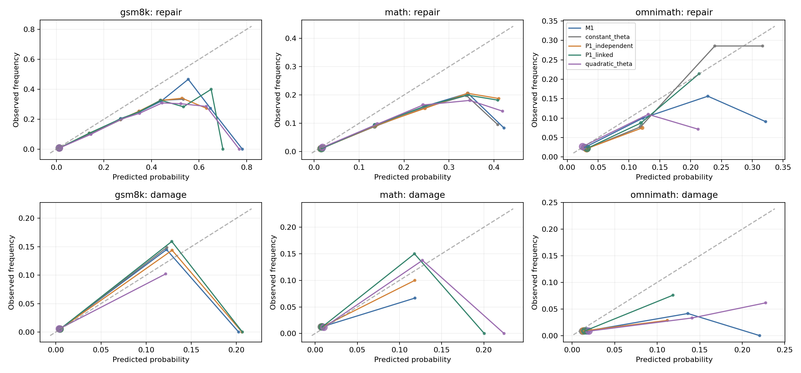
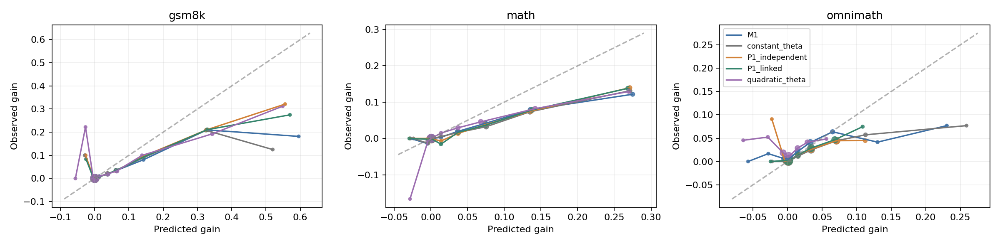

# P1 계층 CRP 구조 ablation

이 폴더는 보고서·그림·집계표·학습 선택 기록을 담은 결과 스냅샷입니다.
개별 실행 기록과 상세 예측 배열은 재실행 시 생성됩니다.
파일 범위와 재현 순서는 [P1 안내](../../docs/P1.md)를 참고하세요.

기존 16-response bank의 9개 cell에서 동일한 joint 학습으로 구조만 비교했습니다. 주 결과는 test의 cell 동일 가중 macro 평균입니다.

## 구조와 통제

q~Beta(a,b), u~Normal(0,1), log θ=clip(t0+t1(2q−1),−8,8)+σu입니다. u는 문제마다 하나이며 전체 prefix와 미래 응답에서 공유됩니다. θ가 작을수록 오답이 소수 문자열에 집중됩니다. 계층 변동은 cell 안의 문제 간 θ 차이를 나타냅니다.

| 방법 | q 연결 | 문제별 random θ | 자유 파라미터 |
|---|---|---|---|
| M1 | linear | 없음 | 4 |
| Constant θ | 없음 | 없음 | 3 |
| P1 independent | 없음 | 있음 | 4 |
| P1 linked | linear | 있음 | 5 |
| Quadratic θ(q) | quadratic | 없음 | 5 |

q 연결 제거는 prior에서 q와 θ를 독립으로 둔다는 뜻입니다. 답의 관측 및 latent c를 통한 posterior 의존성은 남습니다. Quadratic 대조군은 linked P1과 파라미터 수를 맞춰, 단순한 θ(q) 유연성 증가와 random effect를 구분합니다.

모든 방법은 같은 unique-correct train 질문 6901/7200개 model-question pair, 같은 answer id/valid 입력을 사용합니다. 정답 라벨은 train target과 점수 계산에만 사용합니다.

학습 목적 J=−log p(D16,c*)/16 + 6.25e-06×Σraw². 이전 M1 Joint와 같은 정규화·ridge·L-BFGS·공통 초기값 [0, 43, 44]입니다. 파라미터 수가 다른 방법도 raw 하나당 같은 ridge를 씁니다. 각 구조는 penalized train loss가 최소인 restart를 선택하며 dev/test 성능으로 구조를 선택하지 않습니다.

추가 σ는 smooth signed loading 3.0×tanh(raw/3.0)로 나타내며 부호는 대칭 정규분포에서 동일합니다. 보고하는 σ는 절댓값입니다. σ=0에서 random effect가 정확히 사라집니다. 0에서 gradient가 0인 variance component이므로 양의 σ 초기값 [0.25, 0.75, 1.5]를 사용했습니다.

## Posterior·다음 답 예측

모든 loss는 낮을수록 좋습니다. Unique NLL은 bank에 정답 판정 문자열이 최대 하나인 질문에서, OTHER를 포함한 정답 위치 posterior를 평가합니다. Reference/OTHER/미래 점수는 전체 질문을 사용합니다. 다음 답의 categorical 분포는 적분으로 계산하며 MC를 쓰지 않습니다. 추가 미래 사건별 NLL/Brier는 future_by_horizon.csv에 있습니다.

| 방법 | Params | Unique NLL | Reference Brier | OTHER Brier | Next-answer NLL |
|---|---|---|---|---|---|
| M1 | 4 | 0.6577 | 0.1263 | 0.1363 | 0.5749 |
| Constant θ | 3 | 0.6495 | 0.1277 | 0.1374 | 0.5796 |
| P1 / q 연결 제거 | 4 | 0.5818 | 0.1225 | 0.1345 | 0.5647 |
| P1 / q 연결 유지 | 5 | 0.5787 | 0.1210 | 0.1333 | 0.5651 |
| Quadratic θ(q) | 5 | 0.6453 | 0.1237 | 0.1386 | 0.5692 |

| 방법 | Future-correct Brier | Leader-change Brier | Future-reference Brier |
|---|---|---|---|
| M1 | 0.1327 | 0.0713 | 0.1332 |
| Constant θ | 0.1325 | 0.0727 | 0.1345 |
| P1 / q 연결 제거 | 0.1298 | 0.0694 | 0.1298 |
| P1 / q 연결 유지 | 0.1293 | 0.0694 | 0.1290 |
| Quadratic θ(q) | 0.1341 | 0.0703 | 0.1312 |

## Repair·damage·gain calibration

prefix=[1, 2, 4, 8, 16], horizon=[1, 2, 4, 8], t+h≤16의 상태를 질문 안에서 먼저 평균했습니다. 예측은 seed 3개 × 256 continuations입니다. 모든 구조에 동일한 질문/prefix/seed별 난수와 inverse-CDF 순서를 사용합니다. c,q,θ를 공동으로 한 번 뽑고 continuation 동안 고정합니다.

동일 continuation에서 gain=미래 정오−현재 정오=repair−damage입니다. 실제 결과도 bank의 같은 현재/미래 plurality 비교입니다. 동점은 먼저 등장한 valid 답을 선택합니다. Gain bias는 예측−관측이며 pp 단위입니다. Gain MSE−zero<0이면 0-gain 예측보다 좋습니다.

| 방법 | Repair Brier | Damage Brier | Gain MSE | MSE−zero | Gain bias pp | 평균 절대 cell bias pp |
|---|---|---|---|---|---|---|
| M1 | 0.0261 | 0.0089 | 0.0371 | -0.0005 | 0.9956 | 1.2974 |
| Constant θ | 0.0262 | 0.0089 | 0.0371 | -0.0005 | 1.5752 | 1.5752 |
| P1 / q 연결 제거 | 0.0262 | 0.0088 | 0.0369 | -0.0006 | 1.4784 | 1.4784 |
| P1 / q 연결 유지 | 0.0261 | 0.0088 | 0.0368 | -0.0008 | 1.3114 | 1.3508 |
| Quadratic θ(q) | 0.0262 | 0.0090 | 0.0371 | -0.0005 | 0.5016 | 1.4788 |

| 방법 | Repair 예측 % | 실제 % | Damage 예측 % | 실제 % |
|---|---|---|---|---|
| M1 | 3.99 | 2.85 | 1.06 | 0.91 |
| Constant θ | 4.32 | 2.85 | 0.81 | 0.91 |
| P1 / q 연결 제거 | 4.33 | 2.85 | 0.91 | 0.91 |
| P1 / q 연결 유지 | 4.21 | 2.85 | 0.97 | 0.91 |
| Quadratic θ(q) | 3.69 | 2.85 | 1.26 | 0.91 |

## 해석

P1 linked의 M1 대비 상대 변화는 posterior NLL -12.01%, next-answer NLL -1.70%, gain MSE -0.60%입니다. Posterior/답 분포의 개선 크기와 stopping에 필요한 gain 예측의 개선 크기를 구분해야 합니다.

Repair bias는 M1 +1.139pp → P1 linked +1.369pp, damage bias는 +0.143pp → +0.057pp입니다. Gain bias=repair bias−damage bias이므로 damage 보정이 좋아져도 repair 과대예측이 남으면 gain bias가 커질 수 있습니다. P1만으로 기대 이득 calibration 문제가 해결됐다고 판단하지 않습니다.

q 연결을 유지할 때 independent 대비 Δposterior NLL=-0.003104, Δnext-answer NLL=+0.000315, Δgain MSE=-0.000113입니다. 추가 연결의 가치는 posterior·미래 답·전이 목적에 따라 다르므로 한 metric으로 유지/제거를 확정하지 않습니다.

같은 5-parameter quadratic 대조군보다 linked P1의 posterior NLL이 9/9개 cell에서 낮습니다. 이 범위에서는 결정론적 θ(q)에 2차항만 추가하는 설명보다 문제별 잔여 이질성을 모델링하는 설명이 더 지지됩니다.

## 관찰된 변화

Constant θ − M1: unique_nll -0.008166 (7/9 cells 개선); next_answer_nll +0.004792 (1/9 cells 개선); repair_brier +0.000088 (6/9 cells 개선); damage_brier -0.000039 (4/9 cells 개선); gain_mse +0.000012 (6/9 cells 개선).

P1 / q 연결 제거 − M1: unique_nll -0.075905 (9/9 cells 개선); next_answer_nll -0.010108 (9/9 cells 개선); repair_brier +0.000105 (5/9 cells 개선); damage_brier -0.000073 (8/9 cells 개선); gain_mse -0.000111 (6/9 cells 개선).

P1 / q 연결 유지 − M1: unique_nll -0.079010 (9/9 cells 개선); next_answer_nll -0.009793 (9/9 cells 개선); repair_brier -0.000023 (6/9 cells 개선); damage_brier -0.000065 (8/9 cells 개선); gain_mse -0.000224 (7/9 cells 개선).

Quadratic θ(q) − M1: unique_nll -0.012377 (6/9 cells 개선); next_answer_nll -0.005678 (9/9 cells 개선); repair_brier +0.000046 (2/9 cells 개선); damage_brier +0.000083 (5/9 cells 개선); gain_mse +0.000075 (3/9 cells 개선).

Random effect 유무의 주 비교는 M1↔P1 linked, Constant↔P1 independent입니다. q 연결의 주 비교는 P1 independent↔P1 linked입니다. 한 metric의 개선이 다른 층의 개선을 보장하지 않습니다. Gain의 signed bias만으로는 repair와 damage 오차의 상쇄를 구분할 수 없습니다.

아래 직접 비교도 같은 질문과 continuation의 paired contrast입니다. 음수는 왼쪽 모델의 loss가 더 낮음을 뜻합니다. Cell별 질문 bootstrap CI는 structure_contrasts.csv, 개선 cell 수는 structure_macro.csv에 있습니다.

| 비교 | ΔUnique NLL | ΔNext NLL | ΔRepair Brier | ΔDamage Brier | ΔGain MSE |
|---|---|---|---|---|---|
| P1_independent minus constant_theta | -0.067739 | -0.014900 | 0.000017 | -0.000034 | -0.000123 |
| P1_linked minus P1_independent | -0.003104 | 0.000315 | -0.000128 | 0.000009 | -0.000113 |
| P1_linked minus quadratic_theta | -0.066632 | -0.004115 | -0.000069 | -0.000148 | -0.000298 |

## Cell별 결과

| Cell | M1 NLL | Constant θ NLL | P1 / q 연결 제거 NLL | P1 / q 연결 유지 NLL | Quadratic θ(q) NLL | M1 bias pp | Constant θ bias pp | P1 / q 연결 제거 bias pp | P1 / q 연결 유지 bias pp | Quadratic θ(q) bias pp |
|---|---|---|---|---|---|---|---|---|---|---|
| gemma4b / math | 0.5827 | 0.5660 | 0.4990 | 0.4948 | 0.5262 | 1.76 | 2.18 | 2.02 | 1.90 | 0.89 |
| gemma4b / gsm8k | 0.3214 | 0.3229 | 0.3108 | 0.3098 | 0.3226 | 1.52 | 1.51 | 1.47 | 1.48 | 1.79 |
| gemma4b / omnimath | 0.9079 | 0.8808 | 0.7977 | 0.7920 | 0.9517 | -0.56 | 0.13 | 0.07 | -0.18 | -2.08 |
| qwen7b / math | 0.6085 | 0.5908 | 0.5118 | 0.5106 | 0.5465 | 1.06 | 1.31 | 1.10 | 1.03 | 0.25 |
| qwen7b / gsm8k | 0.2997 | 0.2960 | 0.2934 | 0.2937 | 0.3021 | 1.10 | 1.06 | 1.05 | 1.06 | 1.22 |
| qwen7b / omnimath | 0.9381 | 0.9147 | 0.8066 | 0.7981 | 0.9275 | -0.11 | 0.58 | 0.51 | 0.21 | -1.70 |
| llama8b / math | 1.1233 | 1.0469 | 0.9284 | 0.9449 | 1.0998 | 4.51 | 4.54 | 4.29 | 4.31 | 4.17 |
| llama8b / gsm8k | 0.4529 | 0.4523 | 0.4375 | 0.4360 | 0.4511 | 0.35 | 0.36 | 0.31 | 0.30 | 0.59 |
| llama8b / omnimath | 0.6850 | 0.7755 | 0.6509 | 0.6285 | 0.6804 | -0.69 | 2.52 | 2.48 | 1.68 | -0.62 |

| Cell | Normal nodes | σ independent | σ linked | M1 slope | P1 linked slope |
|---|---|---|---|---|---|
| gemma4b / math | 121 | 2.504 | 2.384 | -2.632 | -1.105 |
| gemma4b / gsm8k | 61 | 1.303 | 1.306 | 0.164 | 0.277 |
| gemma4b / omnimath | 61 | 1.517 | 1.509 | -1.012 | -0.546 |
| qwen7b / math | 61 | 1.961 | 1.851 | -1.402 | -0.867 |
| qwen7b / gsm8k | 61 | 1.957 | 1.774 | 1.142 | 1.546 |
| qwen7b / omnimath | 61 | 1.483 | 1.450 | -1.146 | -0.713 |
| llama8b / math | 61 | 1.465 | 1.365 | -0.936 | -0.565 |
| llama8b / gsm8k | 61 | 1.429 | 1.436 | -0.026 | 0.219 |
| llama8b / omnimath | 61 | 1.540 | 1.450 | -5.660 | -1.882 |

## 적분·최적화 검증

q grid는 기존 M1의 80개 logit [−7,7]을 유지합니다. u는 정규분포 Gauss-Hermite로 적분합니다. 해상도 후보 [61, 121, 181, 241]에서 인접 해상도의 train joint NLL, dev unique NLL, dev 개별 posterior/next-answer 최대 절대 차이가 모두 0.001 이하일 때 채택합니다. 그렇지 않으면 양쪽 P1을 함께 높은 해상도로 재학습합니다. 선택된 해상도의 최대 오차는 7.47e-05입니다. Test 점수는 수치 해상도 선택에 사용하지 않았습니다.

이전 controlled M1 Joint와 동일 train ID/hash를 확인했으며 penalized train objective의 최대 차이는 2.22e-16입니다. Nested σ=0 likelihood·posterior·gradient, label 격리, 확률 정규화, 공동 latent 추출, shared simulation parity는 자동 검증합니다.

CRP rising factorial은 log(θ+r)의 누적 합으로 계산해 큰 θ에서 lgamma 차분 소실을 피합니다. Normal random effect 자체는 clip하지 않습니다. θ(q)의 기존 base clip만 유지합니다. σ 상한 근접 여부, 모든 restart/gradient, 적분 오차는 parameters.csv, training_restarts.csv, quadrature_checks.csv에 기록합니다.

## 범위와 한계

1. 기존 xVerify candidate 라벨과 exact-string 답 후보를 재사용합니다. 의미가 같은 여러 정답 문자열은 주 Unique NLL에서 제외하며 future_unique_summary.csv에 미래 민감도를 따로 제공합니다. 새 judge 판정은 수행하지 않았습니다.

2. Paired contrast CI는 질문 단위 bootstrap입니다. Prefix/horizon과 MC seed를 독립 질문으로 세지 않습니다. Macro에 pooled CI나 다중비교 유의성 주장은 없습니다. 전체 CI는 paired_contrasts.csv에 있습니다.

3. MC repair/damage는 Brier와 reliability를 우선합니다. 유한 draw에서 0/1 확률이 생길 수 있어 MC NLL은 clipping=1e−12, zero_probability_events와 함께 해석해야 합니다. MC seed sensitivity와 MC noise 보정 gain MSE도 제공합니다.

4. q grid 절단·σ 상한·특정 Normal prior·단일 joint 목적 내 결과입니다. 적분 검사 통과는 구조 또는 prior가 맞다는 의미가 아닙니다. 학습 bank·judge·구조 선택의 불확실성은 질문 bootstrap에 포함되지 않습니다.

5. 기존 M1과 동일하게 빈 답을 생성하는 observation model이 없습니다. 실제 invalid 다음 답에 0 확률을 줍니다. Stopping threshold나 토큰 절감 성능은 이번 실험에서 최적화하지 않았습니다.

6. 이미 탐색한 test bank이므로 새로운 구조의 독립적인 최종 검증이 아닙니다. 구조·loss를 확정한 뒤 별도 질문 holdout이 필요합니다.

## 재현

pgm hierarchical fit --workers 2

pgm hierarchical run --workers 2

pgm hierarchical report

configs/hierarchical.json과 protocol.json은 설정·코드 hash를, selection/*.json은 test를 읽기 전 fit lock을 담습니다. 큰 posterior/forecast 배열은 artifacts/hierarchical_crp/에 저장합니다. 집계표는 이 폴더의 CSV로 제공하며, cells/*.json과 상세 표는 전체 run 시 생성됩니다.
