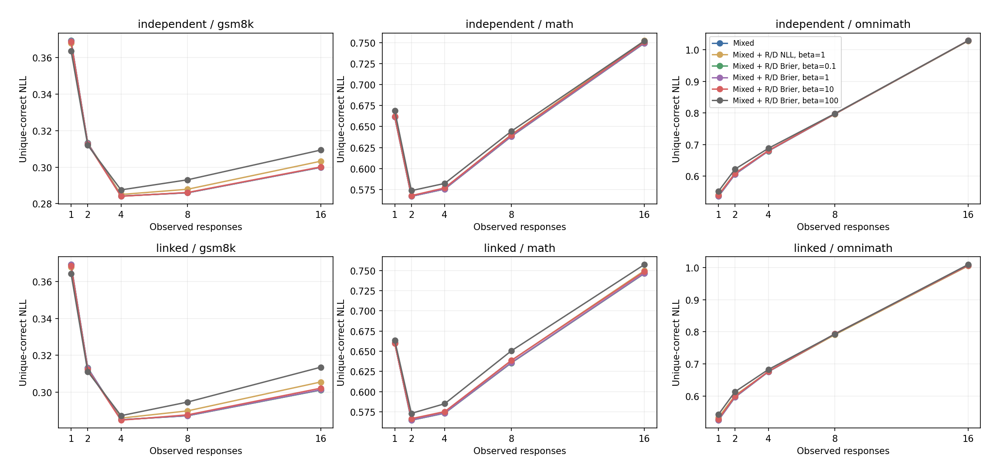
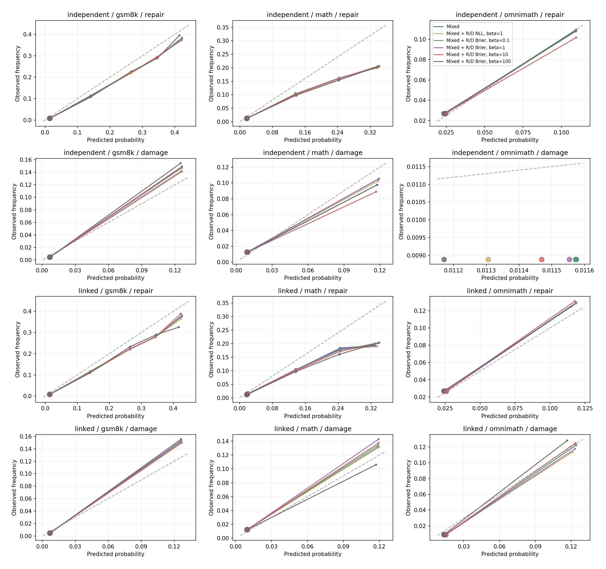
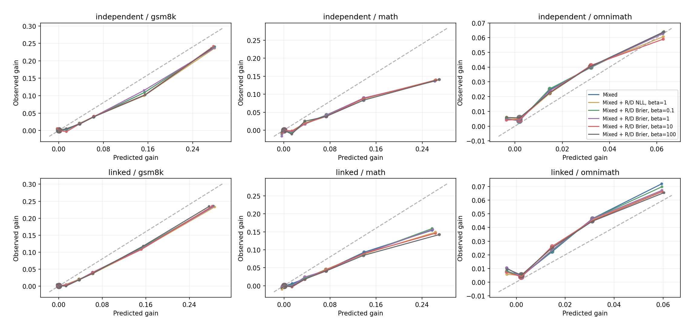

# P1 Mixed + multi-step repair/damage Brier ablation

이 폴더는 보고서·그림·집계표·학습 선택 기록을 담은 결과 스냅샷입니다.
개별 실행 기록과 상세 예측 배열은 재실행 시 생성됩니다.
파일 범위와 재현 순서는 [P1 안내](../../docs/P1.md)를 참고하세요.

P1의 q 연결 유지/제거 모델에서 손실만 바꾸어 기존 Mixed 및 categorical 전이 NLL과 비교했습니다. 9개 cell의 test 결과를 동일 가중 macro로 제시합니다. 모든 사전 고정 β를 보고하며 test에서 계수를 고르지 않습니다.

## 핵심 결과

이번 고정 grid에서는 posterior 개선을 대부분 유지하는 작은 β를 찾았지만 gain calibration의 일관된 추가 개선은 확인하지 못했습니다. 정확 전이 평가에서는 두 구조·두 prefix 가중치·모든 β의 macro gain MSE가 Mixed보다 높았습니다. 현재 비교에서는 Mixed를 유지하는 근거이며, 모든 학습 목적이나 PGM 구조의 가능성을 배제하는 결과는 아닙니다.

q 연결 제거 / uniform: 어떤 β도 Mixed의 macro gain MSE를 낮추지 못했습니다. Paired MC와 exact-event 평가의 방향이 같습니다.

β=1은 Mixed의 posterior NLL 개선을 99.4% 보존합니다. Mixed 대비 Δnext-answer NLL=+0.000341, Δgain ECE=+0.0042 pp입니다. 기존 전이 NLL β=1 대비 Δposterior NLL=-0.001134, Δgain MSE=-0.000023. 두 손실은 단위가 달라 같은 β만으로 최적 학습 목적의 우열을 단정할 수 없습니다.

q 연결 제거 / v1: Mixed보다 macro gain MSE가 낮은 β는 paired MC [1.0], exact-event []입니다. 이는 계수 선택이나 유의성 판정이 아닌 관측된 점추정 비교입니다.

β=1은 Mixed의 posterior NLL 개선을 99.5% 보존합니다. Mixed 대비 Δnext-answer NLL=+0.000316, Δgain ECE=-0.0216 pp입니다. 기존 전이 NLL β=1 대비 Δposterior NLL=-0.001154, Δgain MSE=-0.000037. 두 손실은 단위가 달라 같은 β만으로 최적 학습 목적의 우열을 단정할 수 없습니다.

q 연결 유지 / uniform: 어떤 β도 Mixed의 macro gain MSE를 낮추지 못했습니다. Paired MC와 exact-event 평가의 방향이 같습니다.

β=1은 Mixed의 posterior NLL 개선을 99.4% 보존합니다. Mixed 대비 Δnext-answer NLL=+0.000258, Δgain ECE=+0.0373 pp입니다. 기존 전이 NLL β=1 대비 Δposterior NLL=-0.001508, Δgain MSE=-0.000065. 두 손실은 단위가 달라 같은 β만으로 최적 학습 목적의 우열을 단정할 수 없습니다.

q 연결 유지 / v1: 어떤 β도 Mixed의 macro gain MSE를 낮추지 못했습니다. Paired MC와 exact-event 평가의 방향이 같습니다.

β=1은 Mixed의 posterior NLL 개선을 99.3% 보존합니다. Mixed 대비 Δnext-answer NLL=+0.000213, Δgain ECE=-0.0014 pp입니다. 기존 전이 NLL β=1 대비 Δposterior NLL=-0.001341, Δgain MSE=-0.000070. 두 손실은 단위가 달라 같은 β만으로 최적 학습 목적의 우열을 단정할 수 없습니다.

q 연결 제거 / v1 / β=1의 MC gain MSE 감소(-0.00000450)는 exact-event에서 +0.00000530로 바뀝니다. 이 작은 MC 이득을 native gain 예측의 개선으로 채택하지 않습니다. v1의 일부 ECE 개선은 기술통계로 남깁니다.

## 손실과 통제

B=mean(i,t,h)[((r−Yrepair)^2+(d−Ydamage)^2)/2], M=(J+λCw)/(1+λ), L=(M+βB)/(1+β)+ridge입니다. Repair와 damage의 두 binary Brier를 평균하며 stay의 제곱항, class balancing, gain-only 회귀항은 넣지 않습니다.

β=[0.1, 1.0, 10.0, 100.0]를 모두 비교합니다. Brier는 전이 NLL과 손실 단위·gradient 크기가 달라 100까지 범위를 확장했습니다. 같은 숫자의 β가 NLL과 같은 학습 강도를 뜻하지는 않습니다. 기존 normalized loss 규칙과 raw ridge=6.25e-06는 유지합니다.

기존 Mixed의 λ와 파라미터 수 4/5개·입력 answer id/valid·prior/bounds·train cohort 6901개 model-question pair·L-BFGS·초기값 [0, 43, 44]·σ 초기값 [0.25, 0.75, 1.5]를 고정했습니다. Restart는 penalized train loss로 선택하고 β를 dev/test 점수로 선택하지 않습니다.

전이 학습 prefix=[1, 2, 4, 8], horizon=[1, 2, 4, 8], t+h≤16의 쌍을 질문 안에서 동일 가중합니다. Uniform/v1은 posterior prefix 가중치의 별도 arm이고 B의 가중치는 같습니다.

확률 계산은 이전 NLL 실험의 exact CRP path kernel과 q/Normal 적분을 그대로 재사용합니다. c,q,θ는 과거 답만 조건으로 주변화하며, 현재/미래 정답 여부는 target과 평가에만 씁니다. Native finite-horizon probability나 simulator를 변경하지 않았습니다. β=0은 기존 Mixed입니다.

기존 Mixed·모든 전이 NLL β의 native/정확 전이 prediction 배열을 재사용하고 source bank/cohort/evaluation/code hash를 검증했습니다. 주 paired comparator는 사전에 고정한 NLL β=1입니다. 다른 NLL 계수도 CSV에 남깁니다.

## Uniform: posterior와 다음 답 예측

| 구조 | 학습 | Unique NLL | Reference Brier | OTHER Brier | Next-answer NLL |
|---|---|---|---|---|---|
| q 연결 제거 | Mixed | 0.5593 | 0.1216 | 0.1338 | 0.5924 |
| q 연결 제거 | Mixed + R/D NLL, beta=1 | 0.5606 | 0.1220 | 0.1341 | 0.5941 |
| q 연결 제거 | Mixed + R/D Brier, beta=0.1 | 0.5593 | 0.1216 | 0.1338 | 0.5924 |
| q 연결 제거 | Mixed + R/D Brier, beta=1 | 0.5594 | 0.1217 | 0.1339 | 0.5927 |
| q 연결 제거 | Mixed + R/D Brier, beta=10 | 0.5602 | 0.1219 | 0.1342 | 0.5948 |
| q 연결 제거 | Mixed + R/D Brier, beta=100 | 0.5650 | 0.1228 | 0.1355 | 0.6037 |
| q 연결 유지 | Mixed | 0.5555 | 0.1202 | 0.1313 | 0.5851 |
| q 연결 유지 | Mixed + R/D NLL, beta=1 | 0.5571 | 0.1209 | 0.1319 | 0.5883 |
| q 연결 유지 | Mixed + R/D Brier, beta=0.1 | 0.5555 | 0.1202 | 0.1314 | 0.5851 |
| q 연결 유지 | Mixed + R/D Brier, beta=1 | 0.5556 | 0.1202 | 0.1314 | 0.5853 |
| q 연결 유지 | Mixed + R/D Brier, beta=10 | 0.5565 | 0.1205 | 0.1317 | 0.5872 |
| q 연결 유지 | Mixed + R/D Brier, beta=100 | 0.5627 | 0.1218 | 0.1332 | 0.5968 |

## Uniform: 기존과 같은 paired MC

Seed 3개 × 256 continuations, 같은 질문/prefix/seed 난수·고정 plurality·first-appearance tie-break입니다. 같은 continuation에서 gain=repair−damage가 성립합니다. Bias는 예측−관측, pp 단위입니다. Gain ECE는 기존 고정 bin의 prefix/horizon별 calibration error를 cell 안에서 평균한 뒤 macro 평균한 기술통계입니다. ECE도 pp 단위이며 독립 표본의 calibration 검증으로 해석하지 않습니다.

| 구조 | 학습 | Repair Brier | Damage Brier | RD mean Brier | Gain MSE | Repair bias pp | Damage bias pp | Gain bias pp | Gain ECE pp |
|---|---|---|---|---|---|---|---|---|---|
| q 연결 제거 | Mixed | 0.02576 | 0.00882 | 0.01729 | 0.03641 | 0.747 | 0.050 | 0.697 | 1.415 |
| q 연결 제거 | Mixed + R/D NLL, beta=1 | 0.02578 | 0.00881 | 0.01730 | 0.03644 | 0.739 | 0.031 | 0.708 | 1.425 |
| q 연결 제거 | Mixed + R/D Brier, beta=0.1 | 0.02576 | 0.00882 | 0.01729 | 0.03641 | 0.748 | 0.051 | 0.697 | 1.406 |
| q 연결 제거 | Mixed + R/D Brier, beta=1 | 0.02577 | 0.00882 | 0.01729 | 0.03641 | 0.753 | 0.051 | 0.702 | 1.419 |
| q 연결 제거 | Mixed + R/D Brier, beta=10 | 0.02580 | 0.00881 | 0.01730 | 0.03644 | 0.783 | 0.058 | 0.725 | 1.472 |
| q 연결 제거 | Mixed + R/D Brier, beta=100 | 0.02588 | 0.00882 | 0.01735 | 0.03653 | 0.801 | 0.065 | 0.736 | 1.527 |
| q 연결 유지 | Mixed | 0.02565 | 0.00882 | 0.01723 | 0.03628 | 0.706 | 0.188 | 0.518 | 1.379 |
| q 연결 유지 | Mixed + R/D NLL, beta=1 | 0.02570 | 0.00881 | 0.01725 | 0.03636 | 0.698 | 0.131 | 0.567 | 1.450 |
| q 연결 유지 | Mixed + R/D Brier, beta=0.1 | 0.02565 | 0.00882 | 0.01723 | 0.03628 | 0.708 | 0.188 | 0.519 | 1.381 |
| q 연결 유지 | Mixed + R/D Brier, beta=1 | 0.02566 | 0.00882 | 0.01724 | 0.03629 | 0.722 | 0.188 | 0.534 | 1.417 |
| q 연결 유지 | Mixed + R/D Brier, beta=10 | 0.02573 | 0.00882 | 0.01727 | 0.03637 | 0.784 | 0.189 | 0.596 | 1.463 |
| q 연결 유지 | Mixed + R/D Brier, beta=100 | 0.02585 | 0.00881 | 0.01733 | 0.03654 | 0.833 | 0.149 | 0.684 | 1.555 |

## Exact-event 민감도

같은 native 모델의 repair/damage/gain을 정확 path 합으로 계산해 MC 잡음을 제거한 보조 평가입니다. q/Normal 적분은 동일합니다. 이전 기준점의 exact 배열도 그대로 유지했습니다.

| 구조 | 학습 | Repair Brier | Damage Brier | RD mean Brier | Gain MSE | Repair bias pp | Damage bias pp | Gain bias pp |
|---|---|---|---|---|---|---|---|---|
| q 연결 제거 | Mixed | 0.02567 | 0.00880 | 0.01724 | 0.03629 | 0.751 | 0.050 | 0.701 |
| q 연결 제거 | Mixed + R/D NLL, beta=1 | 0.02569 | 0.00880 | 0.01725 | 0.03632 | 0.743 | 0.032 | 0.711 |
| q 연결 제거 | Mixed + R/D Brier, beta=0.1 | 0.02567 | 0.00880 | 0.01724 | 0.03630 | 0.752 | 0.050 | 0.701 |
| q 연결 제거 | Mixed + R/D Brier, beta=1 | 0.02568 | 0.00880 | 0.01724 | 0.03630 | 0.758 | 0.052 | 0.706 |
| q 연결 제거 | Mixed + R/D Brier, beta=10 | 0.02571 | 0.00880 | 0.01726 | 0.03633 | 0.787 | 0.059 | 0.729 |
| q 연결 제거 | Mixed + R/D Brier, beta=100 | 0.02580 | 0.00880 | 0.01730 | 0.03643 | 0.805 | 0.065 | 0.740 |
| q 연결 유지 | Mixed | 0.02558 | 0.00881 | 0.01719 | 0.03621 | 0.708 | 0.188 | 0.520 |
| q 연결 유지 | Mixed + R/D NLL, beta=1 | 0.02563 | 0.00880 | 0.01721 | 0.03628 | 0.701 | 0.132 | 0.569 |
| q 연결 유지 | Mixed + R/D Brier, beta=0.1 | 0.02558 | 0.00881 | 0.01720 | 0.03621 | 0.710 | 0.188 | 0.522 |
| q 연결 유지 | Mixed + R/D Brier, beta=1 | 0.02559 | 0.00881 | 0.01720 | 0.03622 | 0.723 | 0.189 | 0.534 |
| q 연결 유지 | Mixed + R/D Brier, beta=10 | 0.02566 | 0.00880 | 0.01723 | 0.03629 | 0.787 | 0.189 | 0.597 |
| q 연결 유지 | Mixed + R/D Brier, beta=100 | 0.02578 | 0.00880 | 0.01729 | 0.03645 | 0.835 | 0.150 | 0.685 |

## Posterior 개선 보존

보존율=(Joint macro NLL−새 모델 macro NLL)/(Joint macro NLL−Mixed macro NLL)입니다. 100%는 기존 Mixed의 posterior 개선을 모두 보존한 경우이며 선택 조건으로 사용하지 않습니다. 분모가 양수가 아닌 cell의 개별 보존율은 정의하지 않습니다.

| 구조 | 가중치 | β | macro 보존율 % | Posterior<Joint cells | MC gain<Mixed cells | Exact gain<Mixed cells |
|---|---|---|---|---|---|---|
| q 연결 제거 | uniform | 0.1 | 99.9 | 9 | 3 | 3 |
| q 연결 제거 | uniform | 1.0 | 99.4 | 9 | 2 | 2 |
| q 연결 제거 | uniform | 10.0 | 95.9 | 9 | 3 | 2 |
| q 연결 제거 | uniform | 100.0 | 74.8 | 7 | 3 | 1 |
| q 연결 제거 | v1 | 0.1 | 99.9 | 9 | 3 | 4 |
| q 연결 제거 | v1 | 1.0 | 99.5 | 9 | 6 | 4 |
| q 연결 제거 | v1 | 10.0 | 96.9 | 9 | 4 | 4 |
| q 연결 제거 | v1 | 100.0 | 81.5 | 8 | 4 | 3 |
| q 연결 유지 | uniform | 0.1 | 99.9 | 9 | 4 | 2 |
| q 연결 유지 | uniform | 1.0 | 99.4 | 9 | 2 | 2 |
| q 연결 유지 | uniform | 10.0 | 95.4 | 8 | 4 | 2 |
| q 연결 유지 | uniform | 100.0 | 68.9 | 6 | 3 | 3 |
| q 연결 유지 | v1 | 0.1 | 99.9 | 9 | 4 | 3 |
| q 연결 유지 | v1 | 1.0 | 99.3 | 9 | 5 | 3 |
| q 연결 유지 | v1 | 10.0 | 95.8 | 9 | 3 | 3 |
| q 연결 유지 | v1 | 100.0 | 76.8 | 9 | 3 | 3 |

## Gain 오차 분해

eR=r−Yrepair, eD=d−Ydamage라 두면 Gain MSE=Repair Brier+Damage Brier−2 E[eR·eD]입니다. B는 앞 두 항의 평균이므로, 제한된 PGM 안에서 B의 감소만으로 gain MSE의 감소가 보장되지는 않습니다. gain_decomposition.csv와 gain_decomposition_macro.csv에 각 항과 항등식 잔차를 제공합니다.

q 연결 제거 / uniform / β=1: exact Δrepair Brier=+0.00000618, Δdamage Brier=-0.00000001, Δerror cross=+0.00000029. Test의 R/D Brier 자체도 개선되는지 먼저 확인해야 하며, 결과를 cross term 하나의 문제로 설명하지 않습니다.

q 연결 유지 / uniform / β=1: exact Δrepair Brier=+0.00001171, Δdamage Brier=-0.00000061, Δerror cross=-0.00000104. Test의 R/D Brier 자체도 개선되는지 먼저 확인해야 하며, 결과를 cross term 하나의 문제로 설명하지 않습니다.

## 관찰된 변화

q 연결 제거 / uniform / β=0.1: Mixed 대비 Δposterior NLL +0.000014, ΔRD mean Brier +0.000001, ΔMC gain MSE +0.000001, Δexact gain MSE +0.000001. MC/exact gain 개선 cell은 3/9, 3/9개입니다. 기존 NLL β=1 대비 ΔMC gain MSE=-0.000029.

q 연결 제거 / uniform / β=1: Mixed 대비 Δposterior NLL +0.000125, ΔRD mean Brier +0.000004, ΔMC gain MSE +0.000007, Δexact gain MSE +0.000006. MC/exact gain 개선 cell은 2/9, 2/9개입니다. 기존 NLL β=1 대비 ΔMC gain MSE=-0.000023.

q 연결 제거 / uniform / β=10: Mixed 대비 Δposterior NLL +0.000913, ΔRD mean Brier +0.000017, ΔMC gain MSE +0.000030, Δexact gain MSE +0.000039. MC/exact gain 개선 cell은 3/9, 2/9개입니다. 기존 NLL β=1 대비 ΔMC gain MSE=-0.000000.

q 연결 제거 / uniform / β=100: Mixed 대비 Δposterior NLL +0.005659, ΔRD mean Brier +0.000060, ΔMC gain MSE +0.000125, Δexact gain MSE +0.000136. MC/exact gain 개선 cell은 3/9, 1/9개입니다. 기존 NLL β=1 대비 ΔMC gain MSE=+0.000095.

q 연결 제거 / v1 / β=0.1: Mixed 대비 Δposterior NLL +0.000013, ΔRD mean Brier -0.000000, ΔMC gain MSE +0.000001, Δexact gain MSE +0.000001. MC/exact gain 개선 cell은 3/9, 4/9개입니다. 기존 NLL β=1 대비 ΔMC gain MSE=-0.000032.

q 연결 제거 / v1 / β=1: Mixed 대비 Δposterior NLL +0.000117, ΔRD mean Brier -0.000001, ΔMC gain MSE -0.000004, Δexact gain MSE +0.000005. MC/exact gain 개선 cell은 6/9, 4/9개입니다. 기존 NLL β=1 대비 ΔMC gain MSE=-0.000037.

q 연결 제거 / v1 / β=10: Mixed 대비 Δposterior NLL +0.000669, ΔRD mean Brier +0.000013, ΔMC gain MSE +0.000025, Δexact gain MSE +0.000030. MC/exact gain 개선 cell은 4/9, 4/9개입니다. 기존 NLL β=1 대비 ΔMC gain MSE=-0.000008.

q 연결 제거 / v1 / β=100: Mixed 대비 Δposterior NLL +0.003974, ΔRD mean Brier +0.000035, ΔMC gain MSE +0.000073, Δexact gain MSE +0.000075. MC/exact gain 개선 cell은 4/9, 3/9개입니다. 기존 NLL β=1 대비 ΔMC gain MSE=+0.000041.

q 연결 유지 / uniform / β=0.1: Mixed 대비 Δposterior NLL +0.000015, ΔRD mean Brier +0.000001, ΔMC gain MSE +0.000001, Δexact gain MSE +0.000001. MC/exact gain 개선 cell은 4/9, 2/9개입니다. 기존 NLL β=1 대비 ΔMC gain MSE=-0.000082.

q 연결 유지 / uniform / β=1: Mixed 대비 Δposterior NLL +0.000138, ΔRD mean Brier +0.000007, ΔMC gain MSE +0.000017, Δexact gain MSE +0.000013. MC/exact gain 개선 cell은 2/9, 2/9개입니다. 기존 NLL β=1 대비 ΔMC gain MSE=-0.000065.

q 연결 유지 / uniform / β=10: Mixed 대비 Δposterior NLL +0.001069, ΔRD mean Brier +0.000037, ΔMC gain MSE +0.000092, Δexact gain MSE +0.000087. MC/exact gain 개선 cell은 4/9, 2/9개입니다. 기존 NLL β=1 대비 ΔMC gain MSE=+0.000010.

q 연결 유지 / uniform / β=100: Mixed 대비 Δposterior NLL +0.007237, ΔRD mean Brier +0.000098, ΔMC gain MSE +0.000260, Δexact gain MSE +0.000247. MC/exact gain 개선 cell은 3/9, 3/9개입니다. 기존 NLL β=1 대비 ΔMC gain MSE=+0.000178.

q 연결 유지 / v1 / β=0.1: Mixed 대비 Δposterior NLL +0.000018, ΔRD mean Brier +0.000001, ΔMC gain MSE +0.000002, Δexact gain MSE +0.000001. MC/exact gain 개선 cell은 4/9, 3/9개입니다. 기존 NLL β=1 대비 ΔMC gain MSE=-0.000070.

q 연결 유지 / v1 / β=1: Mixed 대비 Δposterior NLL +0.000156, ΔRD mean Brier +0.000002, ΔMC gain MSE +0.000002, Δexact gain MSE +0.000012. MC/exact gain 개선 cell은 5/9, 3/9개입니다. 기존 NLL β=1 대비 ΔMC gain MSE=-0.000070.

q 연결 유지 / v1 / β=10: Mixed 대비 Δposterior NLL +0.000942, ΔRD mean Brier +0.000029, ΔMC gain MSE +0.000069, Δexact gain MSE +0.000072. MC/exact gain 개선 cell은 3/9, 3/9개입니다. 기존 NLL β=1 대비 ΔMC gain MSE=-0.000003.

q 연결 유지 / v1 / β=100: Mixed 대비 Δposterior NLL +0.005221, ΔRD mean Brier +0.000071, ΔMC gain MSE +0.000179, Δexact gain MSE +0.000178. MC/exact gain 개선 cell은 3/9, 3/9개입니다. 기존 NLL β=1 대비 ΔMC gain MSE=+0.000107.

## v1 가중치 민감도

| 구조 | 학습 | Unique NLL | Reference Brier | OTHER Brier | Next-answer NLL |
|---|---|---|---|---|---|
| q 연결 제거 | Mixed | 0.5603 | 0.1203 | 0.1324 | 0.5816 |
| q 연결 제거 | Mixed + R/D NLL, beta=1 | 0.5616 | 0.1207 | 0.1328 | 0.5841 |
| q 연결 제거 | Mixed + R/D Brier, beta=0.1 | 0.5603 | 0.1203 | 0.1324 | 0.5817 |
| q 연결 제거 | Mixed + R/D Brier, beta=1 | 0.5604 | 0.1203 | 0.1325 | 0.5819 |
| q 연결 제거 | Mixed + R/D Brier, beta=10 | 0.5610 | 0.1204 | 0.1328 | 0.5841 |
| q 연결 제거 | Mixed + R/D Brier, beta=100 | 0.5643 | 0.1214 | 0.1341 | 0.5954 |
| q 연결 유지 | Mixed | 0.5562 | 0.1189 | 0.1303 | 0.5778 |
| q 연결 유지 | Mixed + R/D NLL, beta=1 | 0.5577 | 0.1195 | 0.1308 | 0.5801 |
| q 연결 유지 | Mixed + R/D Brier, beta=0.1 | 0.5562 | 0.1189 | 0.1303 | 0.5778 |
| q 연결 유지 | Mixed + R/D Brier, beta=1 | 0.5564 | 0.1189 | 0.1304 | 0.5780 |
| q 연결 유지 | Mixed + R/D Brier, beta=10 | 0.5572 | 0.1191 | 0.1307 | 0.5795 |
| q 연결 유지 | Mixed + R/D Brier, beta=100 | 0.5614 | 0.1202 | 0.1320 | 0.5896 |

| 구조 | 학습 | Repair Brier | Damage Brier | RD mean Brier | Gain MSE | Repair bias pp | Damage bias pp | Gain bias pp | Gain ECE pp |
|---|---|---|---|---|---|---|---|---|---|
| q 연결 제거 | Mixed | 0.02584 | 0.00882 | 0.01733 | 0.03651 | 0.983 | 0.055 | 0.928 | 1.519 |
| q 연결 제거 | Mixed + R/D NLL, beta=1 | 0.02586 | 0.00882 | 0.01734 | 0.03654 | 0.953 | 0.029 | 0.924 | 1.525 |
| q 연결 제거 | Mixed + R/D Brier, beta=0.1 | 0.02584 | 0.00882 | 0.01733 | 0.03651 | 0.983 | 0.055 | 0.928 | 1.527 |
| q 연결 제거 | Mixed + R/D Brier, beta=1 | 0.02584 | 0.00882 | 0.01733 | 0.03650 | 0.988 | 0.057 | 0.931 | 1.498 |
| q 연결 제거 | Mixed + R/D Brier, beta=10 | 0.02587 | 0.00881 | 0.01734 | 0.03653 | 1.006 | 0.063 | 0.944 | 1.512 |
| q 연결 제거 | Mixed + R/D Brier, beta=100 | 0.02591 | 0.00882 | 0.01736 | 0.03658 | 0.947 | 0.067 | 0.880 | 1.552 |
| q 연결 유지 | Mixed | 0.02572 | 0.00883 | 0.01727 | 0.03639 | 0.838 | 0.204 | 0.634 | 1.438 |
| q 연결 유지 | Mixed + R/D NLL, beta=1 | 0.02577 | 0.00882 | 0.01729 | 0.03646 | 0.847 | 0.151 | 0.696 | 1.472 |
| q 연결 유지 | Mixed + R/D Brier, beta=0.1 | 0.02572 | 0.00883 | 0.01727 | 0.03639 | 0.839 | 0.204 | 0.635 | 1.446 |
| q 연결 유지 | Mixed + R/D Brier, beta=1 | 0.02572 | 0.00883 | 0.01728 | 0.03639 | 0.851 | 0.205 | 0.645 | 1.436 |
| q 연결 유지 | Mixed + R/D Brier, beta=10 | 0.02578 | 0.00882 | 0.01730 | 0.03646 | 0.910 | 0.206 | 0.703 | 1.491 |
| q 연결 유지 | Mixed + R/D Brier, beta=100 | 0.02587 | 0.00882 | 0.01734 | 0.03657 | 0.934 | 0.179 | 0.755 | 1.549 |

## QA와 재현

새 Brier 후보의 최종 coarse/fine 최대 오차는 2.36e-05입니다. Train J/C/B/data loss, dev posterior/Brier, 개별 dev posterior/next-answer/event 확률을 더 높은 Normal 해상도와 비교해 0.001 이하인지 확인한 뒤 test를 평가합니다.

Frozen reference의 공통 summary 최대 차이는 0입니다. Posterior 정규화 오차 3.66e-15, next-answer 정규화 오차 2.22e-15, finite-draw gain 항등식 오차 7.63e-17. validation.json에 기록했습니다.

Brier 식과 기존 exact R/D 평가 점수의 일치, NLL과 같은 예측 확률, gold/suffix 격리, finite-difference gradient, β=0 Mixed 재현을 검증합니다. Kernel 자체의 경로 열거·horizon 8 독립 DP·native MC 검증도 유지합니다.

## 그림

Calibration 그림은 n≥30인 bin을 표시하며 전체 희소 bin은 CSV에 남깁니다. 상태 수를 독립 질문 수로 해석하지 않습니다.

## 범위와 한계

1. 질문 안에서 prefix/horizon 점수를 평균한 뒤 1,000회 paired question bootstrap을 적용합니다. Macro는 cell 동일 가중 평균이며 pooled CI나 다중비교 유의성 주장을 하지 않습니다.

2. 이미 탐색한 기존 xVerify exact-string bank이며 독립 holdout 검증은 아닙니다. 학습은 같은 unique-correct 질문, 주 미래 평가는 전체 질문이고 unique-only 민감도를 함께 저장합니다.

3. λ 고정·현재 β grid·고정 horizon/plurality 규칙·normalized loss와 같은 raw ridge 아래의 결과입니다. NLL/Brier의 척도 차이와 강한 β에서의 상대 정규화 효과를 포함합니다. 결과로 β 또는 λ를 다시 고르지 않았습니다.

4. 기존 P1의 q grid·bounded prior/σ·빈 답 생성 모델 부재가 남습니다. One-step transition-only 또는 gain-only 학습과의 비교는 아니며 실제 stopping threshold/토큰 절감도 최적화하지 않았습니다.

## 실행 및 파일

pgm p1-brier fit --workers 4

pgm p1-brier run --workers 4

pgm p1-brier report

configs/p1_brier.json, protocol.json, selection/*.json에 고정 설정·코드 hash·모든 fit/restart/적분 이력·test 이전 lock을 저장합니다. artifacts/p1_brier/에는 후보와 큰 prediction 배열을 보관합니다.

summary.csv / macro_summary.csv / dataset_summary.csv / paired_contrasts.csv / paired_macro.csv / exact_transition_summary.csv / exact_transition_macro.csv / exact_paired_contrasts.csv / exact_paired_macro.csv / posterior_retention.csv / cell_retention.csv / gain_decomposition.csv / gain_decomposition_macro.csv / *_calibration.csv / future_unique_summary.csv / training_restarts.csv / parameters.csv / quadrature_checks.csv / mc_seed_sensitivity.csv / mc_seed_contrasts.csv를 제공합니다.
