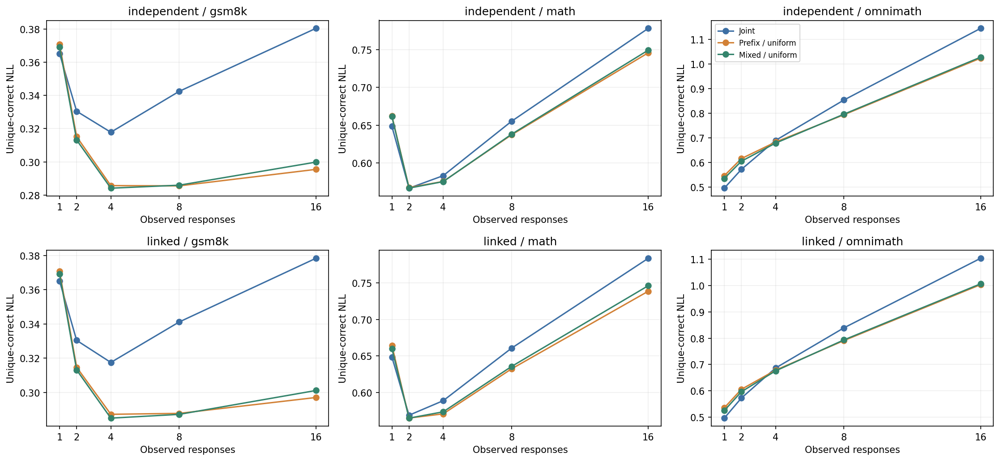
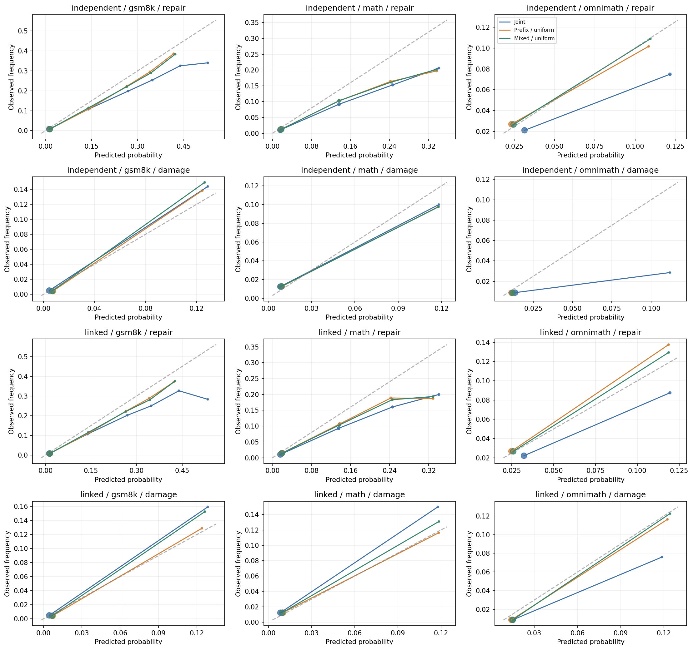
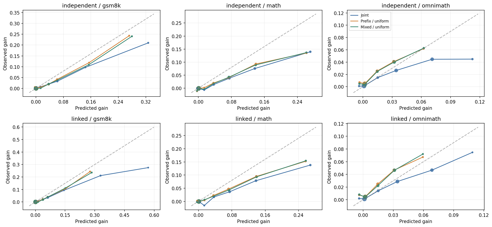

# P1 학습 목적 ablation

이 폴더는 보고서·그림·집계표·학습 선택 기록을 담은 결과 스냅샷입니다.
개별 실행 기록과 상세 예측 배열은 재실행 시 생성됩니다.
파일 범위와 재현 순서는 [P1 안내](../../docs/P1.md)를 참고하세요.

두 P1 구조의 입력과 파라미터 수를 유지하고 Joint / prefix posterior NLL / mixed 학습을 비교했습니다. 9개 cell의 test 결과이며 cell을 동일하게 가중한 macro 평균입니다.

## 고정한 조건과 dev 선택

q 연결 제거형은 4개, 유지형은 5개 파라미터입니다. q~Beta(a,b), log θ=clip(t0+t1(2q−1),−8,8)+σu, u~Normal(0,1)이며 제거형은 t1=0입니다. u는 문제마다 한 번 정해지고 전체 prefix/continuation에서 공유됩니다. 입력은 answer id와 valid뿐입니다.

J=−mean log p(D16,c*)/16. Cw=질문별 Σ(t=1..16) wt[−log p(c*t|Dt)]의 평균입니다. Joint=J, Prefix=Cw, Mixed=(J+λCw)/(1+λ)이며 모두 같은 raw-parameter ridge를 더합니다. 정답이 아직 나타나지 않은 prefix는 OTHER가 target입니다.

모든 학습은 기존 Joint와 정확히 같은 unique-correct train 질문 6901개 model-question pair를 사용합니다. Bank 안에 정답 판정 문자열이 최대 하나인 질문이며, 정답이 한 번도 나오지 않은 질문도 유지합니다. 정답 라벨은 train target과 평가에만 사용합니다.

초기값 seed [0, 43, 44], σ 초기값 [0.25, 0.75, 1.5], L-BFGS, ridge=6.25e-06를 유지합니다. 각 목적은 penalized train loss로 restart를 선택합니다. Mixed λ 후보 [0.1, 1.0, 10.0] 중 dev unique posterior NLL이 가장 낮은 값을 선택합니다. Dev 점수는 고정 평가 prefix의 동일 가중 평균입니다. λ 선택에 미래/gain/test 점수는 쓰지 않습니다.

Uniform은 16개 prefix에 같은 가중치를 줍니다. v1은 1–2/3–4/5–8/9–16 band에 총 0.4/0.2/0.2/0.2를 주며 별도 민감도로 비교합니다. 모든 λ 후보와 restart를 저장합니다.

Joint 기준점은 이전 P1 실험의 파라미터와 posterior/forecast 배열을 그대로 재사용했습니다. Bank hash·train ID hash·평가 설정·수치 구현 hash를 검증하고, 현재 점수가 이전 점수와 같은지 확인합니다. 기존 결과 파일은 덮어쓰지 않습니다.

## Posterior와 미래 예측: uniform

모든 loss는 낮을수록 좋습니다. Unique NLL은 unique-correct 질문, reference/OTHER/미래 점수는 전체 질문을 사용합니다. Next-answer 분포는 적분으로 계산하며 MC를 쓰지 않습니다.

| 구조 | 학습 | Unique NLL | Reference Brier | OTHER Brier | Next-answer NLL |
|---|---|---|---|---|---|
| q 연결 제거 | Joint | 0.5818 | 0.1225 | 0.1345 | 0.5647 |
| q 연결 제거 | Prefix / uniform | 0.5605 | 0.1220 | 0.1345 | 0.5984 |
| q 연결 제거 | Mixed / uniform | 0.5593 | 0.1216 | 0.1338 | 0.5924 |
| q 연결 유지 | Joint | 0.5787 | 0.1210 | 0.1333 | 0.5651 |
| q 연결 유지 | Prefix / uniform | 0.5561 | 0.1207 | 0.1321 | 0.5916 |
| q 연결 유지 | Mixed / uniform | 0.5555 | 0.1202 | 0.1313 | 0.5851 |

| 구조 | 학습 | Future-correct Brier | Leader-change Brier | Future-reference Brier |
|---|---|---|---|---|
| q 연결 제거 | Joint | 0.1298 | 0.0694 | 0.1298 |
| q 연결 제거 | Prefix / uniform | 0.1315 | 0.0719 | 0.1318 |
| q 연결 제거 | Mixed / uniform | 0.1307 | 0.0717 | 0.1311 |
| q 연결 유지 | Joint | 0.1293 | 0.0694 | 0.1290 |
| q 연결 유지 | Prefix / uniform | 0.1295 | 0.0715 | 0.1306 |
| q 연결 유지 | Mixed / uniform | 0.1287 | 0.0711 | 0.1298 |

## Repair·damage·gain calibration: uniform

동일 질문/prefix/seed 난수를 모든 모델에 공유합니다. Prefix=[1, 2, 4, 8, 16], horizon=[1, 2, 4, 8], t+h≤16이며 seed 3개 × 256 draws입니다. Latent c,q,θ를 공동으로 한 번 뽑고 미래 응답 동안 고정합니다. 같은 continuation에서 gain=repair−damage가 유한 draw에서도 성립합니다.

Reference는 valid 답의 plurality이며 동점은 먼저 등장한 답을 택합니다. Bias는 예측−관측, 단위는 pp입니다. 전체 signed gain bias와 평균 절대 cell bias를 함께 제시해 cell 간 오차 상쇄를 구분합니다.

| 구조 | 학습 | Repair Brier | Damage Brier | Gain MSE | Repair bias pp | Damage bias pp | Gain bias pp | 평균 절대 cell bias pp |
|---|---|---|---|---|---|---|---|---|
| q 연결 제거 | Joint | 0.02621 | 0.00882 | 0.03695 | 1.480 | 0.001 | 1.478 | 1.478 |
| q 연결 제거 | Prefix / uniform | 0.02575 | 0.00882 | 0.03638 | 0.689 | 0.064 | 0.625 | 1.038 |
| q 연결 제거 | Mixed / uniform | 0.02576 | 0.00882 | 0.03641 | 0.747 | 0.050 | 0.697 | 1.022 |
| q 연결 유지 | Joint | 0.02608 | 0.00883 | 0.03684 | 1.369 | 0.057 | 1.311 | 1.351 |
| q 연결 유지 | Prefix / uniform | 0.02562 | 0.00882 | 0.03623 | 0.617 | 0.199 | 0.419 | 0.932 |
| q 연결 유지 | Mixed / uniform | 0.02565 | 0.00882 | 0.03628 | 0.706 | 0.188 | 0.518 | 0.993 |

## 해석

q 연결 제거의 uniform Prefix는 Joint 대비 posterior NLL -3.66%, gain MSE -1.54%인 반면, next-answer NLL은 +5.96%입니다. Posterior·gain의 보정과 전체 미래 답 분포의 proper score 사이에 trade-off가 남습니다.

q 연결 제거의 repair bias는 +1.480 → +0.689pp로 바뀌고, damage bias는 +0.001 → +0.064pp입니다. Gain bias 감소에는 repair 변화와 damage 변화가 함께 반영됩니다. Damage proper score와 calibration이 모두 개선됐다고 해석하지 않습니다.

q 연결 제거의 Mixed에서 v1 가중치는 uniform 대비 next-answer NLL을 0.5924 → 0.5816로 바꾸지만, Joint의 0.5647까지 회복하지는 않습니다. Gain MSE는 0.03641 → 0.03651입니다. 가중치 선택도 posterior, 생성 예측, gain 중 어떤 목적을 중시하는지에 따라 달라집니다.

q 연결 유지의 uniform Prefix는 Joint 대비 posterior NLL -3.91%, gain MSE -1.64%인 반면, next-answer NLL은 +4.69%입니다. Posterior·gain의 보정과 전체 미래 답 분포의 proper score 사이에 trade-off가 남습니다.

q 연결 유지의 repair bias는 +1.369 → +0.617pp로 바뀌고, damage bias는 +0.057 → +0.199pp입니다. Gain bias 감소에는 repair 변화와 damage 변화가 함께 반영됩니다. Damage proper score와 calibration이 모두 개선됐다고 해석하지 않습니다.

q 연결 유지의 Mixed에서 v1 가중치는 uniform 대비 next-answer NLL을 0.5851 → 0.5778로 바꾸지만, Joint의 0.5651까지 회복하지는 않습니다. Gain MSE는 0.03628 → 0.03639입니다. 가중치 선택도 posterior, 생성 예측, gain 중 어떤 목적을 중시하는지에 따라 달라집니다.

## Joint 대비 변화

q 연결 제거 / Prefix / uniform − Joint: unique_nll -0.021317 (8/9 cells 개선); next_answer_nll +0.033679 (0/9 cells 개선); repair_brier -0.000459 (8/9 cells 개선); damage_brier -0.000002 (3/9 cells 개선); gain_mse -0.000570 (8/9 cells 개선).

q 연결 제거 / Mixed / uniform − Joint: unique_nll -0.022487 (9/9 cells 개선); next_answer_nll +0.027620 (1/9 cells 개선); repair_brier -0.000450 (8/9 cells 개선); damage_brier -0.000003 (3/9 cells 개선); gain_mse -0.000541 (8/9 cells 개선).

q 연결 유지 / Prefix / uniform − Joint: unique_nll -0.022603 (8/9 cells 개선); next_answer_nll +0.026514 (0/9 cells 개선); repair_brier -0.000462 (8/9 cells 개선); damage_brier -0.000005 (4/9 cells 개선); gain_mse -0.000603 (7/9 cells 개선).

q 연결 유지 / Mixed / uniform − Joint: unique_nll -0.023240 (9/9 cells 개선); next_answer_nll +0.020006 (1/9 cells 개선); repair_brier -0.000436 (8/9 cells 개선); damage_brier -0.000005 (3/9 cells 개선); gain_mse -0.000558 (7/9 cells 개선).

Gain MSE와 calibration bias는 다른 성질입니다. Posterior NLL만 좋아지거나 signed gain bias가 상쇄되는 경우를 전체 개선으로 해석하지 않습니다. Paired contrast CSV에는 각 구조의 Joint 비교, 같은 목적의 q 연결 유지−제거, Mixed−Prefix를 모두 담았습니다.

## 데이터셋별 결과

| Dataset | 구조 | 학습 | Unique NLL | Next NLL | Gain MSE | Gain bias pp |
|---|---|---|---|---|---|---|
| gsm8k | q 연결 제거 | Joint | 0.34724 | 0.29656 | 0.02453 | 0.944 |
| gsm8k | q 연결 제거 | Prefix / uniform | 0.31051 | 0.30733 | 0.02386 | 0.526 |
| gsm8k | q 연결 제거 | Mixed / uniform | 0.31046 | 0.30387 | 0.02391 | 0.598 |
| gsm8k | q 연결 유지 | Joint | 0.34650 | 0.29658 | 0.02458 | 0.947 |
| gsm8k | q 연결 유지 | Prefix / uniform | 0.31144 | 0.30775 | 0.02389 | 0.563 |
| gsm8k | q 연결 유지 | Mixed / uniform | 0.31108 | 0.30361 | 0.02396 | 0.628 |
| math | q 연결 제거 | Joint | 0.64643 | 0.60610 | 0.04976 | 2.472 |
| math | q 연결 제거 | Prefix / uniform | 0.63779 | 0.61213 | 0.04906 | 1.935 |
| math | q 연결 제거 | Mixed / uniform | 0.63827 | 0.61122 | 0.04913 | 1.978 |
| math | q 연결 유지 | Joint | 0.65008 | 0.60563 | 0.04966 | 2.416 |
| math | q 연결 유지 | Prefix / uniform | 0.63417 | 0.61132 | 0.04859 | 1.453 |
| math | q 연결 유지 | Mixed / uniform | 0.63601 | 0.60954 | 0.04867 | 1.638 |
| omnimath | q 연결 제거 | Joint | 0.75174 | 0.79159 | 0.03656 | 1.019 |
| omnimath | q 연결 제거 | Prefix / uniform | 0.73316 | 0.87582 | 0.03622 | -0.586 |
| omnimath | q 연결 제거 | Mixed / uniform | 0.72921 | 0.86202 | 0.03618 | -0.485 |
| omnimath | q 연결 유지 | Joint | 0.73951 | 0.79298 | 0.03626 | 0.571 |
| omnimath | q 연결 유지 | Prefix / uniform | 0.72267 | 0.85567 | 0.03621 | -0.759 |
| omnimath | q 연결 유지 | Mixed / uniform | 0.71928 | 0.84206 | 0.03620 | -0.712 |

## v1 가중치 민감도

| 구조 | 학습 | Unique NLL | Reference Brier | OTHER Brier | Next-answer NLL |
|---|---|---|---|---|---|
| q 연결 제거 | Joint | 0.5818 | 0.1225 | 0.1345 | 0.5647 |
| q 연결 제거 | Prefix / uniform | 0.5605 | 0.1220 | 0.1345 | 0.5984 |
| q 연결 제거 | Mixed / uniform | 0.5593 | 0.1216 | 0.1338 | 0.5924 |
| q 연결 제거 | Prefix / v1 | 0.5606 | 0.1202 | 0.1327 | 0.5854 |
| q 연결 제거 | Mixed / v1 | 0.5603 | 0.1203 | 0.1324 | 0.5816 |
| q 연결 유지 | Joint | 0.5787 | 0.1210 | 0.1333 | 0.5651 |
| q 연결 유지 | Prefix / uniform | 0.5561 | 0.1207 | 0.1321 | 0.5916 |
| q 연결 유지 | Mixed / uniform | 0.5555 | 0.1202 | 0.1313 | 0.5851 |
| q 연결 유지 | Prefix / v1 | 0.5565 | 0.1189 | 0.1305 | 0.5810 |
| q 연결 유지 | Mixed / v1 | 0.5562 | 0.1189 | 0.1303 | 0.5778 |

| 구조 | 학습 | Repair Brier | Damage Brier | Gain MSE | Repair bias pp | Damage bias pp | Gain bias pp | 평균 절대 cell bias pp |
|---|---|---|---|---|---|---|---|---|
| q 연결 제거 | Joint | 0.02621 | 0.00882 | 0.03695 | 1.480 | 0.001 | 1.478 | 1.478 |
| q 연결 제거 | Prefix / uniform | 0.02575 | 0.00882 | 0.03638 | 0.689 | 0.064 | 0.625 | 1.038 |
| q 연결 제거 | Mixed / uniform | 0.02576 | 0.00882 | 0.03641 | 0.747 | 0.050 | 0.697 | 1.022 |
| q 연결 제거 | Prefix / v1 | 0.02583 | 0.00882 | 0.03648 | 0.951 | 0.083 | 0.868 | 1.090 |
| q 연결 제거 | Mixed / v1 | 0.02584 | 0.00882 | 0.03651 | 0.983 | 0.055 | 0.928 | 1.114 |
| q 연결 유지 | Joint | 0.02608 | 0.00883 | 0.03684 | 1.369 | 0.057 | 1.311 | 1.351 |
| q 연결 유지 | Prefix / uniform | 0.02562 | 0.00882 | 0.03623 | 0.617 | 0.199 | 0.419 | 0.932 |
| q 연결 유지 | Mixed / uniform | 0.02565 | 0.00882 | 0.03628 | 0.706 | 0.188 | 0.518 | 0.993 |
| q 연결 유지 | Prefix / v1 | 0.02570 | 0.00883 | 0.03635 | 0.810 | 0.222 | 0.588 | 1.001 |
| q 연결 유지 | Mixed / v1 | 0.02572 | 0.00883 | 0.03639 | 0.838 | 0.204 | 0.634 | 1.026 |

## Cell별 mixed λ 선택

| Cell | q 연결 제거 / uniform | q 연결 제거 / v1 | q 연결 유지 / uniform | q 연결 유지 / v1 |
|---|---|---|---|---|
| gemma4b / math | 10.0 | 10.0 | 10.0 | 10.0 |
| gemma4b / gsm8k | 1.0 | 1.0 | 1.0 | 10.0 |
| gemma4b / omnimath | 10.0 | 10.0 | 10.0 | 10.0 |
| qwen7b / math | 1.0 | 10.0 | 0.1 | 10.0 |
| qwen7b / gsm8k | 1.0 | 10.0 | 1.0 | 10.0 |
| qwen7b / omnimath | 10.0 | 10.0 | 10.0 | 10.0 |
| llama8b / math | 10.0 | 10.0 | 10.0 | 10.0 |
| llama8b / gsm8k | 1.0 | 1.0 | 1.0 | 1.0 |
| llama8b / omnimath | 10.0 | 10.0 | 10.0 | 10.0 |

## 적분과 재현 검증

원래 q grid 80개 logit [−7,7]과 σ 상한 3.0을 유지합니다. 각 후보는 기존 Joint의 Normal 적분 해상도에서 시작해 더 높은 해상도의 train J/Cw/data loss, dev unique NLL, 개별 dev posterior/next-answer 확률과 비교합니다. 최대 오차 허용값은 0.001이고 이번 선택 해상도의 최대 오차는 5e-05입니다. 실패하면 해당 목적을 재학습하며 test 전에 검사를 끝냅니다. Mixed λ의 순위도 더 높은 해상도에서 유지되어야 합니다.

Joint 배열은 이전 cache와 동일합니다. Joint summary의 최대 차이는 0, posterior 정규화 오차는 3.66e-15, next-answer 정규화 오차는 2e-15, gain 항등식 오차는 7.63e-17입니다. validation.json에 저장했습니다.

## Calibration 곡선

같은 데이터셋의 cell/prefix/horizon에서 같은 bin을 합친 descriptive reliability입니다. 그림에는 n≥30인 bin을 표시하며 점 크기는 상태 수입니다. 반복 상태들은 독립 표본이 아닙니다. 희소한 끝 구간을 포함한 전체 bin은 CSV의 n과 함께 확인할 수 있습니다.

## 범위와 한계

1. 기존 xVerify candidate 라벨과 exact-string 후보를 재사용합니다. 다중 정답 문자열은 주 unique posterior 점수와 분리하며 future_unique_summary.csv에 미래 점수의 unique-correct 민감도를 제공합니다.

2. 질문 안에서 prefix/horizon 점수를 먼저 평균한 뒤 1,000회 paired question bootstrap을 적용합니다. Cell macro에는 pooled CI나 다중비교 유의성 주장을 붙이지 않습니다. 모델/목적 선택의 불확실성과 judge 오차는 이 CI에 포함되지 않습니다.

3. Mixed λ는 dev posterior 목적에 맞춘 선택입니다. 미래/gain에 최적인 λ는 아닐 수 있습니다. 테스트 결과로 목적·가중치·λ를 다시 고르지 않았습니다. 이미 탐색한 bank이므로 독립 holdout의 최종 검증은 아닙니다.

4. MC repair/damage는 Brier와 reliability를 우선합니다. MC NLL은 0/1 확률과 clipping=1e−12에 민감하므로 zero_probability_events와 함께 봅니다. seed별 결과와 MC 보정 gain MSE도 저장합니다.

5. 기존 P1과 같은 q grid 절단, bounded prior/σ, 빈 답을 생성하지 않는 한계가 남습니다. Stopping threshold와 토큰 절감 성능은 이번 실험에서 선택하지 않았습니다.

## 재현 및 파일

pgm p1-objective fit --workers 4

pgm p1-objective run --workers 4

pgm p1-objective report

configs/p1_objectives.json, protocol.json, selection/*.json에 설정·코드 hash·test 이전 선택 lock을 기록합니다. artifacts/p1_objectives/에는 후보별 적분 이력·모든 restart·큰 prediction 배열을 보관합니다.

summary.csv, macro_summary.csv, dataset_summary.csv, paired_contrasts.csv, paired_macro.csv, posterior_by_prefix.csv, future_by_horizon.csv, *_calibration.csv, future_unique_summary.csv, selection.csv, training_restarts.csv, parameters.csv, quadrature_checks.csv, mc_seed_sensitivity.csv, mc_seed_contrasts.csv를 제공합니다.
