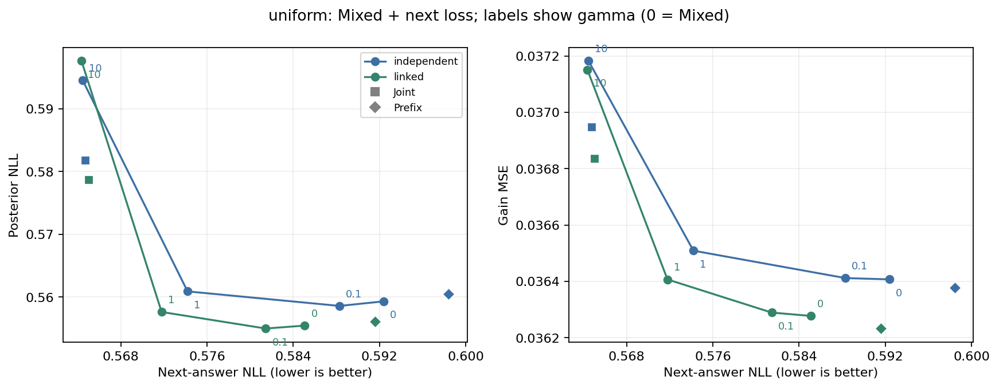
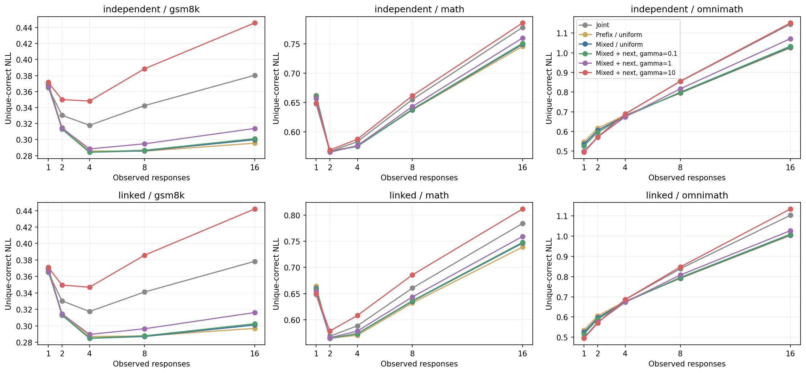
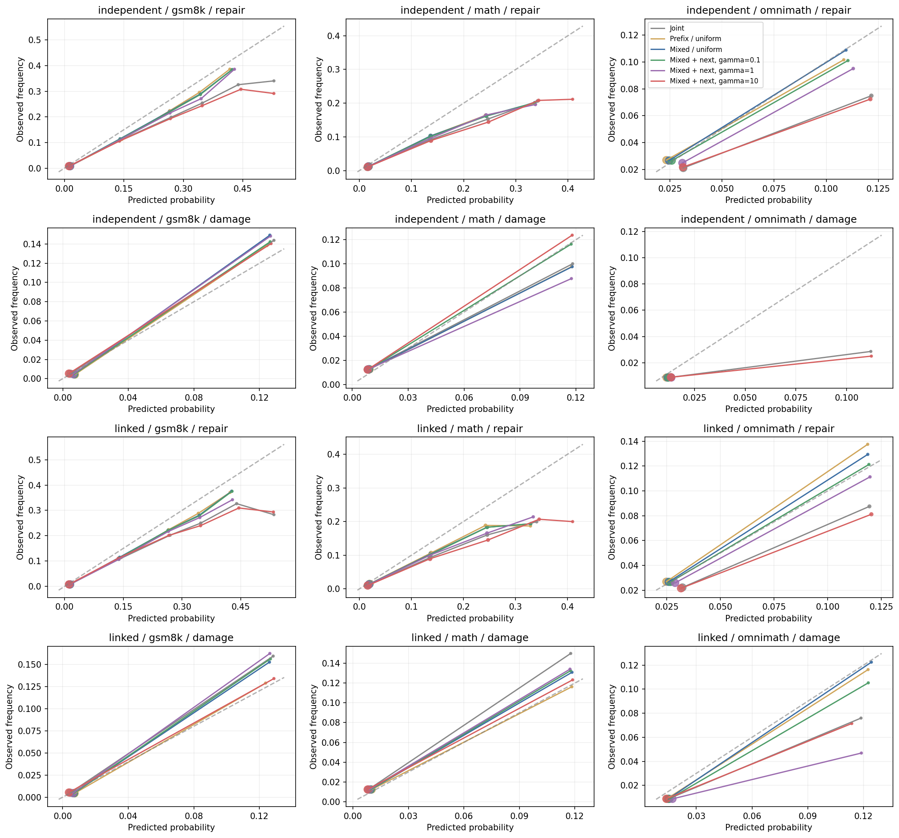
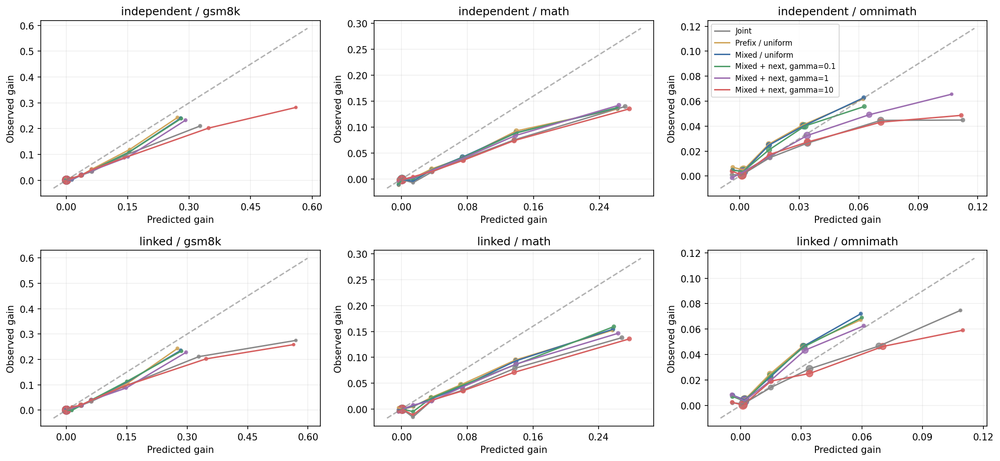

# P1 Mixed + next-answer predictive NLL ablation

이 폴더는 보고서·그림·집계표·학습 선택 기록을 담은 결과 스냅샷입니다.
개별 실행 기록과 상세 예측 배열은 재실행 시 생성됩니다.
파일 범위와 재현 순서는 [P1 안내](../../docs/P1.md)를 참고하세요.

동일한 두 P1 그래프에서 기존 Mixed에 next-answer predictive NLL을 추가했습니다. 9개 cell의 test 결과를 동일 가중 macro로 보고합니다. γ를 test에서 선택하지 않고 모든 사전 고정 arm을 제시합니다.

## 학습 목적과 통제

J=−mean log p(D16,c*)/16, Cw=16개 prefix의 posterior NLL 가중 평균, M=(J+λCw)/(1+λ)입니다. 추가 손실 N=mean(i,t=1..15)[−log p(answer(i,t+1)|D(i,t))]로 두고 L=(M+γN)/(1+γ)+ridge를 학습합니다. γ=0은 기존 Mixed입니다. λ가 달라도 γ가 정규화된 Mixed에 대한 상대 가중치를 뜻하도록 정의했습니다.

λ는 이전 dev-selected Mixed 값을 cell·구조·prefix 가중치별로 그대로 고정했습니다. γ 후보는 [0.1, 1.0, 10.0]이며 모두 별도 arm으로 학습·평가합니다. Posterior 보존 허용폭이나 미래/gain 점수로 γ를 고르는 절차를 추가하지 않았습니다.

N은 latent 정답 c, 성공률 q, 문제별 θ를 적분한 기존 P1의 native 다음 답 분포입니다. Gold c나 posterior 평균을 대입하지 않고 예측 moment를 직접 적분합니다. Valid 전이는 연속 prefix의 marginal evidence 비율과도 일치하는지 교차 검증했습니다. 기존 답/NEW/INVALID categorical target을 사용하며 미래 답은 target에만 쓰고 조건부 입력은 과거 prefix만 씁니다.

N의 학습은 모든 t=1..15, 다음 답 평가는 기존 t=1/2/4/8입니다. 미래 라벨과 관련 없는 단일 답 예측 항이며 정답 라벨을 읽지 않습니다. Invalid 답의 native 확률은 0이고 기존 평가와 같은 1e−12 clipping을 적용하므로 해당 항은 gradient가 없는 상수입니다. 별도의 빈 답 observation model은 추가하지 않았습니다.

파라미터 수는 q 연결 제거형 4개, 유지형 5개입니다. 입력·prior·question-shared θ·q grid·train 질문 6901개 model-question pair·초기값 [0, 43, 44]·σ 초기값 [0.25, 0.75, 1.5]·ridge=6.25e-06·L-BFGS를 유지했습니다. Restart는 penalized train loss로 선택했습니다.

기존 Joint/Prefix/Mixed의 fit과 모든 prediction 배열은 이전 실험에서 그대로 가져왔습니다. Source bank/cohort/evaluation/code hash와 prediction SHA·질문 순서를 검증했습니다. Test 평가 전에 새 fit lock을 저장했습니다.

## Uniform: posterior와 다음 답

모든 loss는 낮을수록 좋습니다. Unique posterior 점수는 bank에 정답 판정 문자열이 최대 하나인 질문에서 계산하며, reference/OTHER/미래 점수는 전체 질문을 사용합니다.

| 구조 | 학습 | Unique NLL | Reference Brier | OTHER Brier | Next-answer NLL |
|---|---|---|---|---|---|
| q 연결 제거 | Joint | 0.5818 | 0.1225 | 0.1345 | 0.5647 |
| q 연결 제거 | Prefix / uniform | 0.5605 | 0.1220 | 0.1345 | 0.5984 |
| q 연결 제거 | Mixed / uniform | 0.5593 | 0.1216 | 0.1338 | 0.5924 |
| q 연결 제거 | Mixed + next, gamma=0.1 | 0.5586 | 0.1212 | 0.1334 | 0.5883 |
| q 연결 제거 | Mixed + next, gamma=1 | 0.5609 | 0.1205 | 0.1327 | 0.5742 |
| q 연결 제거 | Mixed + next, gamma=10 | 0.5945 | 0.1234 | 0.1351 | 0.5645 |
| q 연결 유지 | Joint | 0.5787 | 0.1210 | 0.1333 | 0.5651 |
| q 연결 유지 | Prefix / uniform | 0.5561 | 0.1207 | 0.1321 | 0.5916 |
| q 연결 유지 | Mixed / uniform | 0.5555 | 0.1202 | 0.1313 | 0.5851 |
| q 연결 유지 | Mixed + next, gamma=0.1 | 0.5550 | 0.1198 | 0.1309 | 0.5815 |
| q 연결 유지 | Mixed + next, gamma=1 | 0.5576 | 0.1188 | 0.1304 | 0.5718 |
| q 연결 유지 | Mixed + next, gamma=10 | 0.5976 | 0.1233 | 0.1348 | 0.5644 |

| 구조 | 학습 | Next Brier | Future-correct Brier | Leader-change Brier | Future-reference Brier |
|---|---|---|---|---|---|
| q 연결 제거 | Joint | 0.3160 | 0.1298 | 0.0694 | 0.1298 |
| q 연결 제거 | Prefix / uniform | 0.3398 | 0.1315 | 0.0719 | 0.1318 |
| q 연결 제거 | Mixed / uniform | 0.3358 | 0.1307 | 0.0717 | 0.1311 |
| q 연결 제거 | Mixed + next, gamma=0.1 | 0.3327 | 0.1301 | 0.0716 | 0.1304 |
| q 연결 제거 | Mixed + next, gamma=1 | 0.3223 | 0.1286 | 0.0705 | 0.1285 |
| q 연결 제거 | Mixed + next, gamma=10 | 0.3160 | 0.1303 | 0.0693 | 0.1309 |
| q 연결 유지 | Joint | 0.3162 | 0.1293 | 0.0694 | 0.1290 |
| q 연결 유지 | Prefix / uniform | 0.3352 | 0.1295 | 0.0715 | 0.1306 |
| q 연결 유지 | Mixed / uniform | 0.3308 | 0.1287 | 0.0711 | 0.1298 |
| q 연결 유지 | Mixed + next, gamma=0.1 | 0.3279 | 0.1283 | 0.0709 | 0.1292 |
| q 연결 유지 | Mixed + next, gamma=1 | 0.3204 | 0.1275 | 0.0700 | 0.1278 |
| q 연결 유지 | Mixed + next, gamma=10 | 0.3159 | 0.1302 | 0.0693 | 0.1311 |

## Uniform: repair·damage·gain calibration

평가 prefix=[1, 2, 4, 8, 16], horizon=[1, 2, 4, 8], t+h≤16. 동일한 질문/prefix/seed별 난수, seed 3개 × 256 continuations를 사용했습니다. c,q,θ를 한 번 공동 추출하고 미래 응답 동안 공유합니다. Gain=repair−damage가 finite-draw에서도 성립합니다. Bias는 예측−관측, pp 단위입니다.

| 구조 | 학습 | Repair Brier | Damage Brier | Gain MSE | Repair bias pp | Damage bias pp | Gain bias pp | 평균 절대 cell bias pp |
|---|---|---|---|---|---|---|---|---|
| q 연결 제거 | Joint | 0.02621 | 0.00882 | 0.03695 | 1.480 | 0.001 | 1.478 | 1.478 |
| q 연결 제거 | Prefix / uniform | 0.02575 | 0.00882 | 0.03638 | 0.689 | 0.064 | 0.625 | 1.038 |
| q 연결 제거 | Mixed / uniform | 0.02576 | 0.00882 | 0.03641 | 0.747 | 0.050 | 0.697 | 1.022 |
| q 연결 제거 | Mixed + next, gamma=0.1 | 0.02576 | 0.00882 | 0.03641 | 0.801 | 0.057 | 0.744 | 1.024 |
| q 연결 제거 | Mixed + next, gamma=1 | 0.02585 | 0.00882 | 0.03651 | 1.081 | 0.068 | 1.012 | 1.131 |
| q 연결 제거 | Mixed + next, gamma=10 | 0.02636 | 0.00883 | 0.03718 | 1.497 | -0.035 | 1.532 | 1.532 |
| q 연결 유지 | Joint | 0.02608 | 0.00883 | 0.03684 | 1.369 | 0.057 | 1.311 | 1.351 |
| q 연결 유지 | Prefix / uniform | 0.02562 | 0.00882 | 0.03623 | 0.617 | 0.199 | 0.419 | 0.932 |
| q 연결 유지 | Mixed / uniform | 0.02565 | 0.00882 | 0.03628 | 0.706 | 0.188 | 0.518 | 0.993 |
| q 연결 유지 | Mixed + next, gamma=0.1 | 0.02565 | 0.00883 | 0.03629 | 0.753 | 0.201 | 0.552 | 1.002 |
| q 연결 유지 | Mixed + next, gamma=1 | 0.02572 | 0.00884 | 0.03641 | 0.932 | 0.218 | 0.714 | 1.081 |
| q 연결 유지 | Mixed + next, gamma=10 | 0.02630 | 0.00883 | 0.03715 | 1.493 | -0.027 | 1.520 | 1.520 |

## 해석

q 연결 제거 / uniform γ=1은 Mixed의 macro posterior 개선 중 92.9%를 보존하면서 next-answer NLL을 0.5924 → 0.5742로 바꿉니다. 그러나 gain MSE는 0.03641 → 0.03651, 평균 절대 cell gain bias는 1.022 → 1.131pp입니다. Posterior 보존·다음 답 예측 회복과 Mixed 대비 gain calibration의 추가 개선을 구분해야 합니다.

q 연결 제거 / uniform γ=1의 repair bias는 Mixed의 +0.747 → +1.081pp, damage bias는 +0.050 → +0.068pp입니다. 다음 답 예측이 회복되는 동안 repair 과대예측도 다시 증가했습니다.

q 연결 제거에서는 이번 두 가중치·모든 γ의 macro gain MSE가 각각의 Mixed보다 낮아지지 않았습니다. 희소한 cell별 개선이나 작은 차이를 전체 calibration 해결로 해석하지 않습니다. 질문 단위 CI와 MC 보정/seed 민감도를 함께 봅니다.

q 연결 유지 / uniform γ=1은 Mixed의 macro posterior 개선 중 90.7%를 보존하면서 next-answer NLL을 0.5851 → 0.5718로 바꿉니다. 그러나 gain MSE는 0.03628 → 0.03641, 평균 절대 cell gain bias는 0.993 → 1.081pp입니다. Posterior 보존·다음 답 예측 회복과 Mixed 대비 gain calibration의 추가 개선을 구분해야 합니다.

q 연결 유지 / uniform γ=1의 repair bias는 Mixed의 +0.706 → +0.932pp, damage bias는 +0.188 → +0.218pp입니다. 다음 답 예측이 회복되는 동안 repair 과대예측도 다시 증가했습니다.

q 연결 유지에서는 이번 두 가중치·모든 γ의 macro gain MSE가 각각의 Mixed보다 낮아지지 않았습니다. 희소한 cell별 개선이나 작은 차이를 전체 calibration 해결로 해석하지 않습니다. 질문 단위 CI와 MC 보정/seed 민감도를 함께 봅니다.

## Posterior 개선 보존과 동시 개선

보존율은 macro NLL의 (Joint−새 모델)/(Joint−기존 Mixed)입니다. 100%는 Mixed의 posterior 개선을 모두 보존한 경우이며, 음수는 Joint보다도 나빠진 경우입니다. Cell별 분모가 양수가 아닌 경우의 보존율은 정의하지 않았습니다. 어떠한 비율도 γ 선택 조건으로 사용하지 않았습니다.

세 loss 동시 개선은 unique posterior NLL·next-answer NLL·gain MSE가 해당 reference보다 모두 낮은 cell 수입니다. Signed gain bias의 상쇄를 성공 조건으로 쓰지 않습니다. paired_contrasts.csv에 각 비교의 질문 단위 신뢰구간을 제공합니다.

| 구조 | 가중치 | γ | macro 보존율 % | Posterior<Joint cells | Next<Joint cells | Gain MSE<Joint cells | 세 loss<Joint cells | 세 loss<Mixed cells |
|---|---|---|---|---|---|---|---|---|
| q 연결 제거 | uniform | 0.1 | 103.2 | 9 | 1 | 8 | 1 | 1 |
| q 연결 제거 | uniform | 1.0 | 92.9 | 9 | 1 | 9 | 1 | 1 |
| q 연결 제거 | uniform | 10.0 | -56.7 | 1 | 4 | 2 | 0 | 0 |
| q 연결 제거 | v1 | 0.1 | 97.7 | 9 | 0 | 8 | 0 | 1 |
| q 연결 제거 | v1 | 1.0 | 69.1 | 9 | 0 | 9 | 0 | 0 |
| q 연결 제거 | v1 | 10.0 | -75.5 | 0 | 5 | 2 | 0 | 0 |
| q 연결 유지 | uniform | 0.1 | 102.0 | 9 | 2 | 7 | 2 | 1 |
| q 연결 유지 | uniform | 1.0 | 90.7 | 8 | 3 | 6 | 2 | 2 |
| q 연결 유지 | uniform | 10.0 | -81.4 | 0 | 7 | 1 | 0 | 0 |
| q 연결 유지 | v1 | 0.1 | 98.2 | 9 | 0 | 7 | 0 | 1 |
| q 연결 유지 | v1 | 1.0 | 77.8 | 9 | 1 | 7 | 1 | 0 |
| q 연결 유지 | v1 | 10.0 | -87.1 | 0 | 7 | 0 | 0 | 0 |

## 관찰된 변화

q 연결 제거 / uniform / γ=0.1: Mixed 대비 Δposterior NLL -0.000724, Δnext-answer NLL -0.004072, Δgain MSE +0.000005. Joint 대비 세 loss가 모두 낮은 cell은 1/9개입니다.

q 연결 제거 / uniform / γ=1: Mixed 대비 Δposterior NLL +0.001591, Δnext-answer NLL -0.018172, Δgain MSE +0.000102. Joint 대비 세 loss가 모두 낮은 cell은 1/9개입니다.

q 연결 제거 / uniform / γ=10: Mixed 대비 Δposterior NLL +0.035228, Δnext-answer NLL -0.027905, Δgain MSE +0.000776. Joint 대비 세 loss가 모두 낮은 cell은 0/9개입니다.

q 연결 제거 / v1 / γ=0.1: Mixed 대비 Δposterior NLL +0.000494, Δnext-answer NLL -0.002116, Δgain MSE +0.000016. Joint 대비 세 loss가 모두 낮은 cell은 0/9개입니다.

q 연결 제거 / v1 / γ=1: Mixed 대비 Δposterior NLL +0.006643, Δnext-answer NLL -0.010633, Δgain MSE +0.000141. Joint 대비 세 loss가 모두 낮은 cell은 0/9개입니다.

q 연결 제거 / v1 / γ=10: Mixed 대비 Δposterior NLL +0.037746, Δnext-answer NLL -0.017303, Δgain MSE +0.000783. Joint 대비 세 loss가 모두 낮은 cell은 0/9개입니다.

q 연결 유지 / uniform / γ=0.1: Mixed 대비 Δposterior NLL -0.000466, Δnext-answer NLL -0.003618, Δgain MSE +0.000012. Joint 대비 세 loss가 모두 낮은 cell은 2/9개입니다.

q 연결 유지 / uniform / γ=1: Mixed 대비 Δposterior NLL +0.002168, Δnext-answer NLL -0.013279, Δgain MSE +0.000129. Joint 대비 세 loss가 모두 낮은 cell은 2/9개입니다.

q 연결 유지 / uniform / γ=10: Mixed 대비 Δposterior NLL +0.042168, Δnext-answer NLL -0.020714, Δgain MSE +0.000874. Joint 대비 세 loss가 모두 낮은 cell은 0/9개입니다.

q 연결 유지 / v1 / γ=0.1: Mixed 대비 Δposterior NLL +0.000399, Δnext-answer NLL -0.001581, Δgain MSE +0.000012. Joint 대비 세 loss가 모두 낮은 cell은 0/9개입니다.

q 연결 유지 / v1 / γ=1: Mixed 대비 Δposterior NLL +0.004983, Δnext-answer NLL -0.007044, Δgain MSE +0.000151. Joint 대비 세 loss가 모두 낮은 cell은 1/9개입니다.

q 연결 유지 / v1 / γ=10: Mixed 대비 Δposterior NLL +0.042074, Δnext-answer NLL -0.013489, Δgain MSE +0.000866. Joint 대비 세 loss가 모두 낮은 cell은 0/9개입니다.

## v1 가중치 민감도

| 구조 | 학습 | Unique NLL | Reference Brier | OTHER Brier | Next-answer NLL |
|---|---|---|---|---|---|
| q 연결 제거 | Joint | 0.5818 | 0.1225 | 0.1345 | 0.5647 |
| q 연결 제거 | Prefix / v1 | 0.5606 | 0.1202 | 0.1327 | 0.5854 |
| q 연결 제거 | Mixed / v1 | 0.5603 | 0.1203 | 0.1324 | 0.5816 |
| q 연결 제거 | Mixed + next, gamma=0.1 | 0.5608 | 0.1203 | 0.1324 | 0.5795 |
| q 연결 제거 | Mixed + next, gamma=1 | 0.5669 | 0.1212 | 0.1331 | 0.5710 |
| q 연결 제거 | Mixed + next, gamma=10 | 0.5980 | 0.1241 | 0.1357 | 0.5643 |
| q 연결 유지 | Joint | 0.5787 | 0.1210 | 0.1333 | 0.5651 |
| q 연결 유지 | Prefix / v1 | 0.5565 | 0.1189 | 0.1305 | 0.5810 |
| q 연결 유지 | Mixed / v1 | 0.5562 | 0.1189 | 0.1303 | 0.5778 |
| q 연결 유지 | Mixed + next, gamma=0.1 | 0.5566 | 0.1188 | 0.1303 | 0.5762 |
| q 연결 유지 | Mixed + next, gamma=1 | 0.5612 | 0.1190 | 0.1309 | 0.5707 |
| q 연결 유지 | Mixed + next, gamma=10 | 0.5983 | 0.1243 | 0.1357 | 0.5643 |

| 구조 | 학습 | Repair Brier | Damage Brier | Gain MSE | Repair bias pp | Damage bias pp | Gain bias pp | 평균 절대 cell bias pp |
|---|---|---|---|---|---|---|---|---|
| q 연결 제거 | Joint | 0.02621 | 0.00882 | 0.03695 | 1.480 | 0.001 | 1.478 | 1.478 |
| q 연결 제거 | Prefix / v1 | 0.02583 | 0.00882 | 0.03648 | 0.951 | 0.083 | 0.868 | 1.090 |
| q 연결 제거 | Mixed / v1 | 0.02584 | 0.00882 | 0.03651 | 0.983 | 0.055 | 0.928 | 1.114 |
| q 연결 제거 | Mixed + next, gamma=0.1 | 0.02585 | 0.00882 | 0.03652 | 1.016 | 0.048 | 0.968 | 1.129 |
| q 연결 제거 | Mixed + next, gamma=1 | 0.02596 | 0.00881 | 0.03665 | 1.212 | 0.027 | 1.185 | 1.255 |
| q 연결 제거 | Mixed + next, gamma=10 | 0.02644 | 0.00883 | 0.03729 | 1.532 | -0.049 | 1.581 | 1.581 |
| q 연결 유지 | Joint | 0.02608 | 0.00883 | 0.03684 | 1.369 | 0.057 | 1.311 | 1.351 |
| q 연결 유지 | Prefix / v1 | 0.02570 | 0.00883 | 0.03635 | 0.810 | 0.222 | 0.588 | 1.001 |
| q 연결 유지 | Mixed / v1 | 0.02572 | 0.00883 | 0.03639 | 0.838 | 0.204 | 0.634 | 1.026 |
| q 연결 유지 | Mixed + next, gamma=0.1 | 0.02572 | 0.00883 | 0.03640 | 0.864 | 0.199 | 0.665 | 1.040 |
| q 연결 유지 | Mixed + next, gamma=1 | 0.02583 | 0.00883 | 0.03654 | 1.027 | 0.160 | 0.867 | 1.133 |
| q 연결 유지 | Mixed + next, gamma=10 | 0.02640 | 0.00882 | 0.03725 | 1.544 | -0.045 | 1.588 | 1.588 |

## 수치 검증

Native P1 예측기와 next-answer target 확률 및 gradient를 검증했습니다. 관측 suffix와 gold 라벨을 바꿔 prefix 예측이 오염되지 않는지 확인했습니다. γ=0에서 이전 Mixed 손실과 gradient를 재현합니다. 각 fit은 더 높은 Normal 적분 해상도로 train J/C/N/data loss, dev posterior/next NLL 및 개별 dev posterior/next 확률을 확인했습니다. 최대 허용 오차는 0.001, 이번 선택 해상도의 최대 오차는 0.000167입니다.

모든 frozen reference 배열은 동일하고, summary 최대 차이는 0입니다. Posterior 정규화 오차 3.66e-15, next 정규화 오차 2e-15, gain 항등식 오차 7.63e-17. validation.json에 기록했습니다.

## 그림

Trade-off 그림의 원은 Mixed(γ=0)와 세 predictive 가중치를 잇습니다. 왼쪽 아래일수록 두 loss가 낮습니다. 정사각형은 Joint, 마름모는 Prefix이며, 그림은 cell 동일 가중 macro를 요약합니다.

Calibration 그림은 n≥30 bin을 표시합니다. 점 크기는 상태 수이며 반복 prefix/horizon은 독립 표본이 아닙니다. 전체 희소 bin은 CSV에 남깁니다.

## 범위와 한계

1. 질문 내부 prefix/horizon 평균을 만든 뒤 1,000회 paired question bootstrap을 적용합니다. Macro는 cell 동일 가중 평균이며 pooled CI나 다중비교 유의성 주장을 하지 않습니다. MC seed와 반복 상태를 독립 질문으로 세지 않습니다.

2. 모든 γ를 사전에 고정했고 test 결과를 이용해 γ 또는 λ를 다시 선택하지 않았습니다. 이미 탐색한 기존 bank의 ablation이며 독립 holdout 검증은 아닙니다. λ를 γ와 함께 재탐색하는 실험도 아닙니다.

3. 기존 xVerify 라벨, exact-string 후보, q grid 절단, bounded prior/σ, 빈 답 생성 모델 부재의 한계가 남습니다. Unique-correct train에 맞춘 결과이며 전체 질문의 미래 점수와 unique-only 민감도를 함께 제공합니다.

4. One-step predictive NLL의 개선은 multi-step repair/damage와 stopping 개선을 보장하지 않습니다. MC NLL은 clipping과 zero-probability event에 민감해 Brier/reliability를 우선하며, MC 보정 gain MSE와 seed별 contrast도 제공합니다. 실제 stopping threshold와 토큰 절감은 이번 실험에서 최적화하지 않았습니다.

## 재현

pgm p1-predictive fit --workers 4

pgm p1-predictive run --workers 4

pgm p1-predictive report

configs/p1_predictive.json, protocol.json, selection/*.json에 사전 설정·고정 λ·모든 γ arm·code hash·fit lock을 기록합니다. artifacts/p1_predictive/에 모든 candidate/restart/적분 이력과 큰 prediction 배열을 저장합니다.

summary.csv, macro_summary.csv, dataset_summary.csv, paired_contrasts.csv, paired_macro.csv, posterior_retention.csv, posterior_by_prefix.csv, future_by_horizon.csv, *_calibration.csv, future_unique_summary.csv, training_restarts.csv, parameters.csv, quadrature_checks.csv, selection.csv, mc_seed_sensitivity.csv, mc_seed_contrasts.csv를 제공합니다.
