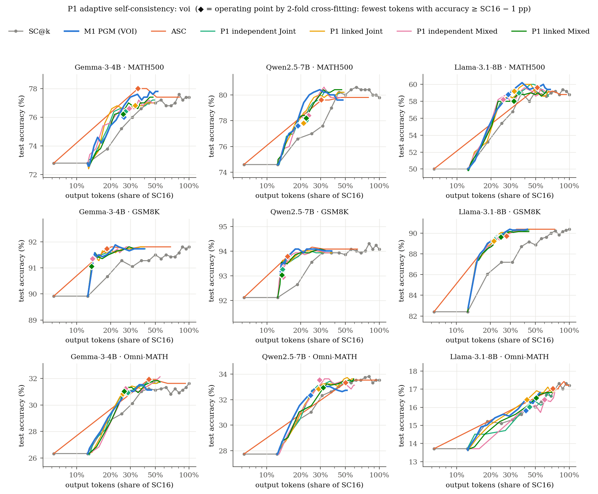
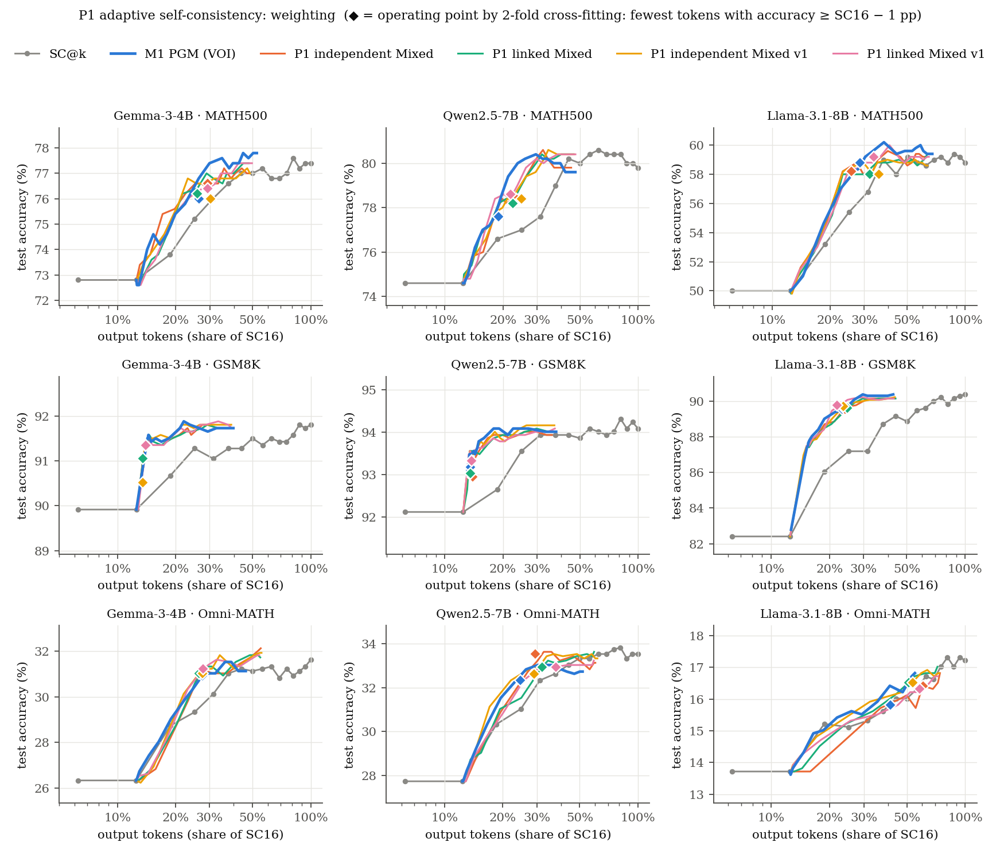
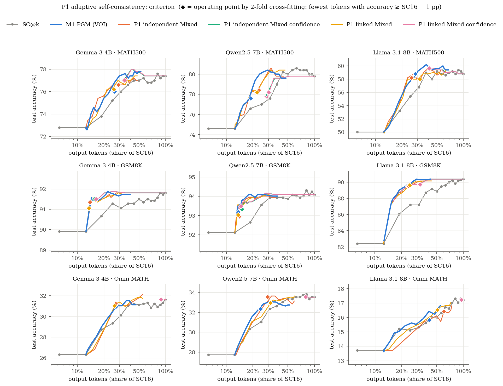

# P1 adaptive self-consistency stopping 결과

이 폴더는 보고서·그림·집계표·학습 선택 기록을 담은 결과 스냅샷입니다.
개별 실행 기록과 상세 예측 배열은 재실행 시 생성됩니다.
파일 범위와 재현 순서는 [P1 안내](../../docs/P1.md)를 참고하세요.

이전 P1 실험은 고정 prefix에서 PGM 자체를 평가했습니다. 이번에는 기존 파라미터를 재학습하지 않고 VOI stopping을 붙여 실제 accuracy–output-token 결과를 평가했습니다. Confidence stopping은 같은 Mixed-uniform posterior의 대조군입니다.

## 핵심 결과

P1 VOI 6개 설정 모두 기존 M1보다 macro frontier가 0.090–0.166 pp 낮았습니다. 현재 결과에서 P1이 M1의 accuracy–token trade-off를 개선했다고 보기 어렵습니다. Frontier는 test oracle 점추정이며 유의성 검정값은 아닙니다.

q independent Mixed-uniform VOI는 M1 대비 CF accuracy +0.297 pp, SC16 token share +3.30 pp입니다. 같은 구조의 Joint 대비 frontier는 -0.023 pp로, 이전 posterior NLL 개선이 stopping 성능의 일관된 개선으로 이어지지 않았습니다.

같은 independent Mixed posterior의 confidence control은 VOI보다 CF token share가 +20.62 pp 높고 frontier는 -1.440 pp 낮습니다. CF accuracy는 +0.387 pp 높으므로 이 operating point를 동일 정확도 비교로 해석하지 않습니다.

q linked Mixed-uniform VOI는 M1 대비 CF accuracy +0.114 pp, SC16 token share +2.64 pp입니다. 같은 구조의 Joint 대비 frontier는 -0.076 pp로, 이전 posterior NLL 개선이 stopping 성능의 일관된 개선으로 이어지지 않았습니다.

같은 linked Mixed posterior의 confidence control은 VOI보다 CF token share가 +21.38 pp 높고 frontier는 -1.432 pp 낮습니다. CF accuracy는 +0.587 pp 높으므로 이 operating point를 동일 정확도 비교로 해석하지 않습니다.

## 비교와 프로토콜

q 연결 제거/유지 각각 Joint·Mixed uniform·Mixed v1의 6개 고정 head에 VOI를 적용하고, Mixed uniform의 confidence 대조군 2개를 더했습니다. 기존 dev-selected 학습 λ와 파라미터 수 4/5개를 유지하며 stopping 결과로 학습 head를 고르지 않았습니다.

README와 docs/PROTOCOL.md의 Python plugin 경로를 사용했습니다. `pgm v2 method --plugin examples/p1_stopping.py`가 기존 `score_families`를 그대로 호출하고, 기존 M1·SC와 함께 새 method JSON을 생성합니다. M1/ASC/ESC/ReASC와 bank·응답 순서·정답 판정·출력 토큰 비용 정의가 같습니다.

최소 2개·최대 16개 응답, 기존 λ 19개와 γ 20개를 그대로 사용했습니다. VOI는 기존처럼 48회 MC, seed=20261116, horizon=[1, 2, 4, 8, 16] 및 남은 cap입니다. VOI=max(0,max_h (E[A(t+h)]−A(t))/h)이며 추가 응답당 이득입니다. 출력 토큰당 VOI로 바꾸지 않았습니다.

현재·미래 답은 v2의 plurality와 posterior tie-break이고, 새 미래 답을 얻은 뒤 P1 posterior를 다시 계산한 confidence를 평균합니다. c,q,θ는 continuation마다 한 번 뽑아 유지합니다. P1 arm 사이에는 같은 난수를 사용합니다.

Primary operating point는 test 2-fold cross-fitting(seed=20261117)으로 선택한 SC16−1 pp matched accuracy입니다. Dev 선택과 20/30/50% 예산도 보고합니다. Frontier는 SC@2–SC16 사이 60개 예산에서의 test oracle curve 요약이며 독립 검증 성능으로 해석하지 않습니다.

Paired bootstrap은 질문 단위 10,000회, seed=20261116와 exact McNemar입니다. JSON의 공식 contrast는 M1−P1이고, paired_vs_m1.csv는 읽기 쉽게 P1−M1 및 P1/M1 token ratio로 뒤집었습니다. Macro는 9개 cell 동일 가중 기술통계로 pooled 유의성을 주장하지 않습니다.

## Macro: cross-fitted matched accuracy

| 학습·기준 | Frontier % | CF accuracy % | CF tokens / SC16 % | CF samples |
|---|---|---|---|---|
| SC@k | 62.886 | 63.094 | 40.32 | 6.444 |
| M1 VOI | 63.515 | 62.839 | 24.25 | 3.586 |
| ASC | 62.377 | 63.855 | 38.36 | 5.363 |
| ESC | 62.264 | 63.774 | 40.70 | 5.661 |
| ReASC off | 62.437 | 62.866 | 35.51 | 4.994 |
| ReASC on | 62.501 | 63.248 | 37.54 | 5.247 |
| P1 independent Joint | 63.382 | 63.031 | 26.22 | 3.772 |
| P1 linked Joint | 63.425 | 63.055 | 25.89 | 3.748 |
| P1 independent Mixed | 63.359 | 63.136 | 27.55 | 4.024 |
| P1 linked Mixed | 63.349 | 62.953 | 26.89 | 3.928 |

## 학습 가중치·stopping criterion 민감도

| 학습·기준 | Frontier % | CF accuracy % | CF tokens / SC16 % | CF samples |
|---|---|---|---|---|
| M1 VOI | 63.515 | 62.839 | 24.25 | 3.586 |
| P1 independent Joint | 63.382 | 63.031 | 26.22 | 3.772 |
| P1 linked Joint | 63.425 | 63.055 | 25.89 | 3.748 |
| P1 independent Mixed | 63.359 | 63.136 | 27.55 | 4.024 |
| P1 linked Mixed | 63.349 | 62.953 | 26.89 | 3.928 |
| P1 independent Mixed v1 | 63.389 | 62.902 | 28.01 | 4.061 |
| P1 linked Mixed v1 | 63.388 | 63.237 | 28.70 | 4.197 |
| P1 independent Mixed confidence | 61.919 | 63.523 | 48.17 | 6.956 |
| P1 linked Mixed confidence | 61.917 | 63.540 | 48.26 | 6.958 |

## Cell별 matched accuracy

각 값은 accuracy (%) / 평균 출력 토큰입니다. 선택 fold에서의 SC16−1 pp 조건은 held-out fold의 정확도 보장이 아닙니다.

| 모델 | 데이터 | SC16 % | M1 VOI | ASC | P1 independent Joint | P1 linked Joint | P1 independent Mixed | P1 linked Mixed |
|---|---|---|---|---|---|---|---|---|
| gemma4b | math | 77.4 | 76.0 / 3130 | 78.0 / 4161 | 76.4 / 3235 | 76.8 / 3935 | 76.6 / 3481 | 76.2 / 3075 |
| gemma4b | gsm8k | 91.8 | 91.4 / 1003 | 91.7 / 1325 | 91.4 / 988 | 91.4 / 985 | 91.4 / 993 | 91.1 / 968 |
| gemma4b | omnimath | 31.6 | 30.9 / 5922 | 31.9 / 9456 | 30.9 / 6148 | 30.8 / 5557 | 31.2 / 5889 | 31.0 / 5717 |
| qwen7b | math | 79.8 | 77.6 / 1724 | 79.6 / 2789 | 78.0 / 2038 | 77.8 / 1936 | 78.4 / 2137 | 78.2 / 2048 |
| qwen7b | gsm8k | 94.1 | 93.2 / 631 | 93.8 / 707 | 93.3 / 639 | 93.0 / 638 | 92.9 / 649 | 93.0 / 630 |
| qwen7b | omnimath | 33.5 | 32.3 / 3238 | 33.3 / 6618 | 32.9 / 3724 | 32.8 / 3822 | 33.5 / 3892 | 32.9 / 4198 |
| llama8b | math | 58.8 | 58.8 / 2202 | 59.6 / 3997 | 59.0 / 2746 | 59.2 / 2501 | 58.2 / 1984 | 58.0 / 2475 |
| llama8b | gsm8k | 90.4 | 89.5 / 674 | 89.7 / 803 | 89.4 / 628 | 89.2 / 622 | 89.5 / 693 | 89.6 / 714 |
| llama8b | omnimath | 17.2 | 15.8 / 6982 | 17.0 / 12171 | 16.0 / 7529 | 16.4 / 7146 | 16.4 / 10255 | 16.5 / 8656 |

## Dev에서 선택한 operating point

| 모델 | 데이터 | SC16 % | M1 VOI | P1 independent Joint | P1 linked Joint | P1 independent Mixed | P1 linked Mixed |
|---|---|---|---|---|---|---|---|
| gemma4b | math | 77.4 | 76.8 / 3117 | 76.4 / 2538 | 76.6 / 2429 | 76.2 / 2661 | 76.4 / 3064 |
| gemma4b | gsm8k | 91.8 | 91.4 / 1068 | 91.4 / 1125 | 91.7 / 1207 | 91.5 / 1098 | 91.4 / 1097 |
| gemma4b | omnimath | 31.6 | 30.3 / 5279 | 31.8 / 9435 | 31.6 / 10966 | 31.0 / 7952 | 31.5 / 8808 |
| qwen7b | math | 79.8 | 80.0 / 2171 | 78.4 / 1844 | 78.2 / 1816 | 78.4 / 1802 | 78.4 / 1896 |
| qwen7b | gsm8k | 94.1 | 93.1 / 607 | 93.5 / 622 | 93.5 / 622 | 93.3 / 617 | 92.6 / 606 |
| qwen7b | omnimath | 33.5 | 32.8 / 3474 | 33.4 / 7414 | 33.5 / 7280 | 33.4 / 6115 | 33.2 / 5585 |
| llama8b | math | 58.8 | 60.2 / 2923 | 59.0 / 2758 | 58.6 / 2539 | 58.0 / 2288 | 58.8 / 3853 |
| llama8b | gsm8k | 90.4 | 87.4 / 442 | 87.9 / 492 | 87.6 / 468 | 87.7 / 464 | 87.6 / 467 |
| llama8b | omnimath | 17.2 | 15.9 / 5969 | 16.0 / 6999 | 15.6 / 4692 | 16.0 / 7888 | 16.1 / 7342 |

## 관측된 차이

P1 independent Joint: M1 대비 macro frontier -0.132 pp (2/9 cell 증가), cross-fitted accuracy +0.192 pp, SC16 token share +1.97 pp. 개별 paired accuracy CI가 0보다 높은/낮은 cell은 0/0개입니다.

P1 independent Mixed: M1 대비 macro frontier -0.155 pp (3/9 cell 증가), cross-fitted accuracy +0.297 pp, SC16 token share +3.30 pp. 개별 paired accuracy CI가 0보다 높은/낮은 cell은 1/0개입니다.

P1 independent Mixed confidence: M1 대비 macro frontier -1.596 pp (1/9 cell 증가), cross-fitted accuracy +0.684 pp, SC16 token share +23.92 pp. 개별 paired accuracy CI가 0보다 높은/낮은 cell은 1/0개입니다.

P1 independent Mixed v1: M1 대비 macro frontier -0.125 pp (3/9 cell 증가), cross-fitted accuracy +0.063 pp, SC16 token share +3.77 pp. 개별 paired accuracy CI가 0보다 높은/낮은 cell은 0/1개입니다.

P1 linked Joint: M1 대비 macro frontier -0.090 pp (3/9 cell 증가), cross-fitted accuracy +0.216 pp, SC16 token share +1.65 pp. 개별 paired accuracy CI가 0보다 높은/낮은 cell은 0/0개입니다.

P1 linked Mixed: M1 대비 macro frontier -0.166 pp (2/9 cell 증가), cross-fitted accuracy +0.114 pp, SC16 token share +2.64 pp. 개별 paired accuracy CI가 0보다 높은/낮은 cell은 0/0개입니다.

P1 linked Mixed confidence: M1 대비 macro frontier -1.598 pp (1/9 cell 증가), cross-fitted accuracy +0.701 pp, SC16 token share +24.02 pp. 개별 paired accuracy CI가 0보다 높은/낮은 cell은 1/0개입니다.

P1 linked Mixed v1: M1 대비 macro frontier -0.127 pp (1/9 cell 증가), cross-fitted accuracy +0.398 pp, SC16 token share +4.45 pp. 개별 paired accuracy CI가 0보다 높은/낮은 cell은 0/0개입니다.

## 고정 예산 결과

### CF budget 0.2

| 학습·기준 | Frontier % | CF accuracy % | CF tokens / SC16 % | CF samples |
|---|---|---|---|---|
| SC@k | 62.886 | 60.712 | 18.04 | 2.889 |
| M1 VOI | 63.515 | 61.844 | 17.98 | 2.704 |
| ASC | 62.377 | 59.233 | 8.62 | 1.316 |
| ESC | 62.264 | 63.662 | 38.28 | 5.325 |
| ReASC off | 62.437 | 59.856 | 9.18 | 1.335 |
| ReASC on | 62.501 | 59.991 | 9.71 | 1.415 |
| P1 independent Joint | 63.382 | 61.457 | 17.67 | 2.634 |
| P1 linked Joint | 63.425 | 61.568 | 17.99 | 2.691 |
| P1 independent Mixed | 63.359 | 61.174 | 17.16 | 2.575 |
| P1 linked Mixed | 63.349 | 61.602 | 18.42 | 2.765 |

### CF budget 0.3

| 학습·기준 | Frontier % | CF accuracy % | CF tokens / SC16 % | CF samples |
|---|---|---|---|---|
| SC@k | 62.886 | 61.600 | 23.96 | 3.833 |
| M1 VOI | 63.515 | 63.268 | 25.72 | 3.753 |
| ASC | 62.377 | 60.392 | 13.70 | 1.978 |
| ESC | 62.264 | 63.738 | 39.39 | 5.489 |
| ReASC off | 62.437 | 61.529 | 16.50 | 2.230 |
| ReASC on | 62.501 | 60.626 | 14.29 | 1.987 |
| P1 independent Joint | 63.382 | 63.000 | 24.81 | 3.567 |
| P1 linked Joint | 63.425 | 63.237 | 24.61 | 3.566 |
| P1 independent Mixed | 63.359 | 63.009 | 24.09 | 3.481 |
| P1 linked Mixed | 63.349 | 62.854 | 25.07 | 3.656 |

### CF budget 0.5

| 학습·기준 | Frontier % | CF accuracy % | CF tokens / SC16 % | CF samples |
|---|---|---|---|---|
| SC@k | 62.886 | 63.250 | 41.70 | 6.667 |
| M1 VOI | 63.515 | 63.643 | 32.73 | 4.751 |
| ASC | 62.377 | 62.788 | 31.05 | 4.311 |
| ESC | 62.264 | 63.847 | 42.67 | 5.951 |
| ReASC off | 62.437 | 62.708 | 32.11 | 4.459 |
| ReASC on | 62.501 | 62.982 | 32.93 | 4.497 |
| P1 independent Joint | 63.382 | 63.334 | 35.14 | 5.100 |
| P1 linked Joint | 63.425 | 63.599 | 36.07 | 5.209 |
| P1 independent Mixed | 63.359 | 63.399 | 33.14 | 4.773 |
| P1 linked Mixed | 63.349 | 63.457 | 35.59 | 5.184 |

## 그림

x축은 SC16 대비 출력 토큰 비율(log), y축은 test accuracy입니다. 회색 SC@k, ◆는 cross-fitted matched-accuracy point이며 색·축·frontier는 기존 plotting 함수를 사용합니다.







## 검증

고정 M1/SC의 재평가 최대 차이=0. Native P1 posterior와 count lookup의 최대 차이=4.44e-15. 16개 응답 내 모든 유효 sufficient state의 coarse/fine log evidence 최대 차이=0.000526. 파라미터·적분 해상도를 test 관측 전에 lock하고 source fit/bank/code/trace hash를 저장했습니다.

새 구현은 반복 적분을 count sufficient-state lookup으로 바꿉니다. P1을 M1로 축소했을 때 기존 MC VOI와 일치하는지, native P1 posterior·미래 count 상태·label/suffix 격리·chunk 무관성·최소/최대 응답 수·strict VOI threshold·캐시 재사용을 검증했습니다.

## 재현 커맨드

```bash
pgm p1-stop trace --workers 4
pgm v2 method --plugin examples/p1_stopping.py
pgm v2 report --methods p1_independent_joint p1_linked_joint p1_independent_mixed p1_linked_mixed
pgm v2 plot --methods M1 asc p1_independent_joint p1_linked_joint p1_independent_mixed p1_linked_mixed --out results/p1_stopping/figures/voi
pgm p1-stop report
```

추가 그림도 같은 `pgm v2 plot`을 사용합니다. `weighting`의 methods: M1 p1_independent_mixed p1_linked_mixed p1_independent_mixed_v1 p1_linked_mixed_v1. `criterion`의 methods: M1 p1_independent_mixed p1_independent_mixed_confidence p1_linked_mixed p1_linked_mixed_confidence. `pgm p1-stop report`는 이 3개 그림을 PNG/SVG로 재생성합니다.

## 범위와 한계

이미 반복해서 탐색한 기존 bank에서의 비교입니다. 학습 목적·q 연결·prefix 가중치를 test에서 골라 단일 최적 모델로 보고하지 않았습니다. Mixed의 posterior 개선이 stopping 성능으로 이어지는지 별도 평가축에서 확인하며, 새 holdout 검증은 별도로 필요합니다.

기존 exact-string 후보·xVerify 판정, 최대 16개 응답, 48 MC의 VOI 추정 오차, P1의 q/Normal 적분·bounded prior와 invalid 응답 생성 모델 부재가 남습니다. PGM 계산 시간·입력 토큰·특징 추출 비용은 출력 토큰 지표에 포함하지 않습니다.

결과 파일: operating_points.csv(전체 선택 규칙), frontier.csv, macro_summary.csv, paired_vs_m1.csv, numerical_checks.csv, validation.json. 표준 method JSON은 results/v2/methods/p1_*/ 에 있습니다.
