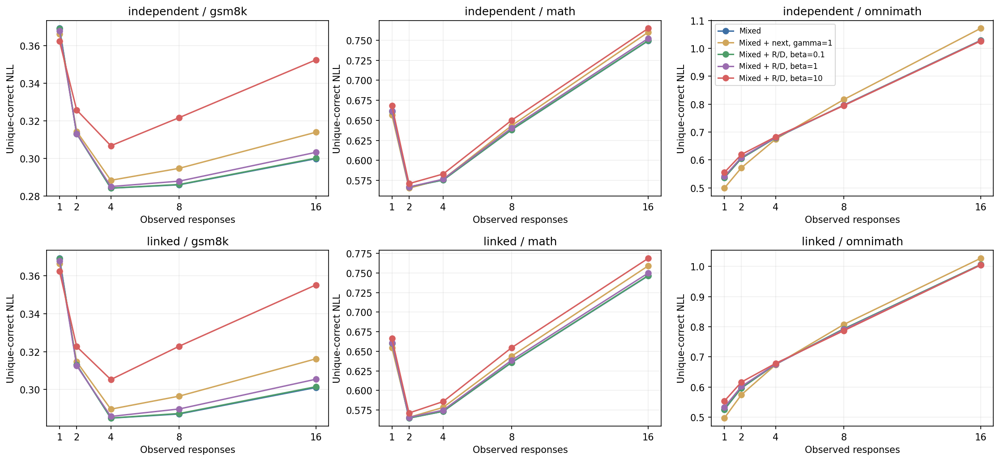
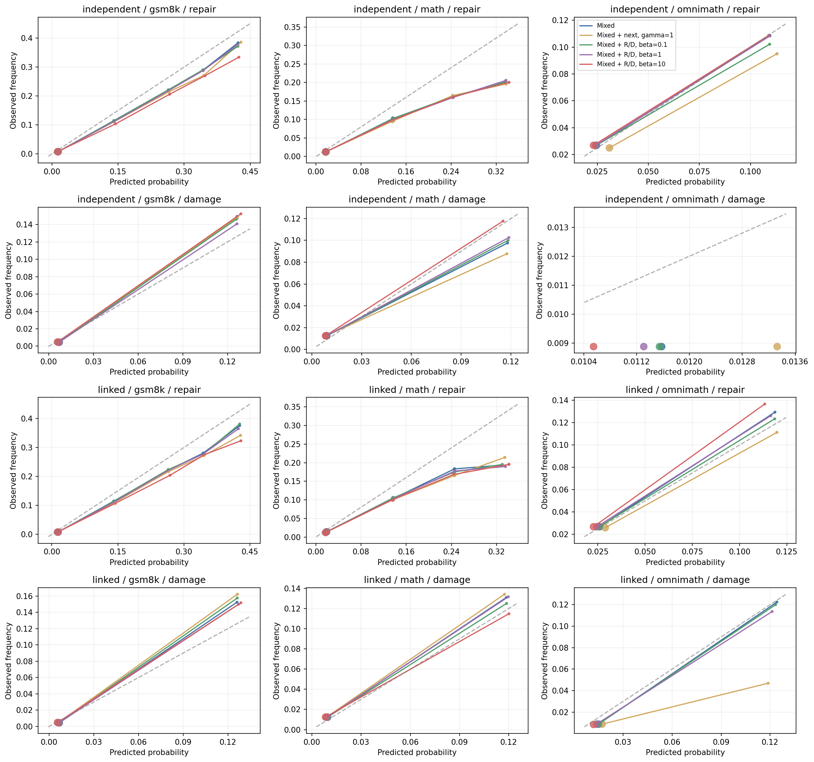
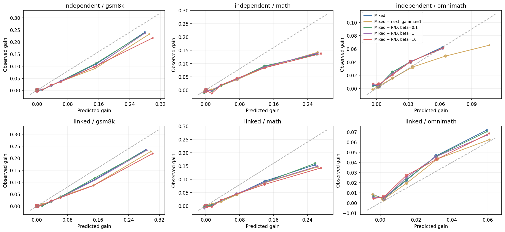

# P1 Mixed + multi-step repair/damage 학습 ablation

이 폴더는 보고서·그림·집계표·학습 선택 기록을 담은 결과 스냅샷입니다.
개별 실행 기록과 상세 예측 배열은 재실행 시 생성됩니다.
파일 범위와 재현 순서는 [P1 안내](../../docs/P1.md)를 참고하세요.

기존 P1의 4/5개 파라미터와 입력을 유지하고, Mixed에 multi-step 전이 손실을 추가했습니다. 9개 cell의 test 결과를 동일 가중 macro로 보고합니다. 고정 β arm을 모두 평가하며 test에서 계수를 고르지 않습니다.

## 학습 목적

M=(J+λCw)/(1+λ), T=mean[−log p(실제 전이|Dt)], L=(M+βT)/(1+β)+ridge입니다. 전이는 repair(오답→정답), damage(정답→오답), stay(정오 변화 없음)의 서로 배타적인 세 class입니다. p=(r,d,1−r−d)이며 class balancing 없이 proper categorical NLL을 사용합니다. β=0은 기존 Mixed입니다.

λ는 이전 Mixed의 dev 선택 값을 고정했습니다. β=[0.1, 1.0, 10.0]를 모두 학습·평가합니다. Prefix=[1, 2, 4, 8], horizon=[1, 2, 4, 8], t+h≤16의 모든 쌍에 같은 가중치를 주고 질문 안에서 먼저 평균합니다. Uniform/v1은 기존 posterior prefix 가중치의 별도 ablation이며 T의 가중치는 같습니다.

r,d는 현재 정답 여부나 gold c를 알려준 조건부 확률이 아닙니다. 과거 답만 조건으로 c,q,θ를 모두 적분한 native P1 예측입니다. 실제 현재/미래 정오는 train target과 평가에만 씁니다. 미래 답 내용은 예측 입력에 들어가지 않습니다.

고정 unique-correct train 6901개 model-question pair, 공통 초기값 [0, 43, 44], σ 초기값 [0.25, 0.75, 1.5], raw ridge=6.25e-06, L-BFGS 및 기존 q/Normal 적분 설정을 유지합니다. Optimizer restart는 penalized train loss로 고릅니다. β를 dev/test posterior나 gain으로 선택하지 않습니다.

## 정확 전이 확률과 검증

Correct-answer hypothesis별로 미래 correct 횟수와 CRP wrong partition을 합산합니다. 관측된 정답 후보는 먼저 등장한 오답과 나중 오답의 tie cap을 나눕니다. 아직 보지 못한 정답은 같은 최종 크기의 새 오답 그룹 r개와 동점일 때 먼저 나타날 확률 1/(r+1)을 반영합니다. Truncated generating function으로 경로를 합한 뒤, q·θ와 prefix posterior를 같은 P1 적분으로 주변화합니다. θ는 continuation 전체에 공유됩니다.

확률 및 gradient는 완전 경로 열거(h≤3), 별도의 정확 동적계획법(h=8), native simulator(h=8), 기존 posterior × conditional kernel 적분, finite difference로 확인했습니다. 같은 count/first-order prefix는 계산을 공유합니다. 새 latent/head/temperature를 추가하지 않습니다.

## Uniform: posterior와 다음 답 예측

모든 loss는 낮을수록 좋습니다. 기존 Mixed와 next-answer 추가 모델의 파라미터·예측은 그대로 재사용했습니다. Next comparator는 사전에 고정한 γ=1이며 나머지 이전 γ도 CSV에 보존합니다.

| 구조 | 학습 | Unique NLL | Reference Brier | OTHER Brier | Next-answer NLL |
|---|---|---|---|---|---|
| q 연결 제거 | Mixed | 0.5593 | 0.1216 | 0.1338 | 0.5924 |
| q 연결 제거 | Mixed + next, gamma=1 | 0.5609 | 0.1205 | 0.1327 | 0.5742 |
| q 연결 제거 | Mixed + R/D, beta=0.1 | 0.5594 | 0.1217 | 0.1339 | 0.5926 |
| q 연결 제거 | Mixed + R/D, beta=1 | 0.5606 | 0.1220 | 0.1341 | 0.5941 |
| q 연결 제거 | Mixed + R/D, beta=10 | 0.5723 | 0.1236 | 0.1355 | 0.6010 |
| q 연결 유지 | Mixed | 0.5555 | 0.1202 | 0.1313 | 0.5851 |
| q 연결 유지 | Mixed + next, gamma=1 | 0.5576 | 0.1188 | 0.1304 | 0.5718 |
| q 연결 유지 | Mixed + R/D, beta=0.1 | 0.5556 | 0.1203 | 0.1314 | 0.5854 |
| q 연결 유지 | Mixed + R/D, beta=1 | 0.5571 | 0.1209 | 0.1319 | 0.5883 |
| q 연결 유지 | Mixed + R/D, beta=10 | 0.5703 | 0.1229 | 0.1337 | 0.5980 |

## Uniform: 같은 paired MC로 평가

기존과 같은 seed 3개 × 256 continuations입니다. 같은 질문/prefix/seed 난수와 고정 plurality·최초 등장 tie-break를 사용합니다. Finite-draw gain=repair−damage입니다. Bias는 예측−관측, pp 단위입니다.

| 구조 | 학습 | Repair Brier | Damage Brier | Gain MSE | Repair bias pp | Damage bias pp | Gain bias pp | 전이 NLL |
|---|---|---|---|---|---|---|---|---|
| q 연결 제거 | Mixed | 0.02576 | 0.00882 | 0.03641 | 0.747 | 0.050 | 0.697 | 0.1448 |
| q 연결 제거 | Mixed + next, gamma=1 | 0.02585 | 0.00882 | 0.03651 | 1.081 | 0.068 | 1.012 | 0.1445 |
| q 연결 제거 | Mixed + R/D, beta=0.1 | 0.02577 | 0.00882 | 0.03642 | 0.747 | 0.048 | 0.698 | 0.1448 |
| q 연결 제거 | Mixed + R/D, beta=1 | 0.02578 | 0.00881 | 0.03644 | 0.739 | 0.031 | 0.708 | 0.1445 |
| q 연결 제거 | Mixed + R/D, beta=10 | 0.02589 | 0.00881 | 0.03662 | 0.718 | -0.057 | 0.775 | 0.1455 |
| q 연결 유지 | Mixed | 0.02565 | 0.00882 | 0.03628 | 0.706 | 0.188 | 0.518 | 0.1433 |
| q 연결 유지 | Mixed + next, gamma=1 | 0.02572 | 0.00884 | 0.03641 | 0.932 | 0.218 | 0.714 | 0.1437 |
| q 연결 유지 | Mixed + R/D, beta=0.1 | 0.02566 | 0.00882 | 0.03629 | 0.706 | 0.182 | 0.524 | 0.1430 |
| q 연결 유지 | Mixed + R/D, beta=1 | 0.02570 | 0.00881 | 0.03636 | 0.698 | 0.131 | 0.567 | 0.1428 |
| q 연결 유지 | Mixed + R/D, beta=10 | 0.02586 | 0.00882 | 0.03665 | 0.699 | -0.011 | 0.709 | 0.1447 |

## Exact-event 민감도

아래 표는 학습과 같은 정확 적분으로 repair/damage와 gain을 계산합니다. MC noise가 없는 동일 모델의 보조 비교이며 주 paired-MC 결과를 대체하지 않습니다. MC 전이 NLL은 0-probability clipping에 민감할 수 있어 exact NLL을 함께 봅니다.

| 구조 | 학습 | Repair Brier | Damage Brier | Gain MSE | Repair bias pp | Damage bias pp | Gain bias pp | 전이 NLL |
|---|---|---|---|---|---|---|---|---|
| q 연결 제거 | Mixed | 0.02567 | 0.00880 | 0.03629 | 0.751 | 0.050 | 0.701 | 0.1420 |
| q 연결 제거 | Mixed + next, gamma=1 | 0.02576 | 0.00880 | 0.03639 | 1.082 | 0.069 | 1.014 | 0.1422 |
| q 연결 제거 | Mixed + R/D, beta=0.1 | 0.02567 | 0.00880 | 0.03630 | 0.750 | 0.048 | 0.702 | 0.1420 |
| q 연결 제거 | Mixed + R/D, beta=1 | 0.02569 | 0.00880 | 0.03632 | 0.743 | 0.032 | 0.711 | 0.1421 |
| q 연결 제거 | Mixed + R/D, beta=10 | 0.02581 | 0.00881 | 0.03653 | 0.721 | -0.057 | 0.778 | 0.1423 |
| q 연결 유지 | Mixed | 0.02558 | 0.00881 | 0.03621 | 0.708 | 0.188 | 0.520 | 0.1418 |
| q 연결 유지 | Mixed + next, gamma=1 | 0.02566 | 0.00883 | 0.03634 | 0.933 | 0.217 | 0.716 | 0.1421 |
| q 연결 유지 | Mixed + R/D, beta=0.1 | 0.02559 | 0.00881 | 0.03622 | 0.708 | 0.182 | 0.527 | 0.1418 |
| q 연결 유지 | Mixed + R/D, beta=1 | 0.02563 | 0.00880 | 0.03628 | 0.701 | 0.132 | 0.569 | 0.1417 |
| q 연결 유지 | Mixed + R/D, beta=10 | 0.02579 | 0.00880 | 0.03655 | 0.701 | -0.010 | 0.711 | 0.1419 |

## 해석

q 연결 제거 / uniform β=1은 Mixed의 posterior 개선을 94.4% 보존합니다. MC gain MSE는 next γ=1의 0.03651보다 낮은 0.03644지만, Mixed의 0.03641보다 낮지는 않습니다. Exact gain MSE도 0.03629 → 0.03632로 같은 방향입니다.

q 연결 제거 / uniform β=1의 exact repair bias는 Mixed +0.751 → +0.743pp, damage bias는 +0.050 → +0.032pp입니다. Gain bias는 +0.701 → +0.711pp입니다. Repair 과대예측이 거의 남은 채 damage 과대예측을 줄이면, 두 오차의 상쇄가 줄어 gain bias가 커질 수 있습니다.

q 연결 제거의 두 prefix 가중치·모든 β에서 MC 및 exact macro gain MSE가 Mixed보다 낮아지지 않았습니다. 이 실험 범위에서는 전이 NLL을 직접 추가해도 gain calibration의 일관된 추가 개선은 확인되지 않았습니다. 약한 arm의 차이가 작다는 점과 cell별 신뢰구간을 함께 해석해야 합니다.

q 연결 유지 / uniform β=1은 Mixed의 posterior 개선을 92.9% 보존합니다. MC gain MSE는 next γ=1의 0.03641보다 낮은 0.03636지만, Mixed의 0.03628보다 낮지는 않습니다. Exact gain MSE도 0.03621 → 0.03628로 같은 방향입니다.

q 연결 유지 / uniform β=1의 exact repair bias는 Mixed +0.708 → +0.701pp, damage bias는 +0.188 → +0.132pp입니다. Gain bias는 +0.520 → +0.569pp입니다. Repair 과대예측이 거의 남은 채 damage 과대예측을 줄이면, 두 오차의 상쇄가 줄어 gain bias가 커질 수 있습니다.

q 연결 유지의 두 prefix 가중치·모든 β에서 MC 및 exact macro gain MSE가 Mixed보다 낮아지지 않았습니다. 이 실험 범위에서는 전이 NLL을 직접 추가해도 gain calibration의 일관된 추가 개선은 확인되지 않았습니다. 약한 arm의 차이가 작다는 점과 cell별 신뢰구간을 함께 해석해야 합니다.

## Posterior 개선 보존과 cell별 일관성

보존율=(Joint macro NLL−새 모델 macro NLL)/(Joint macro NLL−Mixed macro NLL)입니다. 100%는 Mixed의 posterior 개선을 모두 보존한 경우이며, 보존율은 계수 선택에 사용하지 않습니다.

| 구조 | 가중치 | β | macro 보존율 % | Posterior<Mixed cells | MC gain<Mixed cells | Exact gain<Mixed cells |
|---|---|---|---|---|---|---|
| q 연결 제거 | uniform | 0.1 | 99.5 | 0 | 3 | 2 |
| q 연결 제거 | uniform | 1.0 | 94.4 | 0 | 3 | 2 |
| q 연결 제거 | uniform | 10.0 | 42.1 | 0 | 2 | 2 |
| q 연결 제거 | v1 | 0.1 | 99.4 | 2 | 2 | 3 |
| q 연결 제거 | v1 | 1.0 | 94.1 | 2 | 3 | 3 |
| q 연결 제거 | v1 | 10.0 | 39.3 | 0 | 3 | 3 |
| q 연결 유지 | uniform | 0.1 | 99.4 | 2 | 2 | 3 |
| q 연결 유지 | uniform | 1.0 | 92.9 | 0 | 4 | 3 |
| q 연결 유지 | uniform | 10.0 | 36.0 | 0 | 2 | 4 |
| q 연결 유지 | v1 | 0.1 | 99.3 | 2 | 2 | 3 |
| q 연결 유지 | v1 | 1.0 | 93.3 | 1 | 4 | 3 |
| q 연결 유지 | v1 | 10.0 | 39.8 | 0 | 3 | 3 |

## 관찰된 변화

q 연결 제거 / uniform / β=0.1: Mixed 대비 Δposterior NLL +0.000120, ΔMC gain MSE +0.000009, Δexact gain MSE +0.000003. MC/exact gain 개선 cell은 각각 3/9, 2/9개입니다. 고정 next γ=1 대비 ΔMC gain MSE=-0.000093.

q 연결 제거 / uniform / β=1: Mixed 대비 Δposterior NLL +0.001259, ΔMC gain MSE +0.000030, Δexact gain MSE +0.000029. MC/exact gain 개선 cell은 각각 3/9, 2/9개입니다. 고정 next γ=1 대비 ΔMC gain MSE=-0.000072.

q 연결 제거 / uniform / β=10: Mixed 대비 Δposterior NLL +0.013031, ΔMC gain MSE +0.000217, Δexact gain MSE +0.000232. MC/exact gain 개선 cell은 각각 2/9, 2/9개입니다. 고정 next γ=1 대비 ΔMC gain MSE=+0.000115.

q 연결 제거 / v1 / β=0.1: Mixed 대비 Δposterior NLL +0.000121, ΔMC gain MSE +0.000001, Δexact gain MSE +0.000003. MC/exact gain 개선 cell은 각각 2/9, 3/9개입니다. 고정 next γ=1 대비 ΔMC gain MSE=-0.000139.

q 연결 제거 / v1 / β=1: Mixed 대비 Δposterior NLL +0.001271, ΔMC gain MSE +0.000033, Δexact gain MSE +0.000031. MC/exact gain 개선 cell은 각각 3/9, 3/9개입니다. 고정 next γ=1 대비 ΔMC gain MSE=-0.000108.

q 연결 제거 / v1 / β=10: Mixed 대비 Δposterior NLL +0.013045, ΔMC gain MSE +0.000214, Δexact gain MSE +0.000203. MC/exact gain 개선 cell은 각각 3/9, 3/9개입니다. 고정 next γ=1 대비 ΔMC gain MSE=+0.000073.

q 연결 유지 / uniform / β=0.1: Mixed 대비 Δposterior NLL +0.000144, ΔMC gain MSE +0.000011, Δexact gain MSE +0.000009. MC/exact gain 개선 cell은 각각 2/9, 3/9개입니다. 고정 next γ=1 대비 ΔMC gain MSE=-0.000118.

q 연결 유지 / uniform / β=1: Mixed 대비 Δposterior NLL +0.001646, ΔMC gain MSE +0.000082, Δexact gain MSE +0.000077. MC/exact gain 개선 cell은 각각 4/9, 3/9개입니다. 고정 next γ=1 대비 ΔMC gain MSE=-0.000047.

q 연결 유지 / uniform / β=10: Mixed 대비 Δposterior NLL +0.014864, ΔMC gain MSE +0.000371, Δexact gain MSE +0.000346. MC/exact gain 개선 cell은 각각 2/9, 4/9개입니다. 고정 next γ=1 대비 ΔMC gain MSE=+0.000241.

q 연결 유지 / v1 / β=0.1: Mixed 대비 Δposterior NLL +0.000147, ΔMC gain MSE +0.000005, Δexact gain MSE +0.000010. MC/exact gain 개선 cell은 각각 2/9, 3/9개입니다. 고정 next γ=1 대비 ΔMC gain MSE=-0.000146.

q 연결 유지 / v1 / β=1: Mixed 대비 Δposterior NLL +0.001497, ΔMC gain MSE +0.000072, Δexact gain MSE +0.000077. MC/exact gain 개선 cell은 각각 4/9, 3/9개입니다. 고정 next γ=1 대비 ΔMC gain MSE=-0.000079.

q 연결 유지 / v1 / β=10: Mixed 대비 Δposterior NLL +0.013537, ΔMC gain MSE +0.000285, Δexact gain MSE +0.000287. MC/exact gain 개선 cell은 각각 3/9, 3/9개입니다. 고정 next γ=1 대비 ΔMC gain MSE=+0.000134.

## v1 가중치 민감도

| 구조 | 학습 | Unique NLL | Reference Brier | OTHER Brier | Next-answer NLL |
|---|---|---|---|---|---|
| q 연결 제거 | Mixed | 0.5603 | 0.1203 | 0.1324 | 0.5816 |
| q 연결 제거 | Mixed + next, gamma=1 | 0.5669 | 0.1212 | 0.1331 | 0.5710 |
| q 연결 제거 | Mixed + R/D, beta=0.1 | 0.5604 | 0.1203 | 0.1325 | 0.5819 |
| q 연결 제거 | Mixed + R/D, beta=1 | 0.5616 | 0.1207 | 0.1328 | 0.5841 |
| q 연결 제거 | Mixed + R/D, beta=10 | 0.5733 | 0.1228 | 0.1345 | 0.5970 |
| q 연결 유지 | Mixed | 0.5562 | 0.1189 | 0.1303 | 0.5778 |
| q 연결 유지 | Mixed + next, gamma=1 | 0.5612 | 0.1190 | 0.1309 | 0.5707 |
| q 연결 유지 | Mixed + R/D, beta=0.1 | 0.5564 | 0.1190 | 0.1304 | 0.5780 |
| q 연결 유지 | Mixed + R/D, beta=1 | 0.5577 | 0.1195 | 0.1308 | 0.5801 |
| q 연결 유지 | Mixed + R/D, beta=10 | 0.5697 | 0.1220 | 0.1329 | 0.5944 |

| 구조 | 학습 | Repair Brier | Damage Brier | Gain MSE | Repair bias pp | Damage bias pp | Gain bias pp | 전이 NLL |
|---|---|---|---|---|---|---|---|---|
| q 연결 제거 | Mixed | 0.02584 | 0.00882 | 0.03651 | 0.983 | 0.055 | 0.928 | 0.1440 |
| q 연결 제거 | Mixed + next, gamma=1 | 0.02596 | 0.00881 | 0.03665 | 1.212 | 0.027 | 1.185 | 0.1441 |
| q 연결 제거 | Mixed + R/D, beta=0.1 | 0.02584 | 0.00882 | 0.03651 | 0.979 | 0.052 | 0.927 | 0.1440 |
| q 연결 제거 | Mixed + R/D, beta=1 | 0.02586 | 0.00882 | 0.03654 | 0.953 | 0.029 | 0.924 | 0.1443 |
| q 연결 제거 | Mixed + R/D, beta=10 | 0.02596 | 0.00882 | 0.03672 | 0.836 | -0.076 | 0.913 | 0.1455 |
| q 연결 유지 | Mixed | 0.02572 | 0.00883 | 0.03639 | 0.838 | 0.204 | 0.634 | 0.1436 |
| q 연결 유지 | Mixed + next, gamma=1 | 0.02583 | 0.00883 | 0.03654 | 1.027 | 0.160 | 0.867 | 0.1439 |
| q 연결 유지 | Mixed + R/D, beta=0.1 | 0.02572 | 0.00883 | 0.03639 | 0.840 | 0.199 | 0.642 | 0.1435 |
| q 연결 유지 | Mixed + R/D, beta=1 | 0.02577 | 0.00882 | 0.03646 | 0.847 | 0.151 | 0.696 | 0.1431 |
| q 연결 유지 | Mixed + R/D, beta=10 | 0.02589 | 0.00881 | 0.03667 | 0.792 | -0.009 | 0.801 | 0.1444 |

## 수치·재현 QA

최종 해상도의 최대 coarse/fine 오차는 2.7e-05입니다. Train J/C/T/data loss, dev posterior/전이 NLL, dev 개별 posterior/next-answer/event 확률을 검사하며 허용 오차 0.001를 넘으면 test 전에 재학습합니다.

Frozen reference 배열은 이전과 동일합니다. 공통 summary 최대 차이 0, posterior 정규화 오차 3.66e-15, next-answer 정규화 오차 2e-15, paired gain 항등식 오차 7.63e-17. validation.json에 저장했습니다.

## 그림

Calibration 그림은 n≥30인 bin을 표시하며 모든 희소 bin은 CSV에 남깁니다. 상태 수는 독립 질문 수가 아니며 큰 점은 더 많은 반복 상태를 나타냅니다.

## 한계

1. 1,000회 paired question bootstrap을 사용하고 prefix/horizon·MC seed를 독립 질문으로 세지 않습니다. Macro에 pooled CI나 다중비교 유의성 주장을 붙이지 않습니다. Exact sensitivity도 같은 질문으로 평가합니다.

2. 기존에 탐색한 bank와 xVerify exact-string 라벨의 ablation입니다. 학습은 unique-correct 질문에 한정하며 전체 질문과 unique-only 미래 민감도를 제공합니다. 독립 최종 holdout 검증은 아닙니다.

3. T는 고정 prefix/horizon·plurality decision에 맞춘 손실입니다. 다른 horizon·tie-break·stopping 선택 분포로의 일반화는 별도 문제입니다. Stopping threshold나 토큰 절감은 최적화하지 않았습니다.

4. λ 고정·현재 β grid·동일한 P1 그래프/경계 내 결과입니다. q grid 절단, bounded prior/σ와 빈 답을 생성하지 않는 observation-model 한계가 남습니다.

5. Gain bias 감소가 repair 감소와 damage 증가의 상쇄인지 proper R/D score와 함께 확인합니다. 희귀 damage에서 표본 오차가 크며 강한 loss가 posterior나 생성 예측을 훼손할 수 있습니다.

6. One-step transition loss와의 직접 비교나 transition Brier 학습은 이번 arm에 포함하지 않았습니다. 현재 비교는 기존 next-answer 손실과 고정 multi-step categorical 전이 손실의 비교이며, target 변경 효과와 horizon 변경 효과를 각각 분리하지는 않습니다.

## 재현 및 파일

pgm p1-transition fit --workers 4

pgm p1-transition run --workers 4

pgm p1-transition report

configs/p1_transitions.json과 protocol.json은 고정 loss·계수·코드 hash를 기록합니다. selection/*.json은 모든 fit/restart/적분 이력과 test 이전 lock입니다. artifacts/p1_transitions/에는 큰 native/정확 전이 prediction 배열과 후보 cache를 저장합니다.

summary.csv / macro_summary.csv / dataset_summary.csv / paired_contrasts.csv / paired_macro.csv / exact_transition_summary.csv / exact_transition_macro.csv / exact_paired_contrasts.csv / exact_paired_macro.csv / posterior_retention.csv / *_calibration.csv / future_unique_summary.csv / training_restarts.csv / quadrature_checks.csv / parameters.csv / mc_seed_sensitivity.csv / mc_seed_contrasts.csv를 제공합니다.
