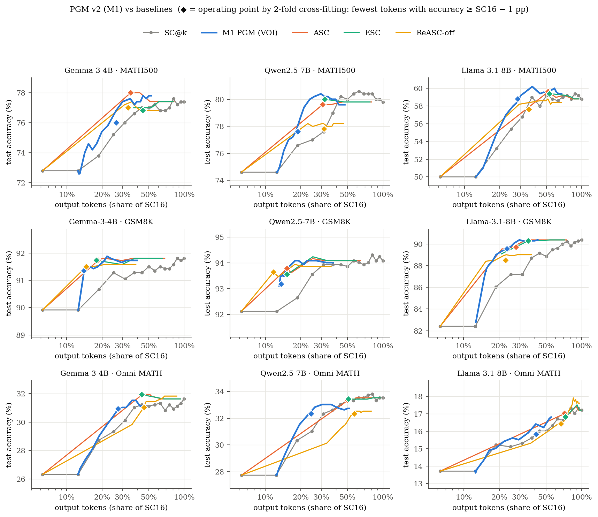
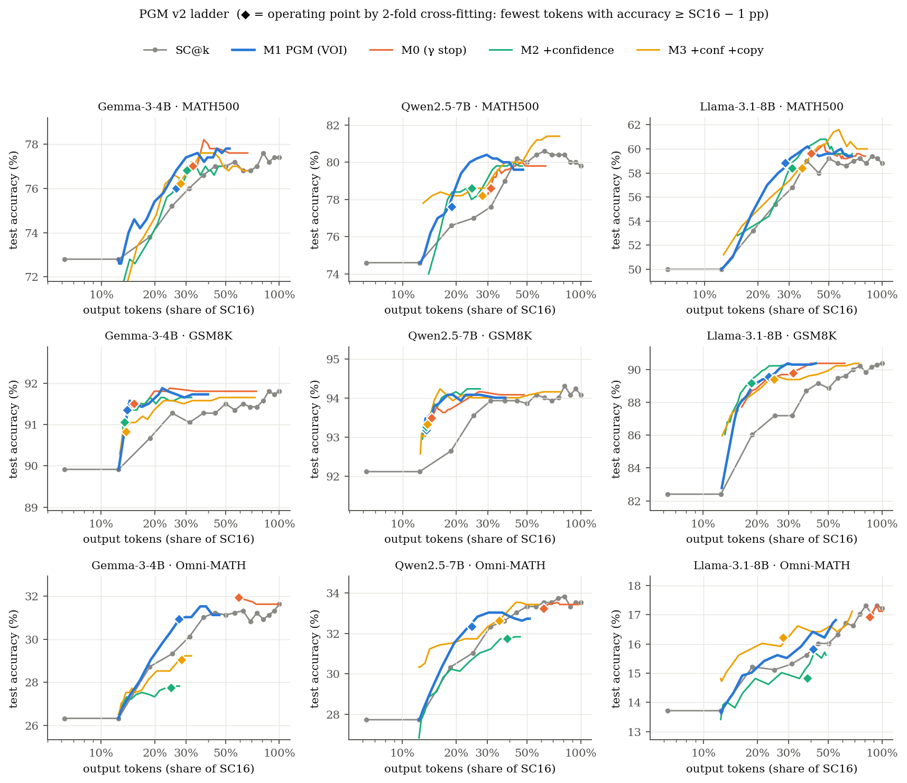

# PGM v2 results

Generated by `pgm v2 report` from `results/v2/cells/*.json`. Table cells: test accuracy (%) / output tokens as a share of SC16.
Primary model: **M1 PGM (VOI)**. Method and protocol: `docs/METHOD.md`.

Operating points are selected two ways, never using a question's own label: on **dev** (200 questions; easier than test on these benchmarks), and by **2-fold cross-fitting on test** (threshold chosen on one half, applied to the other).

## 1. Frontier score

Mean, over 60 budgets from SC@2 to SC16 tokens, of the best test accuracy within the budget (oracle summary, identical for every method).

| cell | M1 PGM (VOI) | M0 (γ stop) | M2 +confidence | M3 +conf +copy | ASC | ESC | ReASC-off | ReASC-on | SC@k |
|---|---|---|---|---|---|---|---|---|---|
| Gemma-3-4B MATH500 | **77.2** | 76.9 | 76.6 | 77.0 | 76.6 | 76.0 | 76.4 | 76.6 | 76.4 |
| Gemma-3-4B GSM8K | **91.8** | 91.8 | 91.6 | 91.6 | 91.7 | 91.7 | 91.5 | 91.6 | 91.3 |
| Gemma-3-4B Omni-MATH | **31.0** | 28.9 | 27.8 | 29.0 | 29.9 | 29.9 | 30.1 | 29.8 | 30.5 |
| Qwen2.5-7B MATH500 | 80.0 | 78.8 | 79.4 | **80.3** | 78.6 | 78.7 | 77.7 | 78.7 | 79.2 |
| Qwen2.5-7B GSM8K | 94.0 | 94.1 | 94.2 | **94.2** | 94.0 | 94.1 | 93.9 | 94.2 | 93.8 |
| Qwen2.5-7B Omni-MATH | 32.6 | 30.2 | 31.4 | **32.9** | 31.0 | 30.9 | 30.9 | 31.0 | 32.5 |
| Llama-3.1-8B MATH500 | 58.9 | 57.0 | 59.1 | **59.4** | 55.3 | 55.0 | 56.9 | 56.0 | 57.6 |
| Llama-3.1-8B GSM8K | 89.9 | 89.7 | **90.0** | 89.7 | 89.5 | 89.3 | 88.7 | 89.3 | 88.5 |
| Llama-3.1-8B Omni-MATH | 16.2 | 14.3 | 15.4 | **16.6** | 14.8 | 14.8 | 15.8 | 15.1 | 16.1 |
| mean | 63.5 | 62.4 | 62.8 | 63.4 | 62.4 | 62.3 | 62.4 | 62.5 | 62.9 |

## 2. Matched accuracy: fewest tokens with accuracy ≥ SC16 − 1 pp

### Cross-fitted on test

| cell | SC16 acc | M1 PGM (VOI) | M0 (γ stop) | M2 +confidence | M3 +conf +copy | ASC | ESC | ReASC-off | ReASC-on |
|---|---|---|---|---|---|---|---|---|---|
| Gemma-3-4B MATH500 | 77.4 | 76.0 / 26% | 77.0 / 33% | 76.8 / 30% | 76.2 / 28% | 78.0 / 35% | 76.8 / 44% | 77.0 / 33% | 77.4 / 32% |
| Gemma-3-4B GSM8K | 91.8 | 91.4 / 14% | 91.5 / 15% | 91.1 / 14% | 90.8 / 14% | 91.7 / 19% | 91.7 / 18% | 91.5 / 15% | 91.6 / 17% |
| Gemma-3-4B Omni-MATH | 31.6 | 30.9 / 27% | 31.9 / 59% | 27.7 / 25% | 29.0 / 28% | 31.9 / 44% | 31.9 / 44% | 31.0 / 46% | 30.5 / 42% |
| Qwen2.5-7B MATH500 | 79.8 | 77.6 / 19% | 78.6 / 31% | 78.6 / 25% | 78.2 / 28% | 79.6 / 31% | 80.0 / 32% | 77.8 / 31% | 79.0 / 32% |
| Qwen2.5-7B GSM8K | 94.1 | 93.2 / 14% | 93.5 / 15% | 93.3 / 14% | 93.3 / 14% | 93.8 / 15% | 93.6 / 15% | 93.6 / 12% | 93.8 / 13% |
| Qwen2.5-7B Omni-MATH | 33.5 | 32.3 / 25% | 33.2 / 62% | 31.7 / 39% | 32.6 / 35% | 33.3 / 50% | 33.4 / 51% | 32.3 / 57% | 32.7 / 54% |
| Llama-3.1-8B MATH500 | 58.8 | 58.8 / 29% | 59.6 / 40% | 58.4 / 31% | 58.4 / 36% | 59.6 / 52% | 59.4 / 53% | 57.6 / 36% | 58.2 / 44% |
| Llama-3.1-8B GSM8K | 90.4 | 89.5 / 23% | 89.8 / 32% | 89.2 / 19% | 89.4 / 25% | 89.7 / 28% | 90.3 / 35% | 88.5 / 23% | 89.4 / 26% |
| Llama-3.1-8B Omni-MATH | 17.2 | 15.8 / 41% | 16.9 / 85% | 14.8 / 38% | 16.2 / 28% | 17.0 / 72% | 16.8 / 73% | 16.4 / 67% | 16.6 / 77% |

### Selected on dev

| cell | SC16 acc | M1 PGM (VOI) | M0 (γ stop) | M2 +confidence | M3 +conf +copy | ASC | ESC | ReASC-off | ReASC-on |
|---|---|---|---|---|---|---|---|---|---|
| Gemma-3-4B MATH500 | 77.4 | 76.8 / 26% | 77.0 / 33% | 76.8 / 31% | 76.6 / 26% | 78.0 / 35% | 77.0 / 37% | 77.2 / 31% | 77.4 / 32% |
| Gemma-3-4B GSM8K | 91.8 | 91.4 / 15% | 91.8 / 20% | 91.7 / 19% | 90.4 / 13% | 91.7 / 19% | 91.7 / 18% | 91.6 / 21% | 91.6 / 17% |
| Gemma-3-4B Omni-MATH | 31.6 | 30.3 / 25% | 31.9 / 59% | 27.3 / 20% | 27.5 / 16% | 31.9 / 51% | 31.6 / 68% | 31.4 / 47% | 31.2 / 46% |
| Qwen2.5-7B MATH500 | 79.8 | 80.0 / 24% | 78.2 / 29% | 78.6 / 23% | 78.2 / 21% | 79.6 / 31% | 80.0 / 32% | 78.0 / 25% | 79.2 / 31% |
| Qwen2.5-7B GSM8K | 94.1 | 93.1 / 13% | 93.5 / 13% | 92.9 / 13% | 93.1 / 13% | 93.8 / 15% | 93.6 / 15% | 93.6 / 12% | 93.8 / 13% |
| Qwen2.5-7B Omni-MATH | 33.5 | 32.8 / 26% | 33.2 / 62% | 29.8 / 17% | 31.5 / 19% | 33.3 / 50% | 33.4 / 51% | 30.1 / 33% | 31.1 / 40% |
| Llama-3.1-8B MATH500 | 58.8 | 60.2 / 38% | 59.4 / 56% | 60.8 / 45% | 60.8 / 60% | 59.6 / 52% | 59.2 / 73% | 58.6 / 47% | 58.6 / 39% |
| Llama-3.1-8B GSM8K | 90.4 | 87.4 / 15% | 89.6 / 24% | 88.7 / 17% | 88.2 / 16% | 89.5 / 21% | 90.3 / 35% | 88.9 / 22% | 89.2 / 20% |
| Llama-3.1-8B Omni-MATH | 17.2 | 15.9 / 35% | 16.9 / 85% | 15.0 / 27% | 16.6 / 34% | 17.0 / 72% | 16.8 / 73% | 16.1 / 55% | 16.0 / 65% |

### Published defaults (no tuning)

| cell | SC@k@16 | ASC@0.95 | ESC@4 | ReASC-off@0.95 | ReASC-on@0.95 |
|---|---|---|---|---|---|
| Gemma-3-4B MATH500 | 77.4 / 100% | 77.4 / 59% | 77.4 / 61% | 76.8 / 48% | 77.0 / 53% |
| Gemma-3-4B GSM8K | 91.8 / 100% | 91.8 / 37% | 91.8 / 38% | 91.6 / 25% | 91.7 / 31% |
| Gemma-3-4B Omni-MATH | 31.6 / 100% | 31.6 / 74% | 31.6 / 79% | 31.7 / 67% | 31.5 / 67% |
| Qwen2.5-7B MATH500 | 79.8 / 100% | 79.8 / 54% | 79.8 / 57% | 78.0 / 34% | 79.6 / 44% |
| Qwen2.5-7B GSM8K | 94.1 / 100% | 94.1 / 32% | 94.1 / 34% | 93.9 / 21% | 94.2 / 28% |
| Qwen2.5-7B Omni-MATH | 33.5 / 100% | 33.5 / 79% | 33.5 / 83% | 32.5 / 63% | 32.9 / 68% |
| Llama-3.1-8B MATH500 | 58.8 / 100% | 59.0 / 78% | 59.0 / 82% | 58.4 / 56% | 58.2 / 63% |
| Llama-3.1-8B GSM8K | 90.4 / 100% | 90.4 / 43% | 90.3 / 45% | 88.9 / 26% | 89.8 / 33% |
| Llama-3.1-8B Omni-MATH | 17.2 / 100% | 17.2 / 94% | 17.2 / 96% | 17.9 / 85% | 16.9 / 87% |

## 3. M1 PGM (VOI) against baselines (paired, question level; positive Δ = PGM better, token ratio < 1 = PGM cheaper)

### Cross-fitted matched accuracy

| cell | vs | Δacc (pp) [95% CI] | token ratio [95% CI] | McNemar p |
|---|---|---|---|---|
| Gemma-3-4B MATH500 | ASC | -2.0 [-3.2, -0.8] | 0.75 [0.71, 0.80] | 0.002 |
| Gemma-3-4B MATH500 | ESC | -0.8 [-2.0, +0.2] | 0.59 [0.56, 0.62] | 0.289 |
| Gemma-3-4B MATH500 | ReASC-off | -1.0 [-2.2, +0.2] | 0.79 [0.74, 0.86] | 0.180 |
| Gemma-3-4B MATH500 | ReASC-on | -1.4 [-2.8, -0.2] | 0.82 [0.76, 0.88] | 0.065 |
| Gemma-3-4B MATH500 | SC@k@default | -1.4 [-3.0, +0.0] | 0.26 [0.25, 0.28] | 0.118 |
| Gemma-3-4B MATH500 | ASC@default | -1.4 [-3.0, +0.0] | 0.45 [0.43, 0.47] | 0.118 |
| Gemma-3-4B MATH500 | ESC@default | -1.4 [-3.0, +0.0] | 0.43 [0.41, 0.46] | 0.118 |
| Gemma-3-4B MATH500 | ReASC-off@default | -0.8 [-2.4, +0.8] | 0.55 [0.52, 0.60] | 0.454 |
| Gemma-3-4B MATH500 | ReASC-on@default | -1.0 [-2.4, +0.4] | 0.50 [0.47, 0.53] | 0.267 |
| Gemma-3-4B GSM8K | ASC | -0.4 [-1.1, +0.4] | 0.76 [0.72, 0.80] | 0.442 |
| Gemma-3-4B GSM8K | ESC | -0.4 [-1.1, +0.3] | 0.78 [0.74, 0.82] | 0.405 |
| Gemma-3-4B GSM8K | ReASC-off | -0.2 [-0.9, +0.6] | 0.96 [0.89, 1.04] | 0.851 |
| Gemma-3-4B GSM8K | ReASC-on | -0.2 [-1.1, +0.5] | 0.84 [0.79, 0.90] | 0.711 |
| Gemma-3-4B GSM8K | SC@k@default | -0.5 [-1.3, +0.4] | 0.14 [0.14, 0.14] | 0.377 |
| Gemma-3-4B GSM8K | ASC@default | -0.5 [-1.3, +0.4] | 0.38 [0.36, 0.39] | 0.377 |
| Gemma-3-4B GSM8K | ESC@default | -0.5 [-1.3, +0.4] | 0.37 [0.36, 0.38] | 0.377 |
| Gemma-3-4B GSM8K | ReASC-off@default | -0.2 [-1.1, +0.6] | 0.56 [0.52, 0.60] | 0.728 |
| Gemma-3-4B GSM8K | ReASC-on@default | -0.3 [-1.1, +0.5] | 0.45 [0.43, 0.47] | 0.597 |
| Gemma-3-4B Omni-MATH | ASC | -1.0 [-2.0, +0.0] | 0.63 [0.60, 0.66] | 0.064 |
| Gemma-3-4B Omni-MATH | ESC | -1.0 [-2.0, +0.0] | 0.63 [0.60, 0.66] | 0.076 |
| Gemma-3-4B Omni-MATH | ReASC-off | -0.1 [-1.3, +1.1] | 0.60 [0.57, 0.63] | 1.000 |
| Gemma-3-4B Omni-MATH | ReASC-on | +0.4 [-0.7, +1.6] | 0.65 [0.62, 0.69] | 0.618 |
| Gemma-3-4B Omni-MATH | SC@k@default | -0.7 [-1.8, +0.4] | 0.27 [0.27, 0.28] | 0.296 |
| Gemma-3-4B Omni-MATH | ASC@default | -0.7 [-1.8, +0.4] | 0.37 [0.36, 0.38] | 0.296 |
| Gemma-3-4B Omni-MATH | ESC@default | -0.7 [-1.8, +0.4] | 0.35 [0.34, 0.36] | 0.296 |
| Gemma-3-4B Omni-MATH | ReASC-off@default | -0.8 [-1.9, +0.3] | 0.41 [0.40, 0.43] | 0.215 |
| Gemma-3-4B Omni-MATH | ReASC-on@default | -0.6 [-1.7, +0.5] | 0.41 [0.40, 0.42] | 0.362 |
| Qwen2.5-7B MATH500 | ASC | -2.0 [-3.8, -0.4] | 0.62 [0.58, 0.67] | 0.041 |
| Qwen2.5-7B MATH500 | ESC | -2.4 [-4.0, -1.0] | 0.59 [0.55, 0.64] | 0.004 |
| Qwen2.5-7B MATH500 | ReASC-off | -0.2 [-2.2, +1.8] | 0.60 [0.54, 0.67] | 1.000 |
| Qwen2.5-7B MATH500 | ReASC-on | -1.4 [-3.2, +0.4] | 0.59 [0.54, 0.64] | 0.210 |
| Qwen2.5-7B MATH500 | SC@k@default | -2.2 [-4.0, -0.4] | 0.19 [0.18, 0.20] | 0.035 |
| Qwen2.5-7B MATH500 | ASC@default | -2.2 [-4.0, -0.4] | 0.35 [0.33, 0.37] | 0.035 |
| Qwen2.5-7B MATH500 | ESC@default | -2.2 [-4.0, -0.4] | 0.33 [0.32, 0.35] | 0.035 |
| Qwen2.5-7B MATH500 | ReASC-off@default | -0.4 [-2.4, +1.6] | 0.55 [0.50, 0.62] | 0.851 |
| Qwen2.5-7B MATH500 | ReASC-on@default | -2.0 [-4.0, +0.0] | 0.43 [0.40, 0.46] | 0.076 |
| Qwen2.5-7B GSM8K | ASC | -0.6 [-1.2, -0.1] | 0.89 [0.86, 0.92] | 0.057 |
| Qwen2.5-7B GSM8K | ESC | -0.4 [-0.9, +0.2] | 0.89 [0.85, 0.92] | 0.267 |
| Qwen2.5-7B GSM8K | ReASC-off | -0.5 [-1.1, +0.1] | 1.17 [1.11, 1.23] | 0.180 |
| Qwen2.5-7B GSM8K | ReASC-on | -0.6 [-1.2, -0.1] | 1.03 [0.98, 1.07] | 0.057 |
| Qwen2.5-7B GSM8K | SC@k@default | -0.9 [-1.7, -0.2] | 0.14 [0.13, 0.14] | 0.029 |
| Qwen2.5-7B GSM8K | ASC@default | -0.9 [-1.7, -0.2] | 0.42 [0.41, 0.44] | 0.029 |
| Qwen2.5-7B GSM8K | ESC@default | -0.9 [-1.7, -0.2] | 0.40 [0.39, 0.42] | 0.029 |
| Qwen2.5-7B GSM8K | ReASC-off@default | -0.7 [-1.4, +0.1] | 0.64 [0.60, 0.68] | 0.108 |
| Qwen2.5-7B GSM8K | ReASC-on@default | -1.0 [-1.7, -0.2] | 0.49 [0.47, 0.51] | 0.019 |
| Qwen2.5-7B Omni-MATH | ASC | -1.0 [-2.2, +0.2] | 0.49 [0.47, 0.51] | 0.143 |
| Qwen2.5-7B Omni-MATH | ESC | -1.1 [-2.3, +0.1] | 0.48 [0.46, 0.50] | 0.099 |
| Qwen2.5-7B Omni-MATH | ReASC-off | +0.0 [-1.4, +1.4] | 0.43 [0.41, 0.45] | 1.000 |
| Qwen2.5-7B Omni-MATH | ReASC-on | -0.4 [-1.8, +1.0] | 0.46 [0.44, 0.48] | 0.665 |
| Qwen2.5-7B Omni-MATH | SC@k@default | -1.2 [-2.5, +0.1] | 0.25 [0.24, 0.25] | 0.088 |
| Qwen2.5-7B Omni-MATH | ASC@default | -1.2 [-2.5, +0.1] | 0.31 [0.30, 0.32] | 0.088 |
| Qwen2.5-7B Omni-MATH | ESC@default | -1.2 [-2.5, +0.1] | 0.30 [0.29, 0.30] | 0.088 |
| Qwen2.5-7B Omni-MATH | ReASC-off@default | -0.2 [-1.6, +1.2] | 0.39 [0.37, 0.41] | 0.888 |
| Qwen2.5-7B Omni-MATH | ReASC-on@default | -0.6 [-2.0, +0.8] | 0.36 [0.35, 0.38] | 0.488 |
| Llama-3.1-8B MATH500 | ASC | -0.8 [-3.0, +1.4] | 0.55 [0.52, 0.58] | 0.608 |
| Llama-3.1-8B MATH500 | ESC | -0.6 [-3.0, +1.8] | 0.54 [0.51, 0.57] | 0.736 |
| Llama-3.1-8B MATH500 | ReASC-off | +1.2 [-1.6, +4.0] | 0.80 [0.72, 0.90] | 0.471 |
| Llama-3.1-8B MATH500 | ReASC-on | +0.6 [-2.2, +3.4] | 0.65 [0.60, 0.70] | 0.775 |
| Llama-3.1-8B MATH500 | SC@k@default | +0.0 [-2.6, +2.6] | 0.29 [0.27, 0.30] | 1.000 |
| Llama-3.1-8B MATH500 | ASC@default | -0.2 [-2.8, +2.4] | 0.37 [0.35, 0.39] | 1.000 |
| Llama-3.1-8B MATH500 | ESC@default | -0.2 [-2.8, +2.4] | 0.35 [0.33, 0.37] | 1.000 |
| Llama-3.1-8B MATH500 | ReASC-off@default | +0.4 [-2.4, +3.2] | 0.51 [0.47, 0.55] | 0.892 |
| Llama-3.1-8B MATH500 | ReASC-on@default | +0.6 [-2.2, +3.4] | 0.45 [0.42, 0.49] | 0.784 |
| Llama-3.1-8B GSM8K | ASC | -0.2 [-0.7, +0.4] | 0.84 [0.81, 0.87] | 0.774 |
| Llama-3.1-8B GSM8K | ESC | -0.8 [-1.4, -0.1] | 0.66 [0.63, 0.69] | 0.041 |
| Llama-3.1-8B GSM8K | ReASC-off | +1.1 [+0.2, +2.0] | 1.03 [0.97, 1.11] | 0.029 |
| Llama-3.1-8B GSM8K | ReASC-on | +0.2 [-0.5, +0.8] | 0.90 [0.86, 0.96] | 0.824 |
| Llama-3.1-8B GSM8K | SC@k@default | -0.8 [-1.6, -0.2] | 0.23 [0.22, 0.25] | 0.035 |
| Llama-3.1-8B GSM8K | ASC@default | -0.8 [-1.6, -0.2] | 0.55 [0.53, 0.57] | 0.035 |
| Llama-3.1-8B GSM8K | ESC@default | -0.8 [-1.4, -0.1] | 0.51 [0.49, 0.54] | 0.052 |
| Llama-3.1-8B GSM8K | ReASC-off@default | +0.6 [-0.4, +1.6] | 0.90 [0.84, 0.96] | 0.280 |
| Llama-3.1-8B GSM8K | ReASC-on@default | -0.3 [-1.1, +0.5] | 0.71 [0.67, 0.75] | 0.557 |
| Llama-3.1-8B Omni-MATH | ASC | -1.2 [-2.3, -0.2] | 0.57 [0.55, 0.60] | 0.043 |
| Llama-3.1-8B Omni-MATH | ESC | -1.0 [-2.2, +0.1] | 0.56 [0.54, 0.59] | 0.121 |
| Llama-3.1-8B Omni-MATH | ReASC-off | -0.6 [-1.8, +0.6] | 0.62 [0.59, 0.65] | 0.418 |
| Llama-3.1-8B Omni-MATH | ReASC-on | -0.8 [-2.0, +0.4] | 0.53 [0.51, 0.56] | 0.256 |
| Llama-3.1-8B Omni-MATH | SC@k@default | -1.4 [-2.6, -0.2] | 0.41 [0.40, 0.43] | 0.034 |
| Llama-3.1-8B Omni-MATH | ASC@default | -1.4 [-2.6, -0.2] | 0.44 [0.42, 0.45] | 0.034 |
| Llama-3.1-8B Omni-MATH | ESC@default | -1.4 [-2.6, -0.2] | 0.43 [0.42, 0.45] | 0.034 |
| Llama-3.1-8B Omni-MATH | ReASC-off@default | -2.1 [-3.4, -0.9] | 0.48 [0.47, 0.50] | 0.001 |
| Llama-3.1-8B Omni-MATH | ReASC-on@default | -1.1 [-2.4, +0.1] | 0.48 [0.46, 0.49] | 0.117 |

### Dev-selected matched accuracy

| cell | vs | Δacc (pp) [95% CI] | token ratio [95% CI] | McNemar p |
|---|---|---|---|---|
| Gemma-3-4B MATH500 | ASC | -1.2 [-2.2, -0.4] | 0.75 [0.71, 0.79] | 0.031 |
| Gemma-3-4B MATH500 | ESC | -0.2 [-1.2, +0.8] | 0.71 [0.67, 0.75] | 1.000 |
| Gemma-3-4B MATH500 | ReASC-off | -0.4 [-1.6, +0.6] | 0.85 [0.79, 0.92] | 0.727 |
| Gemma-3-4B MATH500 | ReASC-on | -0.6 [-1.6, +0.4] | 0.81 [0.76, 0.87] | 0.453 |
| Gemma-3-4B MATH500 | SC@k@default | -0.6 [-2.0, +0.6] | 0.26 [0.25, 0.28] | 0.549 |
| Gemma-3-4B MATH500 | ASC@default | -0.6 [-2.0, +0.6] | 0.45 [0.43, 0.47] | 0.549 |
| Gemma-3-4B MATH500 | ESC@default | -0.6 [-2.0, +0.6] | 0.43 [0.41, 0.45] | 0.549 |
| Gemma-3-4B MATH500 | ReASC-off@default | +0.0 [-1.4, +1.4] | 0.55 [0.52, 0.59] | 1.000 |
| Gemma-3-4B MATH500 | ReASC-on@default | -0.2 [-1.4, +1.0] | 0.50 [0.47, 0.52] | 1.000 |
| Gemma-3-4B GSM8K | ASC | -0.3 [-0.9, +0.3] | 0.81 [0.77, 0.85] | 0.454 |
| Gemma-3-4B GSM8K | ESC | -0.3 [-0.8, +0.2] | 0.83 [0.80, 0.87] | 0.388 |
| Gemma-3-4B GSM8K | ReASC-off | -0.2 [-0.9, +0.6] | 0.71 [0.66, 0.76] | 0.851 |
| Gemma-3-4B GSM8K | ReASC-on | -0.2 [-0.8, +0.5] | 0.89 [0.85, 0.95] | 0.815 |
| Gemma-3-4B GSM8K | SC@k@default | -0.4 [-1.1, +0.3] | 0.15 [0.14, 0.16] | 0.405 |
| Gemma-3-4B GSM8K | ASC@default | -0.4 [-1.1, +0.3] | 0.40 [0.39, 0.42] | 0.405 |
| Gemma-3-4B GSM8K | ESC@default | -0.4 [-1.1, +0.3] | 0.39 [0.38, 0.41] | 0.405 |
| Gemma-3-4B GSM8K | ReASC-off@default | -0.2 [-0.9, +0.6] | 0.59 [0.55, 0.63] | 0.851 |
| Gemma-3-4B GSM8K | ReASC-on@default | -0.2 [-0.9, +0.5] | 0.48 [0.46, 0.50] | 0.678 |
| Gemma-3-4B Omni-MATH | ASC | -1.6 [-2.6, -0.6] | 0.48 [0.46, 0.50] | 0.004 |
| Gemma-3-4B Omni-MATH | ESC | -1.3 [-2.5, -0.1] | 0.36 [0.35, 0.37] | 0.047 |
| Gemma-3-4B Omni-MATH | ReASC-off | -1.1 [-2.1, -0.1] | 0.52 [0.49, 0.54] | 0.061 |
| Gemma-3-4B Omni-MATH | ReASC-on | -0.9 [-2.0, +0.2] | 0.53 [0.51, 0.56] | 0.136 |
| Gemma-3-4B Omni-MATH | SC@k@default | -1.3 [-2.5, -0.1] | 0.25 [0.24, 0.25] | 0.047 |
| Gemma-3-4B Omni-MATH | ASC@default | -1.3 [-2.5, -0.1] | 0.33 [0.32, 0.34] | 0.047 |
| Gemma-3-4B Omni-MATH | ESC@default | -1.3 [-2.5, -0.1] | 0.31 [0.30, 0.32] | 0.047 |
| Gemma-3-4B Omni-MATH | ReASC-off@default | -1.4 [-2.6, -0.2] | 0.37 [0.36, 0.38] | 0.029 |
| Gemma-3-4B Omni-MATH | ReASC-on@default | -1.2 [-2.3, -0.1] | 0.37 [0.35, 0.38] | 0.058 |
| Qwen2.5-7B MATH500 | ASC | +0.4 [-0.8, +1.6] | 0.78 [0.74, 0.83] | 0.754 |
| Qwen2.5-7B MATH500 | ESC | +0.0 [-1.2, +1.0] | 0.74 [0.70, 0.79] | 1.000 |
| Qwen2.5-7B MATH500 | ReASC-off | +2.0 [+0.2, +3.8] | 0.95 [0.86, 1.07] | 0.052 |
| Qwen2.5-7B MATH500 | ReASC-on | +0.8 [-0.8, +2.4] | 0.77 [0.72, 0.83] | 0.454 |
| Qwen2.5-7B MATH500 | SC@k@default | +0.2 [-1.4, +1.8] | 0.24 [0.22, 0.26] | 1.000 |
| Qwen2.5-7B MATH500 | ASC@default | +0.2 [-1.4, +1.8] | 0.44 [0.42, 0.47] | 1.000 |
| Qwen2.5-7B MATH500 | ESC@default | +0.2 [-1.4, +1.8] | 0.42 [0.40, 0.44] | 1.000 |
| Qwen2.5-7B MATH500 | ReASC-off@default | +2.0 [+0.0, +4.0] | 0.70 [0.63, 0.78] | 0.076 |
| Qwen2.5-7B MATH500 | ReASC-on@default | +0.4 [-1.4, +2.2] | 0.54 [0.51, 0.58] | 0.824 |
| Qwen2.5-7B GSM8K | ASC | -0.7 [-1.4, -0.1] | 0.86 [0.82, 0.89] | 0.064 |
| Qwen2.5-7B GSM8K | ESC | -0.5 [-1.1, +0.2] | 0.85 [0.82, 0.89] | 0.210 |
| Qwen2.5-7B GSM8K | ReASC-off | -0.5 [-1.2, +0.1] | 1.12 [1.06, 1.19] | 0.167 |
| Qwen2.5-7B GSM8K | ReASC-on | -0.7 [-1.4, -0.1] | 0.99 [0.94, 1.04] | 0.064 |
| Qwen2.5-7B GSM8K | SC@k@default | -1.0 [-1.8, -0.2] | 0.13 [0.13, 0.13] | 0.024 |
| Qwen2.5-7B GSM8K | ASC@default | -1.0 [-1.8, -0.2] | 0.41 [0.39, 0.42] | 0.024 |
| Qwen2.5-7B GSM8K | ESC@default | -1.0 [-1.8, -0.2] | 0.39 [0.38, 0.40] | 0.024 |
| Qwen2.5-7B GSM8K | ReASC-off@default | -0.8 [-1.6, +0.0] | 0.62 [0.58, 0.66] | 0.087 |
| Qwen2.5-7B GSM8K | ReASC-on@default | -1.1 [-1.9, -0.3] | 0.47 [0.45, 0.49] | 0.016 |
| Qwen2.5-7B Omni-MATH | ASC | -0.5 [-1.5, +0.5] | 0.52 [0.50, 0.55] | 0.442 |
| Qwen2.5-7B Omni-MATH | ESC | -0.6 [-1.7, +0.5] | 0.52 [0.50, 0.54] | 0.362 |
| Qwen2.5-7B Omni-MATH | ReASC-off | +2.7 [+1.2, +4.2] | 0.79 [0.74, 0.85] | 0.001 |
| Qwen2.5-7B Omni-MATH | ReASC-on | +1.7 [+0.4, +3.1] | 0.66 [0.62, 0.70] | 0.024 |
| Qwen2.5-7B Omni-MATH | SC@k@default | -0.7 [-1.8, +0.4] | 0.26 [0.26, 0.27] | 0.296 |
| Qwen2.5-7B Omni-MATH | ASC@default | -0.7 [-1.8, +0.4] | 0.33 [0.32, 0.34] | 0.296 |
| Qwen2.5-7B Omni-MATH | ESC@default | -0.7 [-1.8, +0.4] | 0.32 [0.31, 0.33] | 0.296 |
| Qwen2.5-7B Omni-MATH | ReASC-off@default | +0.3 [-1.0, +1.6] | 0.42 [0.40, 0.43] | 0.766 |
| Qwen2.5-7B Omni-MATH | ReASC-on@default | -0.1 [-1.4, +1.2] | 0.39 [0.37, 0.40] | 1.000 |
| Llama-3.1-8B MATH500 | ASC | +0.6 [-1.0, +2.4] | 0.73 [0.70, 0.77] | 0.648 |
| Llama-3.1-8B MATH500 | ESC | +1.0 [-1.2, +3.2] | 0.52 [0.49, 0.55] | 0.473 |
| Llama-3.1-8B MATH500 | ReASC-off | +1.6 [-0.8, +4.0] | 0.82 [0.75, 0.89] | 0.268 |
| Llama-3.1-8B MATH500 | ReASC-on | +1.6 [-0.6, +3.8] | 0.98 [0.89, 1.08] | 0.229 |
| Llama-3.1-8B MATH500 | SC@k@default | +1.4 [-0.8, +3.6] | 0.38 [0.35, 0.41] | 0.281 |
| Llama-3.1-8B MATH500 | ASC@default | +1.2 [-1.0, +3.4] | 0.49 [0.46, 0.52] | 0.362 |
| Llama-3.1-8B MATH500 | ESC@default | +1.2 [-1.0, +3.4] | 0.46 [0.43, 0.49] | 0.362 |
| Llama-3.1-8B MATH500 | ReASC-off@default | +1.8 [-0.6, +4.4] | 0.68 [0.62, 0.74] | 0.222 |
| Llama-3.1-8B MATH500 | ReASC-on@default | +2.0 [-0.4, +4.4] | 0.60 [0.56, 0.65] | 0.154 |
| Llama-3.1-8B GSM8K | ASC | -2.1 [-3.0, -1.3] | 0.73 [0.70, 0.76] | 0.000 |
| Llama-3.1-8B GSM8K | ESC | -2.9 [-4.0, -1.8] | 0.43 [0.42, 0.45] | 0.000 |
| Llama-3.1-8B GSM8K | ReASC-off | -1.5 [-2.7, -0.4] | 0.70 [0.65, 0.76] | 0.015 |
| Llama-3.1-8B GSM8K | ReASC-on | -1.8 [-2.8, -0.9] | 0.75 [0.71, 0.81] | 0.000 |
| Llama-3.1-8B GSM8K | SC@k@default | -3.0 [-4.1, -1.9] | 0.15 [0.15, 0.16] | 0.000 |
| Llama-3.1-8B GSM8K | ASC@default | -3.0 [-4.1, -1.9] | 0.36 [0.35, 0.37] | 0.000 |
| Llama-3.1-8B GSM8K | ESC@default | -2.9 [-4.0, -1.7] | 0.34 [0.33, 0.35] | 0.000 |
| Llama-3.1-8B GSM8K | ReASC-off@default | -1.5 [-2.7, -0.3] | 0.59 [0.55, 0.64] | 0.017 |
| Llama-3.1-8B GSM8K | ReASC-on@default | -2.4 [-3.6, -1.4] | 0.46 [0.44, 0.49] | 0.000 |
| Llama-3.1-8B Omni-MATH | ASC | -1.1 [-2.3, +0.0] | 0.49 [0.47, 0.51] | 0.090 |
| Llama-3.1-8B Omni-MATH | ESC | -0.9 [-2.1, +0.2] | 0.48 [0.46, 0.50] | 0.175 |
| Llama-3.1-8B Omni-MATH | ReASC-off | -0.2 [-1.6, +1.2] | 0.64 [0.61, 0.68] | 0.885 |
| Llama-3.1-8B Omni-MATH | ReASC-on | -0.1 [-1.3, +1.1] | 0.54 [0.52, 0.57] | 1.000 |
| Llama-3.1-8B Omni-MATH | SC@k@default | -1.3 [-2.6, +0.0] | 0.35 [0.34, 0.36] | 0.066 |
| Llama-3.1-8B Omni-MATH | ASC@default | -1.3 [-2.6, +0.0] | 0.37 [0.36, 0.39] | 0.066 |
| Llama-3.1-8B Omni-MATH | ESC@default | -1.3 [-2.6, +0.0] | 0.37 [0.36, 0.38] | 0.066 |
| Llama-3.1-8B Omni-MATH | ReASC-off@default | -2.0 [-3.3, -0.7] | 0.41 [0.40, 0.43] | 0.005 |
| Llama-3.1-8B Omni-MATH | ReASC-on@default | -1.0 [-2.3, +0.3] | 0.41 [0.39, 0.42] | 0.174 |

## 4. Is each part of the graph needed?

Frontier score of the primary model and each variant:

| cell | M1 PGM (VOI) | M0 (γ stop) | M2 +confidence | M3 +conf +copy | MAP answer | −OTHER | θ constant | −CRP (flat wrong) | M2, MAP answer | +copy (text) | +copy (hidden) | +copy (permuted) |
|---|---|---|---|---|---|---|---|---|---|---|---|---|
| Gemma-3-4B MATH500 | 77.2 | 76.9 | 76.6 | 77.0 | 77.3 | 77.1 | 77.4 | 72.8 | 76.5 | **77.5** | 77.2 | 77.2 |
| Gemma-3-4B GSM8K | 91.8 | 91.8 | 91.6 | 91.6 | 91.8 | 91.6 | 91.7 | 91.0 | 91.6 | 91.8 | **91.9** | 91.8 |
| Gemma-3-4B Omni-MATH | 31.0 | 28.9 | 27.8 | 29.0 | 30.9 | 30.5 | **31.1** | 26.3 | 27.3 | 30.6 | 31.0 | 31.0 |
| Qwen2.5-7B MATH500 | 80.0 | 78.8 | 79.4 | 80.3 | **80.5** | 80.1 | 79.3 | 74.6 | 79.0 | 80.2 | 80.3 | 79.9 |
| Qwen2.5-7B GSM8K | 94.0 | 94.1 | 94.2 | **94.2** | 94.2 | 93.8 | 94.0 | 93.5 | 93.9 | 94.0 | 94.2 | 94.0 |
| Qwen2.5-7B Omni-MATH | 32.6 | 30.2 | 31.4 | 32.9 | 32.6 | 32.4 | 32.7 | 27.7 | 30.7 | **33.0** | 32.9 | 32.9 |
| Llama-3.1-8B MATH500 | 58.9 | 57.0 | 59.1 | 59.4 | 58.7 | 58.7 | 58.6 | 50.0 | **59.5** | 58.8 | 58.3 | 58.7 |
| Llama-3.1-8B GSM8K | 89.9 | 89.7 | **90.0** | 89.7 | 89.7 | 89.3 | 89.7 | 86.9 | 89.9 | 89.7 | 89.8 | 89.8 |
| Llama-3.1-8B Omni-MATH | 16.2 | 14.3 | 15.4 | **16.6** | 15.7 | 14.1 | 16.3 | 13.7 | 14.9 | 16.0 | 16.1 | 15.9 |
| mean | 63.5 | 62.4 | 62.8 | 63.4 | 63.5 | 63.1 | 63.4 | 59.6 | 62.6 | 63.5 | 63.5 | 63.5 |

Paired contrasts at the cross-fitted matched-accuracy point:

| cell | vs | Δacc (pp) [95% CI] | token ratio [95% CI] | McNemar p |
|---|---|---|---|---|
| Gemma-3-4B MATH500 | M0 (γ stop) | -1.0 [-2.2, +0.2] | 0.81 [0.76, 0.87] | 0.180 |
| Gemma-3-4B MATH500 | M2 +confidence | -0.8 [-2.2, +0.6] | 0.87 [0.82, 0.93] | 0.424 |
| Gemma-3-4B MATH500 | M3 +conf +copy | -0.2 [-2.0, +1.4] | 0.95 [0.88, 1.02] | 1.000 |
| Gemma-3-4B MATH500 | MAP answer | -0.4 [-1.6, +0.8] | 1.04 [1.00, 1.08] | 0.727 |
| Gemma-3-4B MATH500 | −OTHER | -0.4 [-1.4, +0.6] | 1.14 [1.08, 1.20] | 0.688 |
| Gemma-3-4B MATH500 | θ constant | -0.6 [-1.6, +0.2] | 1.13 [1.08, 1.18] | 0.375 |
| Gemma-3-4B MATH500 | −CRP (flat wrong) | +3.2 [+1.0, +5.4] | 2.11 [1.96, 2.26] | 0.009 |
| Gemma-3-4B MATH500 | M2, MAP answer | -0.6 [-2.2, +1.0] | 1.05 [0.96, 1.14] | 0.629 |
| Gemma-3-4B MATH500 | +copy (text) | -0.8 [-2.0, +0.4] | 1.02 [0.98, 1.07] | 0.344 |
| Gemma-3-4B MATH500 | +copy (hidden) | -1.0 [-2.4, +0.4] | 1.19 [1.13, 1.26] | 0.267 |
| Gemma-3-4B MATH500 | +copy (permuted) | -0.4 [-1.4, +0.6] | 0.99 [0.95, 1.03] | 0.688 |
| Gemma-3-4B GSM8K | M0 (γ stop) | -0.2 [-0.7, +0.4] | 0.91 [0.88, 0.95] | 0.774 |
| Gemma-3-4B GSM8K | M2 +confidence | +0.3 [-0.2, +0.9] | 1.03 [1.02, 1.05] | 0.454 |
| Gemma-3-4B GSM8K | M3 +conf +copy | +0.5 [-0.2, +1.3] | 1.01 [0.98, 1.04] | 0.230 |
| Gemma-3-4B GSM8K | MAP answer | +0.0 [-0.5, +0.5] | 1.00 [0.99, 1.01] | 1.000 |
| Gemma-3-4B GSM8K | −OTHER | +0.2 [-0.2, +0.7] | 1.00 [0.99, 1.01] | 0.508 |
| Gemma-3-4B GSM8K | θ constant | +0.2 [-0.4, +0.7] | 1.02 [1.00, 1.03] | 0.791 |
| Gemma-3-4B GSM8K | −CRP (flat wrong) | +0.7 [-0.2, +1.5] | 1.07 [1.05, 1.09] | 0.150 |
| Gemma-3-4B GSM8K | M2, MAP answer | +0.0 [-0.5, +0.5] | 1.03 [1.01, 1.04] | 1.000 |
| Gemma-3-4B GSM8K | +copy (text) | +0.2 [-0.4, +0.8] | 1.04 [1.02, 1.06] | 0.648 |
| Gemma-3-4B GSM8K | +copy (hidden) | +0.3 [-0.2, +0.8] | 1.01 [1.00, 1.03] | 0.388 |
| Gemma-3-4B GSM8K | +copy (permuted) | +1.3 [+0.5, +2.1] | 1.07 [1.04, 1.09] | 0.005 |
| Gemma-3-4B Omni-MATH | M0 (γ stop) | -1.0 [-2.0, +0.0] | 0.46 [0.45, 0.48] | 0.076 |
| Gemma-3-4B Omni-MATH | M2 +confidence | +3.2 [+1.7, +4.7] | 1.11 [1.04, 1.19] | 0.000 |
| Gemma-3-4B Omni-MATH | M3 +conf +copy | +1.9 [+0.5, +3.3] | 0.97 [0.91, 1.03] | 0.009 |
| Gemma-3-4B Omni-MATH | MAP answer | +0.4 [-0.3, +1.1] | 0.90 [0.88, 0.93] | 0.388 |
| Gemma-3-4B Omni-MATH | −OTHER | +0.5 [-0.1, +1.1] | 1.29 [1.26, 1.32] | 0.180 |
| Gemma-3-4B Omni-MATH | θ constant | +0.0 [-0.7, +0.7] | 1.12 [1.09, 1.16] | 1.000 |
| Gemma-3-4B Omni-MATH | −CRP (flat wrong) | +4.6 [+3.0, +6.3] | 2.20 [2.14, 2.25] | 0.000 |
| Gemma-3-4B Omni-MATH | M2, MAP answer | +4.0 [+2.4, +5.7] | 1.98 [1.89, 2.07] | 0.000 |
| Gemma-3-4B Omni-MATH | +copy (text) | +0.4 [-0.3, +1.2] | 0.83 [0.80, 0.86] | 0.424 |
| Gemma-3-4B Omni-MATH | +copy (hidden) | +0.1 [-0.6, +0.8] | 0.97 [0.94, 0.99] | 1.000 |
| Gemma-3-4B Omni-MATH | +copy (permuted) | +0.2 [-0.5, +0.9] | 0.92 [0.89, 0.95] | 0.774 |
| Qwen2.5-7B MATH500 | M0 (γ stop) | -1.0 [-2.4, +0.4] | 0.60 [0.56, 0.65] | 0.267 |
| Qwen2.5-7B MATH500 | M2 +confidence | -1.0 [-2.6, +0.4] | 0.77 [0.72, 0.83] | 0.302 |
| Qwen2.5-7B MATH500 | M3 +conf +copy | -0.6 [-2.4, +1.2] | 0.67 [0.63, 0.72] | 0.664 |
| Qwen2.5-7B MATH500 | MAP answer | +0.2 [-0.4, +0.8] | 0.99 [0.96, 1.03] | 1.000 |
| Qwen2.5-7B MATH500 | −OTHER | -0.2 [-1.0, +0.6] | 0.91 [0.87, 0.96] | 1.000 |
| Qwen2.5-7B MATH500 | θ constant | -0.8 [-2.2, +0.4] | 0.74 [0.70, 0.78] | 0.388 |
| Qwen2.5-7B MATH500 | −CRP (flat wrong) | +3.0 [+1.0, +5.2] | 1.52 [1.42, 1.61] | 0.008 |
| Qwen2.5-7B MATH500 | M2, MAP answer | -0.6 [-2.0, +0.8] | 0.77 [0.72, 0.82] | 0.581 |
| Qwen2.5-7B MATH500 | +copy (text) | -1.8 [-3.6, -0.2] | 0.85 [0.81, 0.89] | 0.064 |
| Qwen2.5-7B MATH500 | +copy (hidden) | -0.6 [-1.8, +0.6] | 0.97 [0.93, 1.00] | 0.508 |
| Qwen2.5-7B MATH500 | +copy (permuted) | -1.2 [-2.2, -0.4] | 0.84 [0.81, 0.87] | 0.031 |
| Qwen2.5-7B GSM8K | M0 (γ stop) | -0.3 [-0.8, +0.1] | 0.93 [0.90, 0.96] | 0.289 |
| Qwen2.5-7B GSM8K | M2 +confidence | -0.1 [-0.6, +0.5] | 1.00 [0.97, 1.02] | 1.000 |
| Qwen2.5-7B GSM8K | M3 +conf +copy | -0.2 [-0.9, +0.6] | 0.99 [0.96, 1.01] | 0.839 |
| Qwen2.5-7B GSM8K | MAP answer | +0.0 [-0.4, +0.4] | 1.00 [0.98, 1.02] | 1.000 |
| Qwen2.5-7B GSM8K | −OTHER | -0.3 [-0.7, +0.0] | 0.98 [0.96, 1.00] | 0.219 |
| Qwen2.5-7B GSM8K | θ constant | -0.3 [-0.8, +0.1] | 0.99 [0.96, 1.01] | 0.289 |
| Qwen2.5-7B GSM8K | −CRP (flat wrong) | +0.1 [-0.5, +0.6] | 1.03 [1.01, 1.05] | 1.000 |
| Qwen2.5-7B GSM8K | M2, MAP answer | +0.0 [-0.6, +0.6] | 0.98 [0.95, 1.00] | 1.000 |
| Qwen2.5-7B GSM8K | +copy (text) | +0.0 [-0.5, +0.5] | 1.00 [0.99, 1.02] | 1.000 |
| Qwen2.5-7B GSM8K | +copy (hidden) | -0.4 [-0.9, +0.1] | 1.00 [0.96, 1.02] | 0.227 |
| Qwen2.5-7B GSM8K | +copy (permuted) | -0.2 [-0.7, +0.4] | 0.97 [0.95, 0.99] | 0.774 |
| Qwen2.5-7B Omni-MATH | M0 (γ stop) | -0.9 [-2.2, +0.3] | 0.40 [0.38, 0.41] | 0.211 |
| Qwen2.5-7B Omni-MATH | M2 +confidence | +0.6 [-0.8, +2.0] | 0.64 [0.60, 0.68] | 0.488 |
| Qwen2.5-7B Omni-MATH | M3 +conf +copy | -0.3 [-1.9, +1.3] | 0.70 [0.66, 0.74] | 0.801 |
| Qwen2.5-7B Omni-MATH | MAP answer | -0.2 [-1.1, +0.7] | 0.81 [0.79, 0.84] | 0.832 |
| Qwen2.5-7B Omni-MATH | −OTHER | +0.2 [-0.8, +1.2] | 1.09 [1.06, 1.13] | 0.839 |
| Qwen2.5-7B Omni-MATH | θ constant | +0.2 [-0.9, +1.3] | 0.64 [0.61, 0.67] | 0.860 |
| Qwen2.5-7B Omni-MATH | −CRP (flat wrong) | +4.6 [+3.0, +6.3] | 1.99 [1.94, 2.04] | 0.000 |
| Qwen2.5-7B Omni-MATH | M2, MAP answer | +1.7 [+0.2, +3.2] | 0.89 [0.83, 0.96] | 0.036 |
| Qwen2.5-7B Omni-MATH | +copy (text) | -0.9 [-2.2, +0.3] | 0.87 [0.84, 0.90] | 0.211 |
| Qwen2.5-7B Omni-MATH | +copy (hidden) | -0.6 [-1.7, +0.5] | 0.90 [0.87, 0.93] | 0.362 |
| Qwen2.5-7B Omni-MATH | +copy (permuted) | -0.1 [-1.1, +0.8] | 0.77 [0.74, 0.79] | 1.000 |
| Llama-3.1-8B MATH500 | M0 (γ stop) | -0.8 [-2.6, +0.8] | 0.71 [0.68, 0.75] | 0.503 |
| Llama-3.1-8B MATH500 | M2 +confidence | +0.4 [-0.8, +1.6] | 0.91 [0.87, 0.95] | 0.754 |
| Llama-3.1-8B MATH500 | M3 +conf +copy | +0.4 [-1.6, +2.4] | 0.80 [0.76, 0.84] | 0.845 |
| Llama-3.1-8B MATH500 | MAP answer | +0.4 [-1.0, +1.8] | 1.06 [1.03, 1.09] | 0.774 |
| Llama-3.1-8B MATH500 | −OTHER | -0.2 [-1.4, +1.0] | 0.93 [0.89, 0.96] | 1.000 |
| Llama-3.1-8B MATH500 | θ constant | +0.0 [-1.4, +1.4] | 0.81 [0.78, 0.85] | 1.000 |
| Llama-3.1-8B MATH500 | −CRP (flat wrong) | +8.8 [+5.4, +12.2] | 2.29 [2.14, 2.45] | 0.000 |
| Llama-3.1-8B MATH500 | M2, MAP answer | +0.0 [-1.6, +1.6] | 0.87 [0.83, 0.92] | 1.000 |
| Llama-3.1-8B MATH500 | +copy (text) | +0.0 [-1.8, +1.6] | 1.03 [0.99, 1.06] | 1.000 |
| Llama-3.1-8B MATH500 | +copy (hidden) | +0.8 [-1.0, +2.6] | 0.87 [0.84, 0.91] | 0.503 |
| Llama-3.1-8B MATH500 | +copy (permuted) | -0.6 [-2.2, +1.0] | 0.89 [0.85, 0.93] | 0.629 |
| Llama-3.1-8B GSM8K | M0 (γ stop) | -0.2 [-0.8, +0.2] | 0.73 [0.70, 0.76] | 0.549 |
| Llama-3.1-8B GSM8K | M2 +confidence | +0.4 [-0.5, +1.2] | 1.25 [1.20, 1.30] | 0.473 |
| Llama-3.1-8B GSM8K | M3 +conf +copy | +0.2 [-0.8, +1.0] | 0.94 [0.89, 0.98] | 0.864 |
| Llama-3.1-8B GSM8K | MAP answer | -0.1 [-0.7, +0.5] | 1.10 [1.07, 1.14] | 1.000 |
| Llama-3.1-8B GSM8K | −OTHER | +0.0 [-0.5, +0.5] | 1.14 [1.11, 1.18] | 1.000 |
| Llama-3.1-8B GSM8K | θ constant | -0.1 [-0.6, +0.5] | 1.16 [1.12, 1.19] | 1.000 |
| Llama-3.1-8B GSM8K | −CRP (flat wrong) | +2.7 [+1.7, +3.7] | 1.52 [1.45, 1.59] | 0.000 |
| Llama-3.1-8B GSM8K | M2, MAP answer | +0.2 [-0.7, +1.0] | 1.25 [1.19, 1.30] | 0.860 |
| Llama-3.1-8B GSM8K | +copy (text) | +0.0 [-0.7, +0.7] | 0.91 [0.88, 0.95] | 1.000 |
| Llama-3.1-8B GSM8K | +copy (hidden) | -0.2 [-0.8, +0.3] | 0.81 [0.78, 0.84] | 0.581 |
| Llama-3.1-8B GSM8K | +copy (permuted) | +0.0 [-0.5, +0.5] | 0.97 [0.94, 1.00] | 1.000 |
| Llama-3.1-8B Omni-MATH | M0 (γ stop) | -1.1 [-2.2, +0.0] | 0.48 [0.47, 0.50] | 0.071 |
| Llama-3.1-8B Omni-MATH | M2 +confidence | +1.0 [-0.3, +2.4] | 1.08 [1.01, 1.15] | 0.193 |
| Llama-3.1-8B Omni-MATH | M3 +conf +copy | -0.4 [-1.7, +0.9] | 1.47 [1.37, 1.58] | 0.644 |
| Llama-3.1-8B Omni-MATH | MAP answer | +0.4 [-0.7, +1.5] | 1.24 [1.18, 1.30] | 0.585 |
| Llama-3.1-8B Omni-MATH | −OTHER | +1.8 [+0.6, +3.0] | 2.74 [2.64, 2.85] | 0.006 |
| Llama-3.1-8B Omni-MATH | θ constant | +0.0 [-1.0, +1.0] | 1.19 [1.14, 1.23] | 1.000 |
| Llama-3.1-8B Omni-MATH | −CRP (flat wrong) | +2.1 [+0.8, +3.4] | 3.30 [3.18, 3.42] | 0.002 |
| Llama-3.1-8B Omni-MATH | M2, MAP answer | +0.8 [-0.6, +2.3] | 1.12 [1.05, 1.20] | 0.341 |
| Llama-3.1-8B Omni-MATH | +copy (text) | -0.2 [-1.3, +0.9] | 1.36 [1.30, 1.42] | 0.856 |
| Llama-3.1-8B Omni-MATH | +copy (hidden) | -0.4 [-1.6, +0.7] | 0.96 [0.92, 1.01] | 0.618 |
| Llama-3.1-8B Omni-MATH | +copy (permuted) | -0.3 [-1.2, +0.6] | 0.92 [0.88, 0.97] | 0.678 |

## 5. Matched budget: best accuracy within a share of SC16 tokens (cross-fitted)

### 0.2 × SC16 tokens

| cell | SC16 acc | M1 PGM (VOI) | M0 (γ stop) | M2 +confidence | M3 +conf +copy | ASC | ESC | ReASC-off |
|---|---|---|---|---|---|---|---|---|
| Gemma-3-4B MATH500 | 77.4 | 74.2 / 17% | 77.0 / 33% | 73.6 / 18% | 73.4 / 17% | 72.8 / 6% | 77.0 / 37% | 72.8 / 6% |
| Gemma-3-4B GSM8K | 91.8 | 91.1 / 16% | 91.4 / 16% | 91.2 / 16% | 90.8 / 15% | 91.7 / 19% | 91.7 / 18% | 91.5 / 15% |
| Gemma-3-4B Omni-MATH | 31.6 | 29.0 / 19% | 31.9 / 59% | 27.2 / 16% | 28.1 / 18% | 26.3 / 6% | 31.9 / 44% | 26.3 / 6% |
| Qwen2.5-7B MATH500 | 79.8 | 78.4 / 19% | 78.2 / 29% | 78.4 / 19% | 78.0 / 20% | 74.6 / 6% | 80.0 / 32% | 74.6 / 6% |
| Qwen2.5-7B GSM8K | 94.1 | 93.8 / 16% | 93.3 / 16% | 94.0 / 18% | 94.2 / 16% | 93.8 / 15% | 93.6 / 15% | 93.6 / 14% |
| Qwen2.5-7B Omni-MATH | 33.5 | 31.5 / 20% | 33.2 / 62% | 30.2 / 19% | 31.1 / 15% | 27.7 / 6% | 33.4 / 51% | 27.7 / 6% |
| Llama-3.1-8B MATH500 | 58.8 | 54.6 / 18% | 59.6 / 40% | 52.8 / 15% | 53.6 / 16% | 50.0 / 6% | 59.4 / 53% | 50.0 / 6% |
| Llama-3.1-8B GSM8K | 90.4 | 89.0 / 19% | 88.7 / 19% | 89.5 / 19% | 88.2 / 18% | 82.4 / 6% | 89.1 / 21% | 88.4 / 16% |
| Llama-3.1-8B Omni-MATH | 17.2 | 14.9 / 18% | 16.9 / 85% | 14.3 / 18% | 15.6 / 16% | 13.7 / 6% | 16.8 / 73% | 13.7 / 6% |

### 0.3 × SC16 tokens

| cell | SC16 acc | M1 PGM (VOI) | M0 (γ stop) | M2 +confidence | M3 +conf +copy | ASC | ESC | ReASC-off |
|---|---|---|---|---|---|---|---|---|
| Gemma-3-4B MATH500 | 77.4 | 76.0 / 26% | 77.0 / 33% | 76.4 / 27% | 76.2 / 24% | 72.8 / 6% | 77.0 / 37% | 75.6 / 19% |
| Gemma-3-4B GSM8K | 91.8 | 91.2 / 18% | 91.3 / 17% | 91.1 / 18% | 91.3 / 21% | 91.7 / 25% | 91.7 / 18% | 91.4 / 18% |
| Gemma-3-4B Omni-MATH | 31.6 | 30.9 / 29% | 31.9 / 59% | 27.7 / 25% | 29.0 / 27% | 26.3 / 6% | 31.9 / 44% | 26.3 / 6% |
| Qwen2.5-7B MATH500 | 79.8 | 80.2 / 28% | 78.2 / 29% | 78.8 / 27% | 78.0 / 24% | 77.6 / 20% | 80.0 / 32% | 78.2 / 23% |
| Qwen2.5-7B GSM8K | 94.1 | 93.7 / 19% | 94.2 / 27% | 94.0 / 20% | 94.0 / 19% | 94.2 / 25% | 94.2 / 25% | 93.6 / 14% |
| Qwen2.5-7B Omni-MATH | 33.5 | 32.9 / 28% | 33.2 / 62% | 31.0 / 27% | 31.7 / 23% | 27.7 / 6% | 33.4 / 51% | 27.7 / 6% |
| Llama-3.1-8B MATH500 | 58.8 | 58.6 / 29% | 59.6 / 40% | 58.2 / 29% | 56.2 / 27% | 50.0 / 6% | 59.4 / 53% | 58.2 / 29% |
| Llama-3.1-8B GSM8K | 90.4 | 90.2 / 28% | 89.6 / 26% | 90.1 / 27% | 89.4 / 25% | 89.5 / 23% | 89.1 / 21% | 88.9 / 26% |
| Llama-3.1-8B Omni-MATH | 17.2 | 15.6 / 26% | 16.9 / 85% | 15.0 / 27% | 16.0 / 21% | 13.7 / 6% | 16.8 / 73% | 13.7 / 6% |

### 0.5 × SC16 tokens

| cell | SC16 acc | M1 PGM (VOI) | M0 (γ stop) | M2 +confidence | M3 +conf +copy | ASC | ESC | ReASC-off |
|---|---|---|---|---|---|---|---|---|
| Gemma-3-4B MATH500 | 77.4 | 77.6 / 39% | 78.2 / 38% | 76.8 / 39% | 77.0 / 41% | 77.8 / 38% | 77.0 / 37% | 77.0 / 33% |
| Gemma-3-4B GSM8K | 91.8 | 91.2 / 18% | 91.3 / 17% | 91.1 / 18% | 91.4 / 28% | 91.7 / 28% | 91.6 / 28% | 91.4 / 18% |
| Gemma-3-4B Omni-MATH | 31.6 | 31.5 / 36% | 31.9 / 59% | 27.7 / 25% | 29.0 / 28% | 31.9 / 44% | 31.9 / 44% | 31.4 / 47% |
| Qwen2.5-7B MATH500 | 79.8 | 80.2 / 28% | 79.2 / 40% | 79.8 / 37% | 80.0 / 38% | 79.4 / 40% | 80.0 / 32% | 77.8 / 31% |
| Qwen2.5-7B GSM8K | 94.1 | 93.7 / 19% | 94.2 / 27% | 94.0 / 20% | 94.0 / 19% | 94.2 / 25% | 94.2 / 25% | 93.6 / 14% |
| Qwen2.5-7B Omni-MATH | 33.5 | 32.9 / 32% | 33.2 / 62% | 31.7 / 39% | 33.2 / 42% | 30.9 / 29% | 33.4 / 51% | 31.2 / 46% |
| Llama-3.1-8B MATH500 | 58.8 | 59.2 / 43% | 60.0 / 44% | 60.4 / 43% | 60.2 / 49% | 55.2 / 31% | 59.4 / 53% | 57.6 / 36% |
| Llama-3.1-8B GSM8K | 90.4 | 90.3 / 36% | 90.3 / 44% | 90.1 / 27% | 89.3 / 37% | 90.3 / 38% | 90.2 / 40% | 88.9 / 26% |
| Llama-3.1-8B Omni-MATH | 17.2 | 16.1 / 44% | 16.9 / 85% | 15.4 / 45% | 16.3 / 37% | 13.7 / 6% | 16.8 / 73% | 15.3 / 37% |

## 6. Fitted parameters

| cell | arm | params | train NLL/question | fitted values |
|---|---|---|---|---|
| Gemma-3-4B MATH500 | M0 | 4 | 8.50 | a=0.31, b=0.03, θ(q=.1)=18.15, θ(q=.9)=0.37 |
| Gemma-3-4B MATH500 | M1_copy | 6 | 8.21 | a=0.30, b=0.03, θ(q=.1)=25.80, θ(q=.9)=0.46, ρ=0.36, κ=1.76 |
| Gemma-3-4B MATH500 | M2 | 8 | 21.29 | a=0.82, b=0.31, θ(q=.1)=12.08, θ(q=.9)=7.34, b1=2.78, b2=-0.21, s=0.42 |
| Gemma-3-4B MATH500 | M3 | 10 | 20.22 | a=0.84, b=0.40, θ(q=.1)=16.61, θ(q=.9)=32.82, b1=2.81, b2=-0.08, s=0.41, ρ=0.48, κ=1.03 |
| Gemma-3-4B GSM8K | M0 | 4 | 3.28 | a=1.39, b=0.02, θ(q=.1)=0.98, θ(q=.9)=1.28 |
| Gemma-3-4B GSM8K | M1_copy | 6 | 2.85 | a=1.36, b=0.03, θ(q=.1)=3.78, θ(q=.9)=1.01, ρ=0.99, κ=1.09 |
| Gemma-3-4B GSM8K | M2 | 8 | 15.21 | a=2.35, b=0.05, θ(q=.1)=6.35, θ(q=.9)=0.47, b1=3.40, b2=-0.01, s=0.42 |
| Gemma-3-4B GSM8K | M3 | 10 | 13.73 | a=1.99, b=0.06, θ(q=.1)=6.16, θ(q=.9)=1.87, b1=3.18, b2=0.23, s=0.41, ρ=0.98, κ=0.72 |
| Gemma-3-4B Omni-MATH | M0 | 4 | 16.61 | a=0.02, b=0.39, θ(q=.1)=3.15, θ(q=.9)=0.88 |
| Gemma-3-4B Omni-MATH | M1_copy | 6 | 16.14 | a=0.02, b=0.43, θ(q=.1)=4.13, θ(q=.9)=0.44, ρ=0.33, κ=1.67 |
| Gemma-3-4B Omni-MATH | M2 | 8 | 28.21 | a=0.37, b=1.09, θ(q=.1)=3.41, θ(q=.9)=1.97, b1=3.41, b2=-0.22, s=0.38 |
| Gemma-3-4B Omni-MATH | M3 | 10 | 26.49 | a=0.06, b=0.62, θ(q=.1)=5.75, θ(q=.9)=9.64, b1=2.52, b2=-0.04, s=0.37, ρ=0.39, κ=0.67 |
| Qwen2.5-7B MATH500 | M0 | 4 | 8.00 | a=0.41, b=0.02, θ(q=.1)=9.09, θ(q=.9)=1.02 |
| Qwen2.5-7B MATH500 | M1_copy | 6 | 7.51 | a=0.41, b=0.03, θ(q=.1)=15.97, θ(q=.9)=1.38, ρ=0.59, κ=1.57 |
| Qwen2.5-7B MATH500 | M2 | 8 | 20.51 | a=2.11, b=0.78, θ(q=.1)=8.52, θ(q=.9)=4.93, b1=4.43, b2=-0.10, s=0.39 |
| Qwen2.5-7B MATH500 | M3 | 10 | 18.65 | a=2.69, b=1.55, θ(q=.1)=10.21, θ(q=.9)=25.49, b1=5.72, b2=0.07, s=0.38, ρ=0.85, κ=1.13 |
| Qwen2.5-7B GSM8K | M0 | 4 | 1.62 | a=2.98, b=0.02, θ(q=.1)=0.20, θ(q=.9)=1.23 |
| Qwen2.5-7B GSM8K | M1_copy | 6 | 1.29 | a=2.93, b=0.03, θ(q=.1)=3.26, θ(q=.9)=0.79, ρ=0.99, κ=0.83 |
| Qwen2.5-7B GSM8K | M2 | 8 | 14.14 | a=9.57, b=0.32, θ(q=.1)=4.33, θ(q=.9)=0.38, b1=4.66, b2=0.01, s=0.44 |
| Qwen2.5-7B GSM8K | M3 | 10 | 12.89 | a=6.41, b=0.32, θ(q=.1)=6.54, θ(q=.9)=1.53, b1=4.23, b2=0.39, s=0.43, ρ=0.98, κ=0.52 |
| Qwen2.5-7B Omni-MATH | M0 | 4 | 17.36 | a=0.02, b=0.38, θ(q=.1)=4.97, θ(q=.9)=0.68 |
| Qwen2.5-7B Omni-MATH | M1_copy | 6 | 16.45 | a=0.03, b=0.45, θ(q=.1)=7.07, θ(q=.9)=0.12, ρ=0.56, κ=3.45 |
| Qwen2.5-7B Omni-MATH | M2 | 8 | 31.43 | a=0.77, b=2.10, θ(q=.1)=5.64, θ(q=.9)=2.29, b1=4.41, b2=-0.19, s=0.43 |
| Qwen2.5-7B Omni-MATH | M3 | 10 | 29.22 | a=1.14, b=4.64, θ(q=.1)=9.04, θ(q=.9)=20.57, b1=5.62, b2=0.04, s=0.42, ρ=0.60, κ=1.90 |
| Llama-3.1-8B MATH500 | M0 | 4 | 10.82 | a=0.66, b=0.27, θ(q=.1)=17.62, θ(q=.9)=3.02 |
| Llama-3.1-8B MATH500 | M1_copy | 6 | 10.41 | a=0.77, b=0.41, θ(q=.1)=22.12, θ(q=.9)=3.39, ρ=0.91, κ=7.59 |
| Llama-3.1-8B MATH500 | M2 | 8 | 27.41 | a=5.20, b=2.50, θ(q=.1)=20.16, θ(q=.9)=7.77, b1=7.18, b2=0.07, s=0.52 |
| Llama-3.1-8B MATH500 | M3 | 10 | 26.09 | a=11.07, b=8.26, θ(q=.1)=17.95, θ(q=.9)=15.21, b1=12.31, b2=0.19, s=0.52, ρ=0.97, κ=4.03 |
| Llama-3.1-8B GSM8K | M0 | 4 | 4.34 | a=1.62, b=0.03, θ(q=.1)=1.70, θ(q=.9)=1.63 |
| Llama-3.1-8B GSM8K | M1_copy | 6 | 3.64 | a=1.89, b=0.19, θ(q=.1)=13.71, θ(q=.9)=1.61, ρ=0.97, κ=1.41 |
| Llama-3.1-8B GSM8K | M2 | 8 | 19.12 | a=14.02, b=1.47, θ(q=.1)=116.27, θ(q=.9)=0.97, b1=6.42, b2=0.44, s=0.51 |
| Llama-3.1-8B GSM8K | M3 | 10 | 17.55 | a=11.52, b=2.10, θ(q=.1)=34.82, θ(q=.9)=2.93, b1=7.35, b2=0.55, s=0.51, ρ=0.98, κ=1.04 |
| Llama-3.1-8B Omni-MATH | M0 | 4 | 16.46 | a=0.03, b=0.89, θ(q=.1)=10.78, θ(q=.9)=0.00 |
| Llama-3.1-8B Omni-MATH | M1_copy | 6 | 16.18 | a=0.04, b=1.02, θ(q=.1)=11.24, θ(q=.9)=0.00, ρ=0.62, κ=24.74 |
| Llama-3.1-8B Omni-MATH | M2 | 8 | 35.11 | a=0.54, b=3.05, θ(q=.1)=13.38, θ(q=.9)=4.53, b1=3.98, b2=-0.40, s=0.61 |
| Llama-3.1-8B Omni-MATH | M3 | 10 | 34.25 | a=5.05, b=47.59, θ(q=.1)=16.27, θ(q=.9)=250.61, b1=12.46, b2=0.04, s=0.59, ρ=0.90, κ=20.95 |

## 7. Calibration of the reported posterior (all test prefixes, 10-bin ECE)

| cell | M1 PGM (VOI) | M0 (γ stop) | M2 +confidence | M3 +conf +copy |
|---|---|---|---|---|
| Gemma-3-4B MATH500 | 0.065 | 0.065 | 0.086 | 0.076 |
| Gemma-3-4B GSM8K | 0.043 | 0.043 | 0.057 | 0.039 |
| Gemma-3-4B Omni-MATH | 0.148 | 0.148 | 0.131 | 0.119 |
| Qwen2.5-7B MATH500 | 0.064 | 0.064 | 0.108 | 0.044 |
| Qwen2.5-7B GSM8K | 0.040 | 0.040 | 0.041 | 0.048 |
| Qwen2.5-7B Omni-MATH | 0.131 | 0.131 | 0.149 | 0.081 |
| Llama-3.1-8B MATH500 | 0.152 | 0.152 | 0.246 | 0.202 |
| Llama-3.1-8B GSM8K | 0.051 | 0.051 | 0.083 | 0.061 |
| Llama-3.1-8B Omni-MATH | 0.041 | 0.041 | 0.134 | 0.036 |
